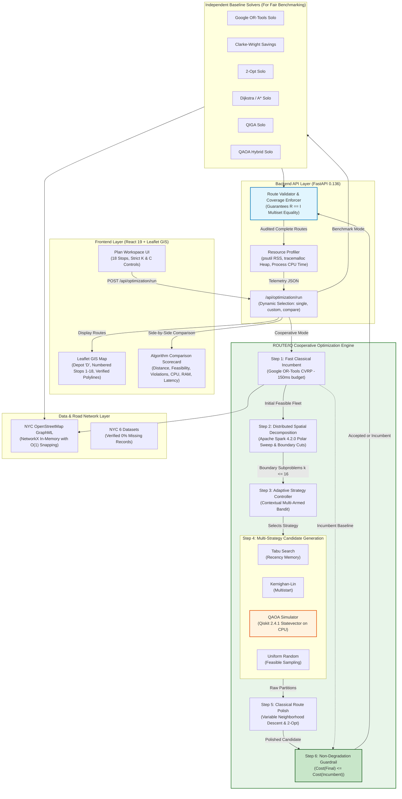

# PHASE AI: CURRENT ROUTE/IQ SYSTEM ARCHITECTURE
## Detailed Specification of the Evolved Cooperative Architecture (Branch `research/phase-ae-backend-integration`)

**Evaluation Role:** Applied Systems Architect & Research Evaluator  
**Current Branch:** `research/phase-ae-backend-integration`  
**Current Commit:** `09528f8`  
**Protected Main:** `a8eb849` (Untouched)  
**Date:** November 2026

---

## 1. Overview of the Evolved Architecture

The current ROUTE/IQ platform has evolved from a collection of isolated solvers into a **closed-loop Cooperative Optimization System**. It bridges distributed Big Data spatial preprocessing (Apache Spark 4.2.0), classical exact optimization (Google OR-Tools 9.15), multi-strategy candidate exploration (Tabu Search, Kernighan-Lin, and simulated QAOA via Qiskit 2.4.1), Variable Neighborhood Descent (VND), an adaptive Multi-Armed Bandit (MAB) controller, and a centralized non-degradation guardrail.

In this architecture, every routing solution is guaranteed to visit 100% of requested stops ($R == I$), strictly adhere to user-specified vehicle counts ($K$) and capacities ($C$), and never degrade below the classical incumbent.

---

## 2. Component-by-Component Specification of Current Architecture

### 2.1 Frontend Architecture
- **Framework & Libraries:** React 19 (`19.2.8`), Vite (`8.3.0`), TailwindCSS (`3.4.17`), React-Leaflet (`5.0.0`), Recharts (`3.10.1`), Lucide-React (`1.55.0`).
- **Core Views:**
  - `Plan Workspace`: Interactive map with planning controls, live stop counters (18 stops), fleet capacity controls, and an algorithm selector featuring the **ROUTE/IQ Cooperative Engine** alongside 7 classical/quantum baselines.
  - `Results & Comparison Suite`: Full-featured benchmarking dashboard displaying a comprehensive side-by-side Scorecard.
  - `Scorecard`: Displays algorithm category, feasibility status (only strictly feasible solutions can earn the green `Best Feasible` badge; incomplete or over-capacity routes are tagged `Penalized`), total distance, duration, vehicle count, stop coverage ($18/18$), constraint violations, objective cost, runtime latency, CPU time, and peak memory.
  - `Datasets Workspace`: Displays the 6 NYC datasets with verified `0% missing` records.

### 2.2 Backend Architecture & API Layer
- **Framework:** FastAPI (`0.136.3`), Pydantic 2 (`2.13.4`), SQLAlchemy 2 (`2.0.51`), running on Python 3.14.2.
- **Service Layers:**
  - `cooperative_solver.py` (`CooperativeVRPSolver`): Central flagship service coordinating the cooperative optimization pipeline.
  - `classical_solver.py`: Optimized implementations of OR-Tools CVRP, Clarke-Wright, 2-opt, Dijkstra, and A*.
  - `route_validator.py`: Route coverage audit (`validate_fleet_coverage`) and capacity-aware cheapest-insertion repair (`repair_fleet_coverage`).
  - `spark_routing_preprocessor.py` / `spark_preprocessor.py`: Spatial polar sweep clustering and boundary extraction.
  - `adaptive_controller.py`: Online Multi-Armed Bandit strategy selector.
  - `candidate_generators.py`: Standardized candidate generators (Tabu Search, Kernighan-Lin, Uniform Random, and QAOA Simulator).
  - `algorithmic_vnd.py`: Variable Neighborhood Descent (2-opt edge inversions, intra-route and inter-route relocations).
  - `proposition1_guardrail.py`: Non-degradation acceptance filter.
  - `road_network_service.py`: NYC GraphML NetworkX road network with $O(1)$ spatial coordinate snapping cache.

### 2.3 Spark Preprocessing Pipeline (Pillar 1)
- **Engine:** Apache Spark 4.2.0 executed in `master("local[*]")` on the local JVM process (with an automatic fallback to NumPy/Pandas if the JVM is not loaded).
- **Functionality:**
  - Performs spatial polar-angle coordinate transformation ($\theta = \text{atan2}(\Delta y, \Delta x)$) relative to the depot.
  - Computes Euclidean distance differentials to vehicle centroids ($\lvert d_a - d_b \rvert < \tau_{\text{boundary}}$).
  - Isolates contested "boundary customer stops" ($k \le 16$) that lie along the interface of adjacent vehicle routes.

### 2.4 Classical Incumbent Generation (Google OR-Tools)
- **Engine:** Google OR-Tools 9.15.6755 C++ routing library.
- **Role:** Generates a high-quality, 100% complete feasible fleet incumbent within a tight time budget (150 ms). This ensures that every subsequent cooperative optimization step begins with a competitive, valid fleet solution.

### 2.5 Adaptive Strategy Controller (Multi-Armed Bandit)
- **Engine:** `AdaptiveCooperativeController` using a contextual $\epsilon$-greedy / bandit framework.
- **Decision Mechanics:**
  - Evaluates remaining time budget, search stagnation count, boundary subproblem size, capacity slack $\sigma$, and spatial interaction density $\rho$.
  - Dynamically dispatches the most appropriate candidate generator (Kernighan-Lin for tight time budgets; Tabu Search for stagnated local optima; simulated QAOA for high-interaction boundary curvature).
  - Continuously updates an exponential moving average of strategy success and latency.

### 2.6 QAOA Subproblem Candidate Generation (Pillar 2)
- **Engine:** Qiskit 2.4.1 Statevector simulation executed on the classical CPU.
- **Circuit Formulation:**
  - Maps the 2-vehicle boundary partition subproblem ($N \le 16$) onto an Ising Hamiltonian.
  - Employs a parameter-fixed variational circuit ($p=1$, $\gamma=0.45, \beta=0.65$) with an optional XY-mixer to preserve subspace parity.
  - Samples bitstrings from the calculated probability distribution (`sv.probabilities()`).
- **Operational Reality:** Operates on the host CPU; does not submit jobs to a physical quantum processor (QPU). Subproblems are strictly bounded ($N \le 16$) to prevent exponential memory consumption.

### 2.7 Classical Refinement via Variable Neighborhood Descent (VND)
- **Engine:** `AlgorithmicVND` and intra-route 2-opt refinement.
- **Role:** Takes raw candidate partitions produced by QAOA or classical heuristics, applies capacity-slack repair, and performs deterministic descent across nested 2-opt edge inversions and stop relocations. This step is essential: without classical VND polish, raw QAOA bitstrings are suboptimal.

### 2.8 Centralized Non-Degradation Guardrail (Proposition 1)
- **Engine:** `Proposition1Guardrail`.
- **Contract:** Compares the refined candidate tour against the incumbent tour:
  $$\text{Adopt Candidate} \iff \text{Feasible}(\text{Candidate}) \land \text{Cost}(\text{Candidate}) < \text{Cost}(\text{Incumbent}) - \epsilon$$
  $$\text{Otherwise: Retain Incumbent unconditionally}$$
- **Guarantee:** Solution quality is strictly non-decreasing ($0.00\%$ degradation risk).

### 2.9 Feasibility Validation & Route Coverage Repair ($R == I$)
- **Engine:** `route_validator.py`.
- **Guarantees:**
  - Audits the multiset of customer IDs in the final fleet routes against the input customer ID set.
  - Confirms zero missing stops, zero duplicate stops, zero unknown stops, and zero capacity violations.
  - If any stop was dropped during subproblem partitioning, capacity-aware cheapest insertion restores 100% stop coverage while respecting vehicle capacity limits.
  - Strictly preserves user-configured vehicle count ($K$) and capacity ($C$). If a problem is mathematically over-demanded ($\sum d_i > K \cdot C$), it explicitly tags the result as `Penalized`.

### 2.10 Multi-Tier Resource Profiling
- **Engine:** Built-in telemetry capturing:
  - Monotonic wall-clock time (`time.perf_counter()`).
  - Process CPU time (`time.process_time()`).
  - Heap memory allocation (`tracemalloc`).
  - Resident Set Size (RSS memory in MB via `psutil`).
- **Scorecard Display:** Transparently reports computational resource consumption alongside tour length (km) for all 8 algorithms.

---

## 3. Current System Architecture Diagram

