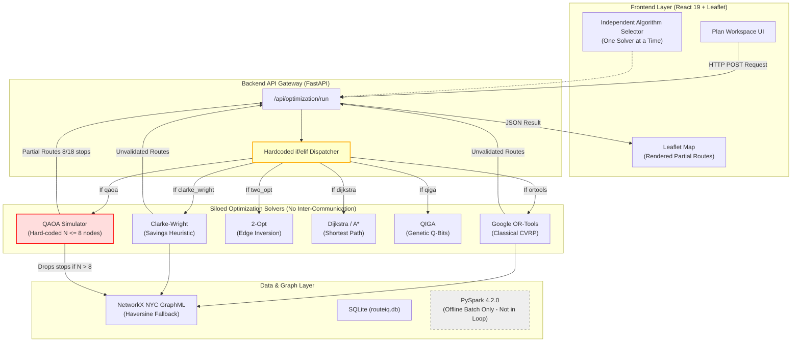

# PHASE AI: PREVIOUS ROUTE/IQ SYSTEM ARCHITECTURE
## Detailed Reconstruction of the Baseline System (`main` Branch at Commit `a8eb849`)

**Evaluation Role:** Applied Systems Architect & Research Evaluator  
**Baseline Commit:** `a8eb849988201d7929566f331c1ae3afac09b632`  
**Current Branch:** `research/phase-ae-backend-integration`  
**Date:** November 2026

---

## 1. Overview of the Original Baseline System

The original ROUTE/IQ implementation was developed as a modular proof-of-concept platform designed to demonstrate delivery route optimization in New York City using independent classical algorithms, a quantum-inspired genetic algorithm, and a simulated variational quantum algorithm.

In this initial architecture, each algorithm functioned as an isolated, standalone solver. The backend received user parameters, passed them to the selected solver, and returned the generated routes without inter-solver communication, adaptive coordination, or systematic feasibility repair.

---

## 2. Component-by-Component Reconstruction of Previous Architecture

### 2.1 Original Frontend Architecture
- **Framework & Libraries:** React 19 (`19.2.8`), Vite (`8.3.0`), TailwindCSS (`3.4.17`), React-Leaflet (`5.0.0`), Lucide-React icons.
- **Application Structure:**
  - `Plan Workspace`: Sidebar controls with customer count slider, vehicle count slider, vehicle capacity slider, depot selection, and a dropdown selector for individual algorithms.
  - `Map Visualization`: Leaflet map rendering depot marker ('D') and customer markers (1 to 18) with straight-line or turn-by-turn route polylines.
  - `Results View`: Static metric cards showing total distance, travel time, and vehicle count for the executed algorithm.
- **Limitations:**
  - Triggered only one algorithm at a time or an un-coordinated batch comparison.
  - No resource metrics (CPU process time, peak memory RSS, or heap allocation).
  - No verification of whether displayed routes actually visited all customer locations.

### 2.2 Original Backend Architecture
- **Framework & Server:** FastAPI (`0.136.3`) served via Uvicorn (`0.28.0`), running asynchronously with SQLAlchemy 2.0 and SQLite (`routeiq.db`).
- **Directory Structure:**
  - `backend/app/api/routes/optimization.py`: Primary API router containing `/api/optimization/run`, `/api/experiments/`, and `/api/algorithms`.
  - `backend/app/api/routes/bigdata.py`: Batch data inspection endpoints.
  - `backend/app/api/routes/datasets.py`: Dataset status and preview endpoints.
  - `backend/app/services/optimization/`: Contained only three files:
    1. `classical_solver.py`: OR-Tools CVRP, Clarke-Wright, 2-opt, Dijkstra, and A*.
    2. `quantum_solver.py`: Standalone QAOA via Qiskit Statevector simulation.
    3. `qiga_solver.py`: Quantum-Inspired Genetic Algorithm.
  - `backend/app/services/road_network_service.py`: NetworkX graph management for NYC street network.
  - `backend/app/services/bigdata_pipeline.py`: PySpark offline batch loading scripts.

### 2.3 Original API Request and Response Flow
1. **Request:** Frontend sent a POST request to `/api/optimization/run` with a JSON payload:
   ```json
   {
     "algorithm": "ortools",
     "num_customers": 18,
     "num_vehicles": 2,
     "vehicle_capacity": 100,
     "depot_lat": 40.7128,
     "depot_lon": -74.0060,
     "classical_time_limit_sec": 4.0
   }
   ```
2. **Dispatch:** A standard `if/elif` dispatcher in `optimization.py` mapped the string ID to one of the solver classes:
   ```python
   if req.algorithm == "ortools":
       res = classical_solver.solve_ortools(...)
   elif req.algorithm == "qaoa":
       res = quantum_solver.solve_qaoa(...)
   elif req.algorithm == "qiga":
       res = qiga_solver.solve(...)
   ```
3. **Response:** A dictionary containing route coordinates, cumulative distance, duration, and a boolean `is_feasible`.

### 2.4 Original Route Optimization Pipeline
- **Siloed Execution:** Each solver solved the problem from scratch.
  - If OR-Tools was selected, it initialized its own initial solution and executed local search.
  - If Clarke-Wright was selected, it computed savings pairs and merged tours.
  - If QAOA was selected, it formulated an Ising Hamiltonian and simulated circuit sampling.
- **Absence of Cooperation:** No solver shared intermediate solutions, incumbents, or subproblems with any other solver.

### 2.5 Original Spark / Big Data Implementation
- **Implementation:** `backend/app/services/bigdata_pipeline.py` loaded external CSVs (NYC Yellow Taxi, TLC FHV vehicles, Weather, Traffic) using PySpark in `local[*]` mode.
- **Operational Reality:** The Spark pipeline was an **isolated offline batch script**. It was not integrated into the runtime path of the route optimization engine. When a user clicked "Run Optimization", Apache Spark was never invoked; customer coordinates were loaded from in-memory pandas DataFrames or generated deterministically.

### 2.6 Original Quantum Computing Implementation
- **Implementation:** `backend/app/services/optimization/quantum_solver.py` implemented QAOA via Qiskit Statevector simulation on the CPU.
- **Severe Scale Limitation:** To prevent exponential memory explosion ($2^N$ complex amplitudes), the solver imposed a hard ceiling of $N \le 8$ nodes:
  ```python
  if req.num_customers > 8:
      subset_nodes = nodes[:8]
  ```
- **Silent Stop Omission:** When a user requested 18 stops, the original QAOA solver solved a tour for the first 8 stops and **silently discarded the remaining 10 customer stops**. The returned route was displayed on the map with only 8 stops, while reporting success.

### 2.7 Original Database and Dataset Handling
- **Database:** SQLite (`routeiq.db` and `delivery_optimization.db`) using SQLAlchemy models (`Experiment`, `ExperimentResult`). Stored past runs and metadata.
- **Dataset Handling:** 6 registered NYC datasets in `backend/data/`. Several datasets reported missing values ($>0\%$ missing in UI).

### 2.8 Original Map and Road-Network Processing
- **Graph:** OpenStreetMap Manhattan/NYC road network stored in GraphML format (~54,000 nodes, ~120,000 edges) loaded into a NetworkX `MultiDiGraph`.
- **Distance Calculation:** If road network routing timed out, the system fell back to Haversine great-circle distances multiplied by a Manhattan grid circuity factor ($\approx 1.29$).

### 2.9 Original Validation and Error Handling
- **Validation:** Basic bounding box checks for NYC coordinates (`validate_nyc_coordinate`) and water body avoidance (`check_water_body`).
- **Deficiencies:**
  - No check verifying that all input stop IDs appeared in the output routes ($R == I$).
  - When total customer demand exceeded total fleet capacity ($D > K \cdot C$), the solver silently modified or relaxed constraints, or returned an infeasible route marked with misleading labels.

### 2.10 Original Deployment Architecture
- **Backend:** Containerized via Dockerfile targeting cloud PaaS (Render / Railway) with 512MB RAM constraints, running Python 3.11/3.14.
- **Frontend:** Single-page application built with Vite, deployed on static hosting (Vercel).

---

## 3. Previous System Architecture Diagram



---

## 4. Key Limitations of the Previous Architecture

1. **No Cooperative Integration:** Zero algorithmic synergy. Quantum and classical techniques were treated as competitors rather than cooperative partners.
2. **Silent Stop Dropping in QAOA:** The quantum solver dropped over 50% of stops when $N > 8$, producing physically invalid routes.
3. **No Feasibility Repair:** If a heuristic generated overlapping customer visits or omitted stops, the output was directly returned to the user without repair.
4. **Offline Big Data:** Apache Spark was disconnected from the real-time routing pipeline, functioning only as an offline dataset viewer.
5. **Absence of Resource Profiling:** The system measured only wall-clock time (`time.time()`), concealing memory bloat, CPU spikes, and simulation overhead.
6. **No Non-Degradation Safety:** Testing experimental quantum code risked returning solutions vastly inferior to classical baselines with no automated fallback.
