# PHASE AI: PREVIOUS VS CURRENT TECHNOLOGY STACK
## Comprehensive Technical Evolution & Version Audit

**Evaluation Role:** Applied Systems Architect & Research Evaluator  
**Baseline Main:** `a8eb849988201d7929566f331c1ae3afac09b632`  
**Current Branch:** `research/phase-ae-backend-integration`  
**Verification Method:** Exact versions verified against runtime environment (`sys.version`, `__version__`), `requirements.txt`, `package.json`, and git commit history.

---

## 1. Master Technology Stack Comparison Table

| Layer | Previous Technology (`main` @ `a8eb849`) | Current Technology (`research/phase-ae`) | What Changed | Technical & Research Reason for Change |
|---|---|---|---|---|
| **Python Runtime** | Python 3.11 / 3.12 | **Python 3.14.2** | Upgraded runtime environment. | Leveraged Python 3.14 performance optimizations, improved async task scheduling, and enhanced typing support. |
| **Backend Framework** | FastAPI `0.110.0` (in manifest) | **FastAPI 0.136.3** | Upgraded framework version. | Supported Pydantic 2.13 serialization performance and high-concurrency multi-solver benchmark requests. |
| **Data Validation** | Pydantic `2.7.0` | **Pydantic 2.13.4** | Upgraded validation schema engine. | Strict request/response validation for 8-algorithm benchmark payloads, telemetry schemas, and route models. |
| **Database & ORM** | SQLAlchemy `2.0.0` + SQLite | **SQLAlchemy 2.0.51** + SQLite (`routeiq.db`) | Retained architecture; upgraded library. | Stable asynchronous persistence of benchmark experiments, telemetry, and solution metrics. |
| **Scientific Computing** | NumPy `1.26.0`, SciPy `1.12.0` | **NumPy 2.4.3**, **SciPy 1.17.1** | Upgraded numeric libraries. | Accelerated matrix operations for distance calculations, Ising Hamiltonians, and statevector probabilities. |
| **Tabular Data Processing** | Pandas `2.2.0` | **Pandas 3.0.5** | Upgraded data engine. | Ingested and cleaned 6 NYC datasets; verified 0% missing values; prepared customer coordinate matrices. |
| **Graph Modeling** | NetworkX `3.2` | **NetworkX 3.6.1** | Upgraded graph library. | Loaded NYC GraphML road network (~54,000 nodes) with spatial coordinate snapping cache. |
| **Big Data Engine (Pillar 1)** | PySpark `3.5.0` (offline script only) | **PySpark 4.2.0** (runtime integration) | **Integrated into live optimization loop.** | Moved from an offline CSV viewer to an active spatial decomposition preprocessor (polar sweep & boundary cuts) running in `local[*]` mode. |
| **Quantum Computing (Pillar 2)** | Qiskit `1.0.0` (standalone global solver) | **Qiskit 2.4.1** (subproblem optimizer) | **Re-scoped to boundary bipartitions.** | Standalone QAOA dropped stops when $N > 8$; re-scoped QAOA to compact boundary subproblems ($N \le 16$) with XY-mixers under classical scaffolding. |
| **Classical Optimization** | Google OR-Tools `9.9.0` (solo solver) | **Google OR-Tools 9.15.6755** (incumbent generator) | Upgraded version & redefined role. | OR-Tools upgraded to 9.15; repurposed as the high-speed incumbent generator (150ms budget) for the Cooperative Engine while remaining an independent baseline. |
| **Metaheuristic Optimization** | Basic 2-opt post-pass | **Tabu Search, Kernighan-Lin, Algorithmic VND** | **Newly introduced algorithms.** | Added multi-strategy candidate generators (recency tabu search, multistart KL) and systematic Variable Neighborhood Descent (2-opt edge inversions, relocations). |
| **Adaptive Control** | None (manual selection only) | **Contextual Multi-Armed Bandit (MAB)** | **Newly introduced controller.** | Dynamically dispatches candidate generators based on remaining time budget, search stagnation, capacity slack $\sigma$, and spatial curvature $\rho$. |
| **Safety & Guardrails** | None (unfiltered solver outputs) | **Centralized Proposition 1 Guardrail** | **Newly introduced invariant.** | Guaranteed $0.00\%$ degradation risk: candidate solutions are only accepted if strictly feasible and strictly lower in tour distance than the incumbent. |
| **Coverage & Validation** | None (partial routes returned) | **Route Validator & Repair (`route_validator.py`)** | **Newly introduced validation engine.** | Strictly enforces Universal Coverage Invariant ($R == I$); repairs missing stops via capacity-aware cheapest insertion; preserves user fleet constraints. |
| **Resource Profiling** | Basic `time.time()` wall clock | **psutil 7.2.2 + tracemalloc + time.process_time** | **Multi-tier OS resource monitoring.** | Monitored process CPU percentage, Resident Set Size (RSS memory in MB), and peak heap allocation across all 8 algorithms in real time. |
| **Frontend Framework** | React `19.2.8` + Vite `8.3.0` | **React 19.2.8 + Vite 8.3.0** | Retained; enhanced components. | Maintained original visual theme, typography, and controls while adding Scorecard metrics, resource badges, and cooperative settings. |
| **UI Styling & Icons** | TailwindCSS `3.4.17`, Lucide-React `1.55.0` | **TailwindCSS 3.4.17**, **Lucide-React 1.55.0** | Retained styling stack. | Preserved dark neon theme, glassmorphism cards, and interactive planning controls. |
| **Mapping & GIS** | Leaflet `1.9.4`, React-Leaflet `5.0.0` | **Leaflet 1.9.4**, **React-Leaflet 5.0.0** | Fixed layout & marker alignment. | Rendered glowing 'D' depot marker, sequential stop markers (1–18), and turn-by-turn road network polylines. |
| **Automated Testing** | Pytest `8.0.0` (basic tests) | **Pytest 8.0.0 + Selenium WebDriver** | **Comprehensive regression & browser testing.** | Added 70 backend unit/integration tests and 10/10 automated browser tests with live screenshot capture. |

---

## 2. Rationale for Major Technology Stack Decisions

### 2.1 Why Apache Spark 4.2.0 Was Retained and Integrated
- **The Challenge:** Real-world logistics workflows ingest millions of GPS pings, telematics records, and customer orders before route planning occurs.
- **The Solution:** Rather than discarding Apache Spark, it was upgraded to version 4.2.0 and integrated into the live preprocessor (`spark_preprocessor.py`). In `local[*]` mode, it processes spatial polar angles and isolates contested boundary customers between vehicle clusters, proving pipeline compatibility with distributed big data clusters.

### 2.2 Why Qiskit Was Upgraded to 2.4.1 and Re-Scoped
- **The Challenge:** In the previous system, running QAOA on global routing instances caused severe memory bloat ($O(2^N)$ complex statevector size) and forced the solver to silently drop 10 out of 18 stops.
- **The Solution:** Upgraded to Qiskit 2.4.1. Re-scoped QAOA to operate exclusively on inter-route boundary subproblems ($N \le 16$ qubits). Integrated domain-preserving XY-mixers to enforce subspace parity and wrapped the quantum output in classical Variable Neighborhood Descent to repair bitstring defects.

### 2.3 Why Google OR-Tools 9.15 Was Assigned a Dual Role
- **The Challenge:** Metaheuristics starting from random initial solutions take excessive time to find feasible routes for tightly constrained fleets.
- **The Solution:** Google OR-Tools 9.15.6755 is one of the world's fastest exact/guided local search solvers. ROUTE/IQ uses OR-Tools with a 150ms time budget to establish a rock-solid, fully feasible initial fleet incumbent. The cooperative engine then focuses its computational energy on refining contested inter-route boundaries.

### 2.4 Why `psutil` and `tracemalloc` Were Introduced
- **The Challenge:** Measuring only wall-clock execution time conceals the true computational cost of quantum simulation and distributed frameworks.
- **The Solution:** Integrated `psutil 7.2.2` and Python’s native `tracemalloc`. The system now measures process CPU time, Resident Set Size (RSS memory), and peak heap memory in real time, exposing the resource profile of every algorithm on the benchmark scorecard.

---

## 3. Technology Evolution Diagram

```mermaid
graph LR
    subgraph PreviousStack["Previous Stack (main @ a8eb849)"]
        direction TB
        P_Py["Python 3.11"]
        P_FastAPI["FastAPI 0.110"]
        P_Spark["PySpark 3.5 (Offline Only)"]
        P_Qiskit["Qiskit 1.0 (Global N<=8)"]
        P_ORTools["OR-Tools 9.9 (Solo)"]
        P_Telemetry["time.time() Wall-Clock Only"]
    end

    subgraph EvolutionDrivers["Engineering & Research Drivers"]
        direction TB
        D1["Silent stop dropping in QAOA"]
        D2["Disconnected Big Data pipeline"]
        D3["Lack of safety contracts (degradation risk)"]
        D4["Missing memory & CPU resource visibility"]
    end

    subgraph CurrentStack["Current Stack (research/phase-ae @ 09528f8)"]
        direction TB
        C_Py["Python 3.14.2"]
        C_FastAPI["FastAPI 0.136.3"]
        C_Spark["PySpark 4.2.0 (Live Spatial Cuts)"]
        C_Qiskit["Qiskit 2.4.1 (Subproblem + XY-Mixer)"]
        C_ORTools["OR-Tools 9.15 (Incumbent + Solo)"]
        C_Coop["Cooperative Engine (MAB + VND + Prop 1)"]
        C_Validator["Route Validator (R == I Universal Coverage)"]
        C_Telemetry["psutil 7.2 + tracemalloc + CPU Process Time"]
    end

    PreviousStack --> EvolutionDrivers
    EvolutionDrivers --> CurrentStack

    style PreviousStack fill:#ffebee,stroke:#c62828,stroke-width:2px
    style CurrentStack fill:#e8f5e9,stroke:#2e7d32,stroke-width:2px
    style EvolutionDrivers fill:#fff8e1,stroke:#f57f17,stroke-width:2px
```

