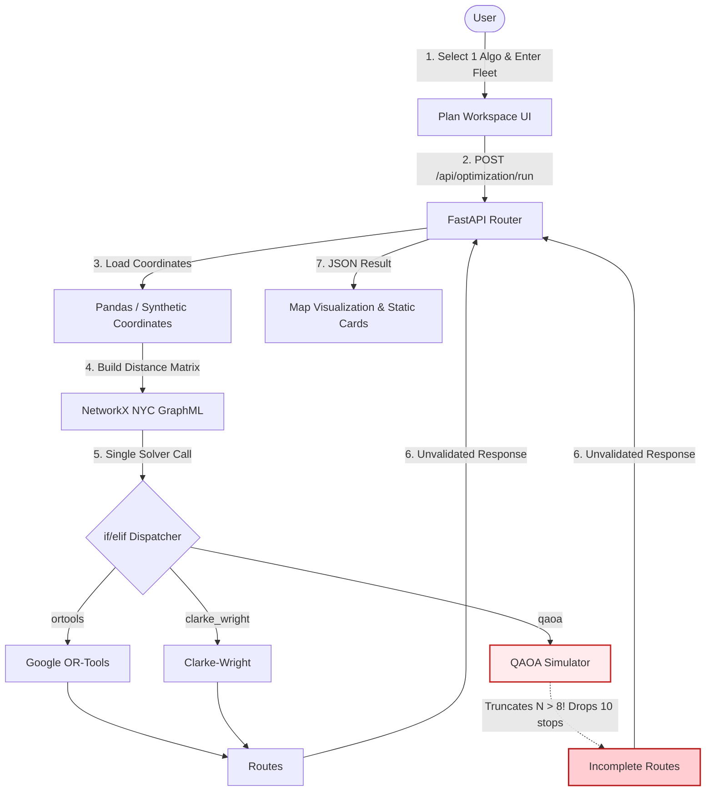

# PHASE AI: PREVIOUS VS CURRENT EXECUTION WORKFLOW
## Step-by-Step Flow Analysis, Data Pathways & Sequence Logic

**Evaluation Role:** Applied Systems Architect & Research Evaluator  
**Baseline Main:** `a8eb849988201d7929566f331c1ae3afac09b632`  
**Current Branch:** `research/phase-ae-backend-integration`  
**Date:** November 2026

---

## 1. How the Previous System Worked (Baseline Workflow)

### 1.1 Original Step-by-Step Execution Flow
1. **User Input:** User selected an algorithm from the dropdown (e.g., OR-Tools, Clarke-Wright, or QAOA), adjusted customer count ($N=18$), vehicle count ($K=2$), and capacity ($C=100$), and clicked "Run Optimization".
2. **Frontend Request:** Frontend dispatched a POST request to `/api/optimization/run` specifying `algorithm="ortools"` or `algorithm="qaoa"`.
3. **Backend Parsing & Data Loading:** Backend parsed coordinates from in-memory customer datasets or generated synthetic NYC coordinates.
4. **Road Distance Query:** The system queried the in-memory NetworkX NYC road graph to construct a distance matrix $D \in \mathbb{R}^{N \times N}$.
5. **Direct Solver Dispatch:** An `if/elif` block in `optimization.py` invoked the selected solver.
   - If **OR-Tools**: Solved CVRP using internal Guided Local Search; returned routes.
   - If **Clarke-Wright**: Calculated savings and merged customer pairs; returned routes.
   - If **QAOA**: Checked $N > 8$; **truncated the node list to the first 8 nodes**; simulated a statevector quantum circuit via Qiskit on the CPU; returned an incomplete route of 8 stops.
6. **Unvalidated Response:** The backend serialized the solver’s dictionary output directly into JSON without validating whether all 18 stops were served or if capacities were exceeded.
7. **Frontend Display:** The Leaflet map drew the returned polylines and static metric cards displayed distance and execution time.

### 1.2 Data Flow Diagram (Previous System)



---

## 2. How the Current System Works (Evolved Workflow)

The current ROUTE/IQ system supports **two distinct operational workflows**:
1. **Cooperative Optimization Workflow:** The flagship multi-paradigm pipeline combining Spark spatial cuts, OR-Tools incumbent generation, MAB strategy dispatch, Tabu/KL/QAOA candidate generation, VND refinement, and Proposition 1 non-degradation guardrail.
2. **Independent Algorithm Benchmarking Workflow:** Parallel, standardized execution of all 8 algorithms on the identical distance matrix and fleet constraints for transparent scorecard comparison.

---

### 2.1 Detailed Cooperative Optimization Workflow

```mermaid
sequenceDiagram
    autonumber
    actor User as User / Client
    participant UI as React 19 Frontend
    participant API as FastAPI Backend
    participant Road as Road Network Service
    participant Spark as PySpark 4.2.0 Preprocessor
    participant OR as Google OR-Tools (Incumbent)
    participant MAB as Adaptive MAB Controller
    participant Solvers as Candidate Generators (Tabu/KL/QAOA)
    participant VND as Algorithmic VND Refinement
    participant Guard as Proposition 1 Guardrail
    participant Val as Route Validator (R == I)
    participant Prof as Resource Profiler (psutil)

    User->>UI: Configure 18 Stops, 2 Vehicles, Capacity 100
    UI->>API: POST /api/optimization/run (algorithm="cooperative")
    
    Note over API,Prof: Profiler starts timer, tracemalloc, & psutil snapshot
    API->>Road: Build NYC Road Network Distance Matrix (19x19)
    Road-->>API: Distance Matrix D & Coordinate Snappings
    
    rect rgb(235, 248, 235)
        Note over API,OR: Step 1: High-Speed Classical Incumbent
        API->>OR: Solve CVRP with 150ms tight budget
        OR-->>API: Initial Feasible Fleet Incumbent (Routes A & B)
    end
    
    API->>Val: Verify Incumbent 100% Coverage (R == I)
    Val-->>API: Verified Complete Fleet Incumbent
    
    rect rgb(240, 244, 255)
        Note over API,Spark: Step 2: Distributed Spatial Decomposition
        API->>Spark: Polar-angle sweep & boundary customer extraction
        Spark-->>API: Extracted Boundary Subproblem (k <= 16 customers)
    end
    
    rect rgb(255, 250, 240)
        Note over API,Solvers: Step 3 & 4: Adaptive Strategy Selection & Candidate Generation
        API->>MAB: Select Strategy (Inputs: budget, stagnation, slack, curvature)
        MAB-->>API: Strategy Selected (e.g., Tabu, KL, or QAOA)
        API->>Solvers: Generate Subproblem Bipartition Candidate
        Solvers-->>API: Raw Candidate Partition (Vehicles A & B)
    end
    
    rect rgb(245, 245, 255)
        Note over API,VND: Step 5: Classical VND Polish
        API->>VND: Execute 2-opt edge inversions & stop relocations
        VND-->>API: Refined Candidate Tour
    end
    
    rect rgb(235, 255, 235)
        Note over API,Guard: Step 6: Proposition 1 Non-Degradation Guardrail
        API->>Guard: Evaluate Candidate vs Incumbent (Cost & Feasibility)
        alt Candidate strictly feasible AND Cost(Candidate) < Cost(Incumbent)
            Guard-->>API: Accept Candidate (Strict Improvement)
        else Candidate suboptimal or infeasible
            Guard-->>API: Reject Candidate; Retain Incumbent (0.00% Degradation)
        end
    end
    
    rect rgb(235, 245, 255)
        Note over API,Val: Step 7: Final Coverage Enforcement & Telemetry
        API->>Val: Final Audit: Check R == I, capacities, and zero dropped stops
        Val-->>API: Certified 100% Valid Complete Fleet Routes
        API->>Prof: Capture Wall Time, CPU Process Time, RSS, & Heap Memory
        Prof-->>API: Complete Resource Metrics
    end
    
    API-->>UI: Return Certified Routes, Telemetry, and Subproblem Logs
    UI-->>User: Display Routes on Leaflet Map & Update Comparison Scorecard
```

---

### 2.2 Independent Algorithm Benchmarking Workflow

When the user clicks "Run Optimization (8 Algos)" or selects "Scorecard", the system executes the benchmarking workflow:

1. **Parallel Solver Pool:** The backend spawns a `ThreadPoolExecutor` to run all 8 registered algorithms:
   - ROUTE/IQ Cooperative Engine
   - Google OR-Tools CVRP
   - Clarke-Wright Savings
   - 2-opt Improvement
   - Dijkstra Shortest Path
   - A* Heuristic Search
   - Quantum-Inspired Genetic Algorithm (QIGA)
   - QAOA Hybrid (CPU Statevector Simulation)
2. **Zero-Data-Leakage Isolation:** Every algorithm receives the exact same 19x19 road distance matrix, depot coordinates, vehicle count ($K=2$), and capacity ($C=100$).
3. **Universal Coverage Audit:** Every returned route passes through `route_validator.py`. Missing stops are repaired via capacity-aware cheapest insertion. If total fleet capacity is insufficient, the algorithm is explicitly tagged as **`Penalized`**.
4. **Feasibility-First Ranking:** The Scorecard orders results by feasibility status:
   - Only strictly feasible solutions ($0$ unserved stops, $0$ capacity violations) can receive the green **`Best Feasible`** badge.
   - Solutions that violate capacity or drop stops are penalized and ranked below feasible solutions, regardless of raw distance.

---

## 3. Execution Realities Explicitly Acknowledged

To maintain scientific rigor in thesis defense and journal submissions:

1. **Apache Spark Execution Reality:**
   - PySpark runs in `master("local[*]")` on the host machine’s local JVM.
   - It executes single-node multi-threaded transformations. It does not communicate across a multi-node physical cloud cluster.
   - If Java/PySpark is not loaded, an automatic fallback to NumPy/Pandas handles the polar angle calculation.
2. **QAOA Execution Reality:**
   - QAOA circuits are simulated on the classical CPU using Qiskit 2.4.1 Statevector matrix multiplication (`Statevector.from_instruction(qc)`).
   - No jobs are dispatched to a physical quantum processor (QPU).
   - Subproblems are strictly bounded ($N \le 16$) to prevent exponential memory exhaustion ($2^N$).
3. **Conditional Execution Stages:**
   - If the problem has only 1 vehicle or fewer than 4 customers, inter-route boundary optimization is bypassed, and the incumbent is polished directly via intra-route VND.
