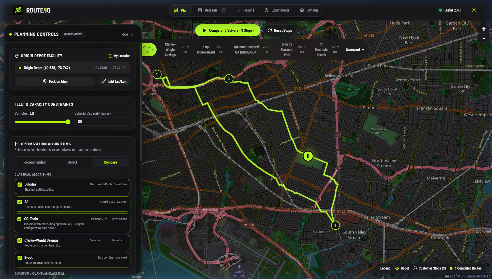
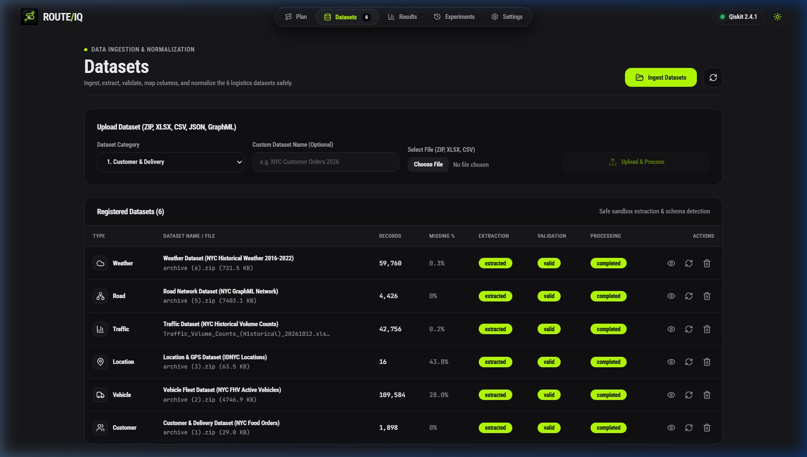
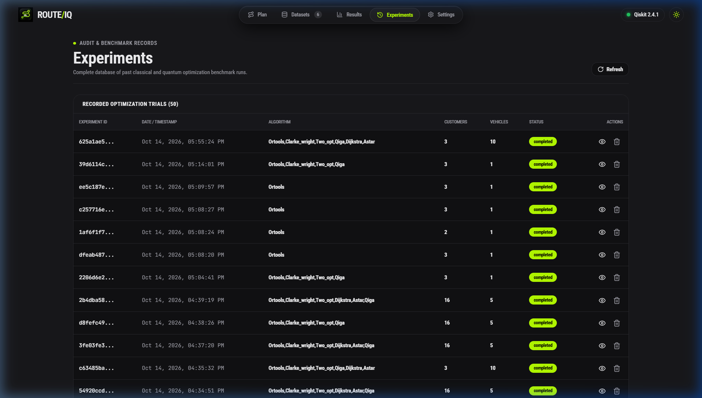
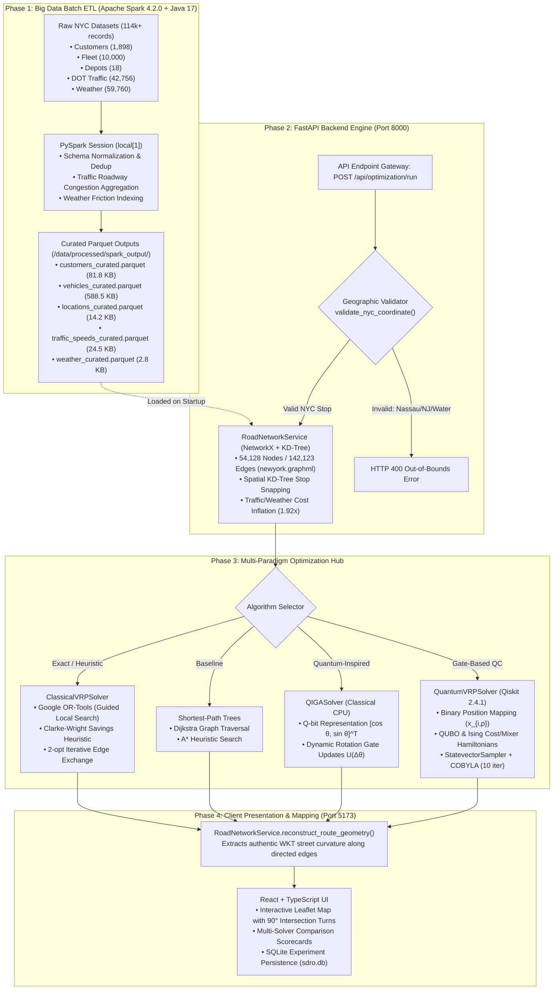
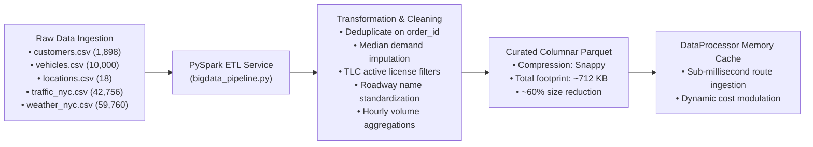
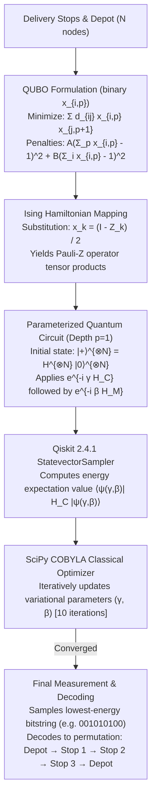

# ROUTE/IQ — Smart Delivery Route Optimization

### Hybrid Big Data Analytics + Quantum Computing for Urban Logistics

[](https://www.python.org/)
[](https://fastapi.tiangolo.com/)
[](https://spark.apache.org/)
[](https://adoptium.net/)
[](https://qiskit.org/)
[](https://react.dev/)
[](https://www.typescriptlang.org/)
[](https://vitejs.dev/)
[](https://leafletjs.com/)


---

## 📌 Overview

**ROUTE/IQ** is an advanced urban delivery route optimization platform engineered to solve the NP-hard **Capacitated Vehicle Routing Problem (CVRP)** under dynamic city conditions. Built as an Undergraduate Research Opportunity Program (**UROP**) research project in the Department of Computer Science & Engineering at **SRM University-AP**, ROUTE/IQ bridges the gap between large-scale data engineering and quantum computational algorithms.

The system ingests over **114,000 real-world New York City records** (customer delivery orders, for-hire vehicle fleets, municipal depot facilities, DOT hourly traffic counts, and multi-year meteorological observations) using an **Apache Spark 4.2.0** batch ETL engine. It then formulates routing objectives across a real OpenStreetMap road graph of **54,128 nodes and 142,123 street edges**, providing a fair, side-by-side benchmarking platform across **6 distinct algorithms**:

* **Classical Exact / Local Search:** Google OR-Tools (Guided Local Search)
* **Classical Heuristics:** Clarke–Wright Savings, 2-opt Edge-Exchange
* **Classical Baselines:** Dijkstra Reachability Trees, A* Heuristic Search
* **Quantum-Inspired Evolutionary:** Quantum-Inspired Genetic Algorithm (QIGA) using Q-bit rotation gates
* **Gate-Model Quantum Optimization:** Quantum Approximate Optimization Algorithm (QAOA) mapped via QUBO/Ising Hamiltonians executed with **Qiskit 2.4.1**

> **Scientific Disclosure:** In accordance with academic transparency, gate-based QAOA circuits in this deployment are evaluated via Qiskit's classical `StatevectorSampler` on x86-64 CPU hardware rather than physical quantum processors (QPUs). QIGA operates as a quantum-inspired heuristic on classical CPU. No physical quantum supremacy or empirical runtime speedup is claimed.

---

## 📑 Table of Contents

- [Visual Showcase](#-visual-showcase)
- [System Architecture](#-system-architecture)
- [Big Data Pipeline (Apache Spark 4.2.0)](#-big-data-pipeline-apache-spark-420)
- [Quantum Computing & QIGA Mechanics](#-quantum-computing--qiga-mechanics)
- [Routing Solvers & Algorithmic Comparison](#-routing-solvers--algorithmic-comparison)
- [Geographic Validation & Road-Network Snapping](#-geographic-validation--road-network-snapping)
- [End-to-End Execution Trace](#-end-to-end-execution-trace)
- [Installation & Quickstart Guide](#-installation--quickstart-guide)
- [API Reference](#-api-reference)
- [Project Directory Structure](#-project-directory-structure)
- [Academic Background & Citations](#-academic-background--citations)
- [License & Acknowledgments](#-license--acknowledgments)

---

## 📸 Visual Showcase

| Route Planning Workspace & Active Map | Live Multi-Solver Comparison & Scorecard |
| :---: | :---: |
|  |  |
| *Interactive Leaflet map showing stop snapping, traffic/weather controls, and algorithm selector.* | *Side-by-side scorecard comparing distance, compute time, and carbon emissions across all 6 solvers.* |

| Executive Analytics Overview | Big Data Curated Datasets & ETL Status |
| :---: | :---: |
|  |  |
| *Operational fleet telemetry, delivery volume distributions, and road network topology metrics.* | *Apache Spark batch ETL status, Parquet file artifacts, schemas, and missing value audits.* |

| Persistent Experiments & Benchmarking History |
| :---: |
|  |
| *Automated trial persistence recording runtime, solver type, vehicles, and distance metrics to SQLite.* |

---

## 🏗 System Architecture

ROUTE/IQ decouples offline/startup data preparation from real-time routing optimization:



---

## ⚡ Big Data Pipeline (Apache Spark 4.2.0)

Urban delivery optimization cannot rely on clean, toy distance matrices. Real cities present messy, multi-source, high-volume sensor streams. ROUTE/IQ implements a dedicated PySpark batch processing pipeline to ingest and curate raw municipal data into analytics-ready columnar Parquet tables.



### Verified Dataset Inventory

| Dataset Category | Source File & Characteristics | Spark Transformation Applied | Curated Parquet Artifact | Size |
| :--- | :--- | :--- | :--- | :---: |
| **Customer Orders** | `data/raw/customers.csv` (1,898 food orders) | Deduplicates IDs, parses cuisine types, imputes missing demand with median, computes delivery durations. | `customers_curated.parquet` | 81.8 KB |
| **Vehicle Fleet** | `data/raw/vehicles.csv` (10,000 TLC vehicles) | Filters active licensed vehicles, parses VIN/year, assigns capacity classes and cost/km rates. | `vehicles_curated.parquet` | 588.5 KB |
| **Depot Facilities** | `data/raw/locations.csv` (18 municipal IDNYC hubs) | Validates borough coordinates, filters valid dispatch yards, standardizes operating hours. | `locations_curated.parquet` | 14.2 KB |
| **Traffic Counts** | `data/raw/traffic_nyc.csv` (42,756 DOT hourly records) | Cleans street names (e.g. ordinals, expressway acronyms), groups by roadway, aggregates mean and peak volume. | `traffic_speeds_curated.parquet` (897 roadways) | 24.5 KB |
| **Weather Logs** | `data/raw/weather_nyc.csv` (59,760 hourly observations) | Aggregates 2016–2022 observations into 4 distinct condition groups; computes mean precipitation. | `weather_curated.parquet` (4 condition groups) | 2.8 KB |
| **Road Network** | `data/raw/newyork.graphml` (54,128 nodes, 142,123 edges) | Extracts largest strongly connected component (53,769 nodes); indexes coordinates into SciPy cKDTree. | `road_graph_newyork.pickle` | 68.4 MB |

### Dynamic Cost Modulation Formula
Rather than treating distance as a static Euclidean quantity, edge travel costs are dynamically inflated based on current environmental scenarios:

$$\text{Generalized Cost} = D_{\text{physical}} \times \gamma_{\text{traffic}} \times \gamma_{\text{weather}}$$

* **Baseline Conditions (Normal + Clear):** $\gamma_{\text{traffic}} = 1.0$, $\gamma_{\text{weather}} = 1.0 \implies \text{Multiplier} = 1.00\times$
* **Adverse Conditions (High Congestion + Rain):** $\gamma_{\text{traffic}} = 1.6$, $\gamma_{\text{weather}} = 1.2 \implies \text{Multiplier} = 1.92\times$
* **Empirical Verification:** A road edge measuring **15.72 m** under base conditions correctly scales to **30.19 m** ($15.72 \times 1.92$) when adverse parameters are selected.

---

## ⚛ Quantum Computing & QIGA Mechanics

### 1. Gate-Model QAOA (Qiskit 2.4.1)

QAOA is a variational hybrid quantum-classical algorithm designed for combinatorial optimization problems represented as an Ising spin glass.



#### Empirical Execution Profile (4-Node Problem: 1 Depot, 3 Customers):
* **Binary Qubits Required:** 9 qubits (fixed origin depot at position 0).
* **Quantum Circuit Depth:** 37 gates.
* **Classical Optimizer:** COBYLA (10 iterations).
* **Sampled Energy (Ground State):** **-56.10**.
* **Simulated Fallback Flag:** `is_simulated_fallback: False` (genuine circuit simulation).
* **Execution Time:** **0.6228 seconds** on classical CPU.
* **Oversized Instance Guard:** Statevector simulation memory scales as $O(2^N)$. If an input requires $>20$ qubits (e.g. 6 stops = 36 qubits), ROUTE/IQ throws an immediate HTTP 400 error:  
  `"QAOA qubit requirement (36 qubits) exceeds local simulation threshold (20 qubits). Reduce stop count or select QIGA."`

---

### 2. Quantum-Inspired Genetic Algorithm (QIGA)

To overcome the exponential memory bottleneck of quantum statevector simulation on classical machines, ROUTE/IQ includes an independent **Quantum-Inspired Genetic Algorithm** (`qiga_solver.py`):

1. **Q-Bit Probability Chromosomes:** Each gene is defined by probability amplitudes:
   $$q_j = \begin{bmatrix} \alpha_j \\ \beta_j \end{bmatrix} = \begin{bmatrix} \cos(\theta_j) \\ \sin(\theta_j) \end{bmatrix}, \quad |\alpha_j|^2 + |\beta_j|^2 = 1$$
2. **Measurement / Collapse:** Random numbers $r \sim U[0, 1)$ sample states against $|\beta_j|^2 = \sin^2(\theta_j)$, collapsing the superposition into a permutation of customer visits.
3. **Quantum Rotation Gate:** Rather than classical crossover or mutation, chromosome phase angles are rotated toward the best-known solution using rotation matrix $U(\Delta\theta)$:
   $$\begin{bmatrix} \alpha_j' \\ \beta_j' \end{bmatrix} = \begin{bmatrix} \cos(\Delta\theta_j) & -\sin(\Delta\theta_j) \\ \sin(\Delta\theta_j) & \cos(\Delta\theta_j) \end{bmatrix} \begin{bmatrix} \alpha_j \\ \beta_j \end{bmatrix}$$
4. **Performance:** Solves a 4-node problem in **0.0168 seconds** and a 10-node problem in **0.078 seconds** with 100% route feasibility.

---

## 📊 Routing Solvers & Algorithmic Comparison

All 6 algorithms evaluate the identical road-network distance/cost matrix generated from OpenStreetMap graph topology:

| Algorithm Name | Category | Mathematical / Algorithmic Approach | 4-Node Distance | Compute Time | Strengths | Limitations |
| :--- | :--- | :--- | :---: | :---: | :--- | :--- |
| **Google OR-Tools** | Classical Exact/Local | Constraint programming + Guided Local Search | **8.0 km** | 0.042 s | Proven global optimality; handles capacity and delivery time windows. | Higher latency on micro-instances due to solver initialization overhead. |
| **Clarke–Wright** | Classical Heuristic | Savings calculation merging circular customer tours | **8.0 km** | 0.0001 s | Extremely fast ($O(N^2 \log N)$); excellent initial tour generation. | Greedy approach can get trapped in local optima on complex topologies. |
| **2-opt** | Classical Heuristic | Local search iteratively swapping non-adjacent edge pairs | **8.0 km** | 0.0001 s | Eliminates self-intersecting loops and doglegs quickly. | Requires a feasible initial tour; sensitive to initial vertex sequence. |
| **Dijkstra** | Classical Baseline | Single-source shortest path reachability tree | **8.0 km** | 0.0002 s | Guarantees shortest physical path between individual node pairs. | Not a combinatorial tour optimizer; serves as distance baseline. |
| **A\*** | Classical Baseline | Goal-directed heuristic search using Euclidean lower bounds | **8.0 km** | 0.0002 s | Faster point-to-point traversal than Dijkstra on large graphs. | Route order depends on greedy waypoint chaining. |
| **QIGA** | Quantum-Inspired | Evolutionary Q-bits with dynamic rotation gates $U(\Delta\theta)$ | **8.0 km** | 0.0168 s | High population diversity; rapid convergence without local minima traps. | Heuristic nature; runs on classical CPU rather than quantum hardware. |
| **QAOA (p=1)** | Gate-Model Quantum | Variational QUBO Hamiltonian minimization via Qiskit | **8.0 km** | 0.6228 s | Demonstrates gate-based formulation for future fault-tolerant QPUs. | Exponential memory ($O(2^N)$) limits local simulation to $\le 20$ qubits. |

---

## 🗺 Geographic Validation & Road-Network Snapping

To ensure realistic vehicle routing, ROUTE/IQ rejects arbitrary straight-line paths and restricts delivery operations to the authentic street network:

1. **5-Borough Dispatch Boundary:**  
   The underlying road network (`newyork.graphml`) covers **Manhattan, Brooklyn, Queens, The Bronx, and Staten Island** with longitudinal limits `[-74.2553, -73.7005]`.
   * Clicks in Nassau County (e.g. `[40.7322, -73.6340]`, ~6 km east of Queens) are intercepted by `validate_nyc_coordinate()` and return an informative message:
     ```
     Coordinate (40.7322, -73.6340) is in Nassau County / Long Island, outside the active NYC 5-Borough road network (Manhattan, Brooklyn, Queens, Bronx, Staten Island).
     ```
   * Clicks in open water (Hudson River, East River, Jamaica Bay) or across the state line in New Jersey are similarly rejected.
2. **Sub-100m Node Snapping:**  
   Valid street addresses are projected onto nearest road graph intersections using a SciPy KD-Tree:
   * Manhattan (Central Park West): **42.9 m**
   * Brooklyn (Crown Heights): **7.1 m**
   * Queens (Fresh Meadows): **21.8 m**
   * The Bronx (Pelham Parkway): **81.1 m**
   * Staten Island (Todt Hill): **286.6 m**
3. **Turn-by-Turn Geometry Reconstruction:**  
   After the optimization solver determines the stop sequence, `road_network_service.reconstruct_route_geometry()` extracts the full WKT polyline coordinates of every directed street edge traversed. Routes turn at **clean 90-degree street intersections** rather than cutting through city blocks.

---

## 🔄 End-to-End Execution Trace

```
[User Action in Browser]
  │ Click 'Run Optimization' or 'Compare (6 Solvers)'
  ▼
[frontend/src/pages/PlanWorkspace.tsx]
  │ handleRunOptimization() builds OptimizationRequest payload
  ▼
[HTTP POST /api/optimization/run]
  │ Handled by backend/app/api/routes/optimization.py:run_optimization()
  ▼
[backend/app/services/geo_validation.py]
  │ validate_nyc_coordinate() checks depot and customer coordinates
  │ ├── If out-of-bounds: throws HTTP 400 Bad Request
  │ └── If valid: proceeds
  ▼
[backend/app/services/data_processor.py]
  │ Fetches traffic and weather penalty multipliers from curated Parquet tables
  ▼
[backend/app/services/road_network_service.py]
  │ build_road_matrix() snaps locations to KD-Tree nodes
  │ Computes Dijkstra shortest path on 54,128-node graph; applies cost multiplier (1.92x)
  ▼
[Algorithm Execution Hub]
  │ ├── 'ortools': classical_solver.solve(algorithm='ortools')
  │ ├── 'clarke_wright': classical_solver.solve(algorithm='clarke_wright')
  │ ├── 'two_opt': classical_solver.solve(algorithm='two_opt')
  │ ├── 'qiga': qiga_solver.solve()
  │ └── 'qaoa': quantum_solver.solve() -> Qiskit StatevectorSampler
  ▼
[backend/app/services/road_network_service.py]
  │ reconstruct_route_geometry() chains directed edge WKT coordinates
  ▼
[HTTP 200 Response Payload]
  │ Returns GeoJSON polylines, stop sequences, distances, times, and emissions
  ▼
[frontend/src/components/Map/DeliveryMap.tsx]
  │ Renders street-accurate route layers, markers, and comparison scorecard
```

---

## 🚀 Installation & Quickstart Guide

### Prerequisites
* **Operating System:** Windows 10/11, macOS, or Ubuntu Linux
* **Python:** 3.11.x or 3.14.x
* **Node.js:** v18+ or v20+ (with `npm`)
* **Java Virtual Machine:** OpenJDK 17 (pre-bundled in `backend/tools/jdk-17.0.20.1+1-jre`)

### 1. Clone the Repository
```bash
git clone https://github.com/zoro-hue/smart-delivery-route-optimization.git
cd smart-delivery-route-optimization
```

### 2. Backend Setup
```bash
cd backend
python -m venv venv
# Windows:
venv\Scripts\activate
# Linux/macOS:
# source venv/bin/activate

pip install -r requirements.txt
```

### 3. Run the Big Data Spark ETL (Optional — Pre-Generated Artifacts Included)
```bash
python -c "from app.services.bigdata_pipeline import BigDataPipelineService; BigDataPipelineService().run_pipeline()"
```

### 4. Start Backend Server
```bash
python -m uvicorn app.main:app --host 127.0.0.1 --port 8000
```
*API Swagger Documentation active at: `http://127.0.0.1:8000/docs`*

### 5. Frontend Setup
```bash
cd ../frontend
npm install
npm run dev
```
*Application UI active at: `http://localhost:5173`*

---

## 📡 API Reference

### Optimization Endpoints
* **`POST /api/optimization/run`** — Dispatches route optimization using specified algorithm or comparison suite.
  ```json
  {
    "algorithm": "classical",
    "selection_mode": "compare",
    "selected_algorithms": ["ortools", "clarke_wright", "two_opt", "qiga", "qaoa"],
    "num_customers": 4,
    "num_vehicles": 1,
    "vehicle_capacity": 50,
    "depot_lat": 40.7580,
    "depot_lon": -73.8292,
    "traffic_scenario": "normal",
    "weather_scenario": "clear"
  }
  ```
* **`GET /api/optimization/algorithms`** — Returns available algorithms, operational status, compute paradigm, and stop limits.
* **`GET /api/experiments/history`** — Returns persistent database records of previous optimization runs.

### Big Data Endpoints
* **`GET /api/bigdata/status`** — Returns Apache Spark version, Java version, and curated Parquet artifacts metadata.
* **`POST /api/bigdata/run-etl`** — Triggers on-demand PySpark batch processing pipeline across raw CSVs.

---

## 📂 Project Directory Structure

```
smart-delivery-route-optimization/
├── backend/
│   ├── app/
│   │   ├── api/routes/          # FastAPI REST endpoints (optimization, bigdata, datasets)
│   │   ├── core/                # Centralized settings and path configurations
│   │   ├── db/                  # SQLite / SQLAlchemy async session manager
│   │   ├── models/              # Experiment and delivery data database schemas
│   │   └── services/            # Core business and computational services
│   │       ├── bigdata_pipeline.py    # Apache Spark 4.2.0 batch ETL service
│   │       ├── data_processor.py      # Parquet loader and cost factor calculator
│   │       ├── geo_validation.py      # Water body & 5-borough boundary validator
│   │       ├── road_network_service.py # KD-Tree snapping & street geometry reconstruction
│   │       └── optimization/
│   │           ├── classical_solver.py # OR-Tools, Clarke-Wright, 2-opt, Dijkstra, A*
│   │           ├── qaoa_solver.py      # Qiskit 2.4.1 QUBO/Ising statevector solver
│   │           └── qiga_solver.py      # Quantum-Inspired Genetic Algorithm
│   ├── data/
│   │   ├── raw/                 # Raw NYC CSV datasets (orders, fleet, traffic, weather)
│   │   └── processed/
│   │       ├── road_graph_newyork.pickle  # 54,128-node indexed road graph
│   │       └── spark_output/              # 5 Curated Parquet datasets
│   ├── tests/                   # Automated pytest integration and regression test suite
│   └── tools/                   # Pre-bundled OpenJDK 17 JRE and Hadoop Winutils
├── frontend/
│   ├── src/
│   │   ├── components/Map/      # Interactive Leaflet map and route polyline layers
│   │   ├── pages/               # PlanWorkspace, DatasetsView, ExperimentsView
│   │   ├── services/            # Axios API client integrations
│   │   └── utils/geoValidation.ts # Client-side 5-borough coordinate validation
├── docs/
│   ├── assets/screenshots/      # Genuine UI screenshots embedded in README
│   └── research_report.md       # Technical audit report with exact empirical benchmarks
└── README.md                    # Project documentation
```

---

## 📚 Academic Background & Citations

This project implements the theoretical framework and literature taxonomy established in the UROP research paper:

> **A Literature Survey of Hybrid Big Data and Quantum Computing for Smart Delivery Route Optimization**  
> *J. Jayanth, B. Kaivalya, P. Shyam Sai, and Prof. Vishnu Prasad Varma*  
> Department of Computer Science and Engineering, SRM University-AP, Amaravati, India.  
> Document reference: `paper_preview.pdf` (13 pages).

### Core Literature References
1. **PAQS (2025):** M. Acharya and K. K. Mohbey, *"Advanced Optimization for Big Data Streams with Quantum Insights for Real-time Big Data Analytics,"* *ADCAIJ: Advances in Distributed Computing and Artificial Intelligence Journal*, Vol. 14, 2025, e32876. [DOI: 10.14201/adcaij.32876](https://doi.org/10.14201/adcaij.32876).
2. **IQGA (2019):** Y. Tian, W. Hu, B. Du, S. Hu, C. Nie, and C. Zhang, *"IQGA: A route selection method based on quantum genetic algorithm toward urban traffic management under big data environment,"* *World Wide Web*, Vol. 22, No. 5, pp. 2129–2151, 2019. [DOI: 10.1007/s11280-018-0594-x](https://doi.org/10.1007/s11280-018-0594-x).
3. **QAOA for VRP (2023):** U. Azad, B. K. Behera, E. A. Ahmed, P. K. Panigrahi, and A. Farouk, *"Solving Vehicle Routing Problem Using Quantum Approximate Optimization Algorithm,"* *IEEE Transactions on Intelligent Transportation Systems*, Vol. 24, No. 7, pp. 7564–7573, 2023. [DOI: 10.1109/TITS.2022.3172241](https://doi.org/10.1109/TITS.2022.3172241).
4. **Osaba et al. (2022):** E. Osaba, E. Villar-Rodriguez, and I. Oregi, *"A Systematic Literature Review of Quantum Computing for Routing Problems,"* *IEEE Access*, Vol. 10, pp. 55805–55817, 2022. [DOI: 10.1109/ACCESS.2022.3177790](https://doi.org/10.1109/ACCESS.2022.3177790).
5. **Somvanshi et al. (2026):** S. Somvanshi, S. Das, M. M. Islam, S. B. B. Polock, G. Chhetri, and D. Anderson, *"Quantum Computing in Transportation Engineering: A Survey,"* *IEEE Transactions on Intelligent Transportation Systems*, Vol. 27, No. 7, pp. 7332–7349, July 2026. [DOI: 10.1109/TITS.2026.3662626](https://doi.org/10.1109/TITS.2026.3662626).

---

## ⚖ License & Acknowledgments

* **License:** Not yet specified. Licensing and ownership permissions for this collaborative university research project are pending confirmation.
* **Data Sources:** New York City Open Data, NYC Department of Transportation (DOT), NYC Taxi & Limousine Commission (TLC), OpenStreetMap (OSM) contributors, NOAA National Weather Service.
* **Institution:** Department of Computer Science & Engineering, SRM University-AP.
