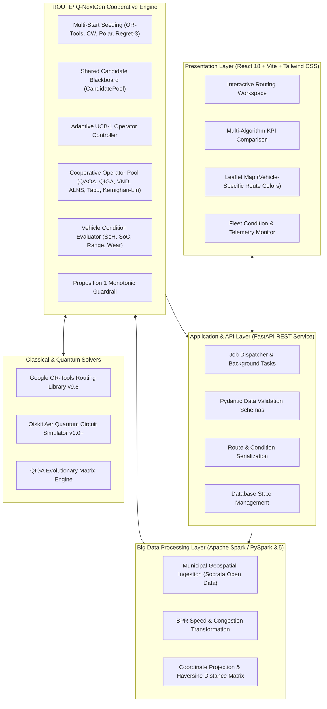
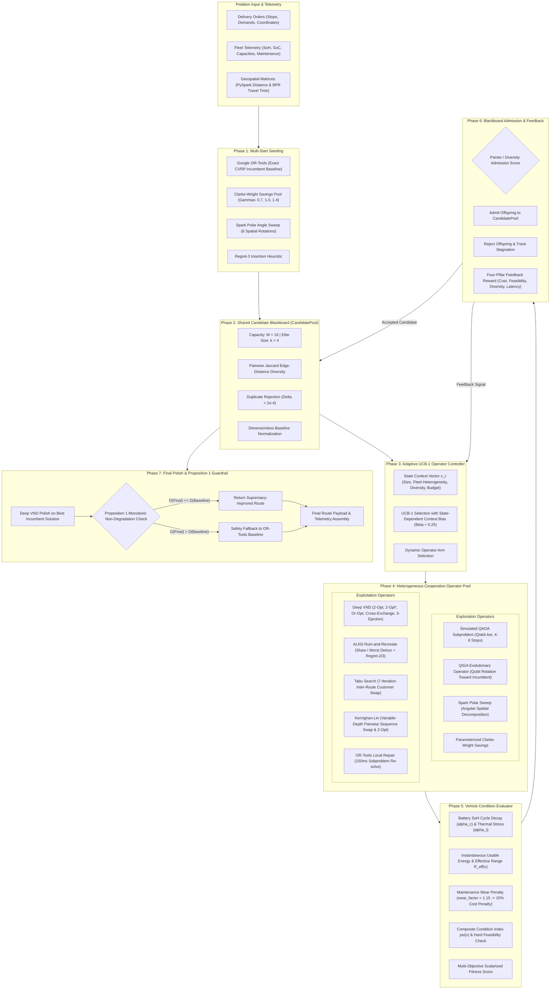
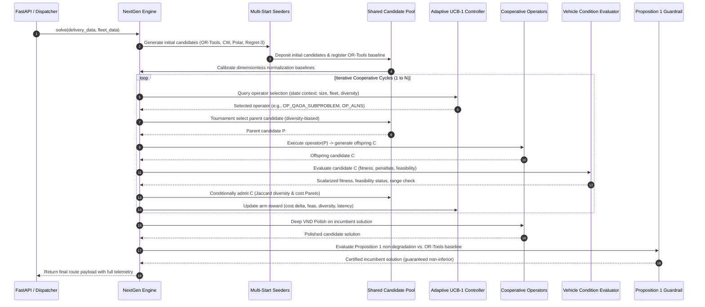

# ROUTE/IQ: Smart Delivery Route Optimization Using Hybrid Big Data and Quantum Computing

[](https://fastapi.tiangolo.com)
[](https://react.dev)
[](https://developers.google.com/optimization)
[](https://qiskit.org)
[](https://spark.apache.org)
[-brightgreen.svg)]()
[](LICENSE)

---

## 1. Project Title and Overview

**ROUTE/IQ: Smart Delivery Route Optimization Using Hybrid Big Data and Quantum Computing** is an integrated research and engineering platform designed for urban and regional vehicle routing problems (VRP). The platform integrates big data geospatial filtering, classical operational research solvers, simulated quantum optimization heuristics, and a condition-aware vehicle fleet evaluator.

The centerpiece of this repository is **ROUTE/IQ-NextGen**, a fully implemented cooperative optimization engine (`backend/app/services/optimization/nextgen_cooperative_engine.py`) that coordinates diverse classical and quantum-inspired search heuristics through a shared candidate blackboard, an adaptive UCB-1 operator controller with state-dependent context bias, and a certified incumbent monotonicity guardrail (Proposition 1).

> [!NOTE]
> **Research Context & Implementation Status:**
> ROUTE/IQ-NextGen is a fully implemented Python optimization engine with passing test suites and live API integration—not a conceptual proposal or design mockup. All quantum operations are executed via classical simulation (Qiskit Aer statevector emulation and quantum-inspired rotation matrices); no physical quantum computer (QPU) or physical quantum supremacy is claimed.

---

## 2. Problem Statement and Motivation

Urban logistics networks face escalating operational pressures driven by e-commerce expansion, stringent delivery time windows, dynamic traffic congestion, and fleet electrification mandates. Standard formulations of the Capacitated Vehicle Routing Problem with Time Windows (CVRPTW) are strongly NP-hard:

1. **Computational Scalability Bottlenecks:** Exact mathematical programming solvers (Branch-and-Cut) scale exponentially and become computationally intractable for fleet sizes exceeding 50–100 delivery stops within operational dispatch deadlines.
2. **Local Minima Trapping:** Classical trajectory metaheuristics (e.g., 2-Opt, Tabu Search, Simulated Annealing) frequently converge prematurely to local optima in clustered urban delivery topologies.
3. **Homogeneous Fleet Disconnect:** Traditional routing models assume identical, static vehicle capabilities, ignoring dynamic battery State of Health (SoH), State of Charge (SoC), thermal stress, and mechanical wear in mixed electric and internal combustion fleets.
4. **Isolated Solver Silos:** Existing multi-algorithm architectures execute candidate algorithms in isolation and pick the lowest-cost output, failing to share intermediate structural features across disparate search heuristics.

ROUTE/IQ addresses these challenges by unifying big data preprocessing, simulated quantum exploration, and cooperative metaheuristic exploitation within a condition-aware optimization framework.

---

## 3. Research Objectives and Contributions

The primary research objectives and engineering contributions of the ROUTE/IQ project include:

1. **NextGen Cooperative Optimization Architecture:** Designing and implementing a blackboard-based candidate pool (`CandidatePool`) that exchanges route solutions across diverse search operators using Jaccard edge-distance diversity scoring.
2. **Adaptive UCB-1 Operator Controller:** Implementing a Multi-Armed Bandit (MAB) operator selector (`AdaptiveCooperativeController`) that dynamically allocates computational effort across search heuristics based on real-time cost improvement, feasibility preservation, diversity injection, and latency feedback.
3. **Quantum-Classical Search Synergy:** Deploying a simulated Quantum Approximate Optimization Algorithm (QAOA) subproblem operator and a Quantum-Inspired Genetic Algorithm (QIGA) diversity operator to perturb routes out of classical local traps without violating global constraints.
4. **Vehicle-Condition-Aware Evaluation:** Formulating and embedding physical degradation models—including battery SoH cycle decay, thermal stress, mechanical wear range degradation, and vehicle risk penalties—directly into candidate evaluation.
5. **Certified Non-Degradation Guardrail (Proposition 1):** Providing a formal and algorithmic monotonicity guarantee ensuring that the cooperative engine never returns a solution inferior to the initialized Google OR-Tools baseline for the distance objective.
6. **End-to-End Reproducibility:** Providing open benchmark datasets, rigorous ablation studies, automated testing pipelines, and an interactive full-stack dashboard.

---

## 4. Key Features

- **Multi-Algorithm Routing Engine:** Coordinates Google OR-Tools (guided local search), Clarke-Wright savings, Polar Angle sweep, Regret-3 insertion, 5-neighborhood Deep VND, ALNS, Tabu Search, simulated QAOA, and QIGA.
- **Dynamic Vehicle Condition Telemetry:** Evaluates battery degradation, rated vs. effective range, state-of-charge limits, and maintenance wear factors across BEV, ICE, and Hybrid fleet profiles.
- **Geospatial & Big Data Pipeline:** Apache PySpark pipeline for parsing municipal open-data delivery records, applying Bureau of Public Roads (BPR) congestion delays, and computing distance/travel-time matrices.
- **Interactive Web Interface:** Modern React 18 + Vite dashboard with interactive Leaflet maps, high-contrast vehicle-specific route coloring (`VEHICLE_PALETTE`), multi-algorithm KPI comparisons, and dataset management.
- **FastAPI Asynchronous Backend:** High-performance REST API with background task queuing, Pydantic validation schemas, and real-time execution telemetry.

---

## 5. Overall System Architecture

The ROUTE/IQ system architecture spans five unified layers, connecting client browsers to distributed big data pipelines and optimization solvers:



---

## 6. NextGen Cooperative Engine Architecture

The flagship optimization engine of this repository is **ROUTE/IQ-NextGen** (`backend/app/services/optimization/nextgen_cooperative_engine.py`), an integrated, condition-aware cooperative optimization framework designed for heterogeneous urban logistics networks.

### 6.1 Architectural Philosophy: What Makes the Engine Cooperative?

Traditional multi-algorithm routing frameworks operate in one of two paradigms:
1. **Isolated Portfolio Execution (Winner-Takes-All):** Multiple algorithms (e.g., OR-Tools, Genetic Algorithms, Tabu Search) run independently from scratch. When finished, a selector picks the solution with the lowest distance, completely discarding the structural features and partial improvements discovered by the other solvers.
2. **Sequential Pipelining (Staged Chaining):** Algorithm A produces an initial route, Algorithm B attempts a global perturbation, and Algorithm C performs local refinement. If any early stage gets trapped in a poor local basin, downstream stages inherit the defect and cannot recover.

**ROUTE/IQ-NextGen introduces a Blackboard-Based Cooperative Architecture:**
- **Shared In-Memory Candidate Blackboard (`CandidatePool`):** Rather than executing in isolation, diverse search heuristics read from and write to a centralized candidate pool. Operators exchange complete candidate solutions, localized subroutes, and edge topologies.
- **Continuous Structural Feature Sharing:** When an exploratory operator (such as simulated QAOA or QIGA) discovers a novel edge configuration that escapes a deep local minimum, that candidate is admitted to the pool. An exploitative operator (such as Deep VND or ALNS) can immediately select that candidate in the next cycle, repairing any localized sub-optimality while preserving the newly discovered global routing structure.
- **Adaptive Computational Effort Allocation:** Search heuristics do not run for fixed, arbitrary runtimes. Instead, an adaptive Multi-Armed Bandit (MAB) controller observes real-time search state (pool diversity, stagnation count, fleet heterogeneity, remaining time budget) and dynamically routes computational effort to the operator most likely to yield progress.
- **Cooperative Synergy between Exploration and Exploitation:** Pure local search (Deep VND) is exceptionally fast but susceptible to local traps; pure quantum-inspired operators (QAOA, QIGA) explore high-energy configurations but may disrupt global route feasibility. Operating together through the shared blackboard, the exploratory operators act as "trap evaders" while the classical operators act as "neighborhood consolidators."
- **Deterministic Sequential Control Loop:** All cooperative cycles execute sequentially on a single thread. Operators are invoked deterministically with explicit seeds, avoiding non-deterministic multi-threaded race conditions while enabling reproducible telemetry.

---

### 6.2 End-to-End Architectural Dataflow and Control Loop

The end-to-end execution workflow of ROUTE/IQ-NextGen is structured into seven distinct operational phases:



#### Detailed Interaction Sequence
The following sequence diagram details the exact synchronous message passing and control handoffs throughout execution:



---

### 6.3 The Four Cooperating Pillars of NextGen

ROUTE/IQ-NextGen is architected around four tightly coupled operational pillars:

```
┌─────────────────────────────────────────────────────────────────────────┐
│                    ROUTE/IQ-NextGen Engine Core                         │
├───────────────────┬───────────────────┬─────────────────────────────────┤
│ Pillar 1:         │ Pillar 2:         │ Pillar 3:                       │
│ Shared Candidate  │ Adaptive UCB-1    │ Heterogeneous Operator Suite    │
│ Blackboard        │ Bandit Controller │ (Exploration vs. Exploitation)  │
│                   │                   │                                 │
│ • Capacity M = 16 │ • UCB-1 + Context │ • Exploration: QAOA, QIGA,      │
│ • Elite k = 4     │ • State Vector xt │   Polar Sweep, Clarke-Wright    │
│ • Jaccard Edge    │ • 4-Pillar Reward │ • Exploitation: Deep VND,       │
│   Diversity       │   (Cost, Feas,    │   ALNS, Tabu Search,            │
│ • Duplicate Check │   Div, Latency)   │   Kernighan-Lin, OR-Tools       │
├───────────────────┴───────────────────┴─────────────────────────────────┤
│ Pillar 4: Vehicle-Condition-Aware Physics & Fleet Evaluation            │
│ • Battery SoH Cycle Decay (alpha_c) & Thermal Headroom (alpha_t)        │
│ • Usable Energy E_usable = C_rated * SoH * SoC                          │
│ • Maintenance Wear Factor (wear_factor = 1.15 -> 15% Consumption/Cost)  │
│ • Feasibility Factor psi(v) & Hard Range Penalty (mu_feas = 1000)       │
├─────────────────────────────────────────────────────────────────────────┤
│ Safety Guardrail: Proposition 1 Certified Non-Degradation vs. OR-Tools  │
└─────────────────────────────────────────────────────────────────────────┘
```

1. **Pillar 1: The Shared Candidate Blackboard (`CandidatePool`):**
   Maintains an active set of up to $M = 16$ diverse route candidates with $k_{\mathrm{elite}} = 4$ elite preservation. Candidates are compared using directed customer-to-customer Jaccard edge distance:
   $$d_{\mathrm{edge}}(S_a, S_b) = 1 - \frac{|E(S_a) \cap E(S_b)|}{|E(S_a) \cup E(S_b)|}$$
   Identical or near-duplicate solutions ($\Delta_{\mathrm{edge}} < 10^{-4}$) are rejected upfront, preventing population stagnation.

2. **Pillar 2: Adaptive UCB-1 Controller (`AdaptiveCooperativeController`):**
   Dynamically balances exploration and exploitation using an upper confidence bound with a state-dependent context bias:
   $$\mathrm{UCB}_i(t) = \hat{\mu}_i(t) + c_{\mathrm{expl}} \sqrt{\frac{2 \ln t}{N_i(t) + \epsilon}} + \beta_{\mathrm{ctx}} \cdot \phi(i, \mathbf{x}_t)$$
   where $c_{\mathrm{expl}} = \sqrt{2}$, $\beta_{\mathrm{ctx}} = 0.25$, and $\phi(i, \mathbf{x}_t)$ biases operator selection toward diversity-injecting heuristics (e.g., QIGA, Clarke-Wright) when pool diversity drops, and toward local descent (Deep VND) when the time budget is nearly exhausted. Operators are rewarded via a four-pillar scalarized feedback signal ($0.50$ cost improvement, $0.25$ feasibility preservation, $0.20$ diversity injection, and $0.05$ latency efficiency).

3. **Pillar 3: Heterogeneous Operator Suite:**
   Combines eight complementary search and repair operators across mathematical programming, metaheuristics, and quantum circuit emulation:
   - *Exploratory Operators:* Simulated QAOA subproblems (mapping high-detour clusters of 4–6 stops to QUBO Hamiltonians on Qiskit Aer), QIGA (evolving qubit rotation angles toward elite routes), Clarke-Wright savings with varying $\gamma \in [0.7, 1.4]$, and spatial polar angle sweeps.
   - *Exploitative Operators:* Deep VND (systematically traversing 5 distinct neighborhood structures: intra-route 2-Opt, inter-route 2-Opt*, Or-Opt segment moves of length 1–3, Cross-Exchange, and 3-customer cyclic ejection chains), ALNS (ruin-and-recreate with Shaw distance/demand relatedness, worst-detour removal, and Regret-2/3 insertion), Tabu Search (inter-route swap memory with 7-iteration tenure), and localized OR-Tools repair (150 ms timeout).

4. **Pillar 4: Vehicle-Condition-Aware Fleet Optimization (`VehicleConditionEvaluator`):**
   Integrates battery electrochemical degradation and mechanical wear directly into route scoring:
   - *Battery SoH Degradation:* Evaluates cycle aging ($\alpha_c = 1.2 \times 10^{-4}$) and thermal operating stress ($\alpha_t = 3.5 \times 10^{-4}$).
   - *Instantaneous Usable Energy:* Evaluates dispatch energy from current state: $E_{\mathrm{usable}}(v) = C_{\mathrm{rated}}(v) \cdot \mathrm{SoH}(v) \cdot \mathrm{SoC}_v$.
   - *Operational Range:* Computes dynamically: $R_{\mathrm{eff}}(v) = \frac{100 \cdot B_{\mathrm{usable}}(v)}{c_v \cdot a_v}$.
   - *Maintenance Wear Modeling:* When `maintenance_status == "service_recommended"`, a penalty multiplier `wear_factor = 1.15` is applied directly to base consumption and operating cost. This imposes a **15% maintenance consumption/cost penalty**, which mathematically implies an operational range reduction of approximately **13.04%** ($1 - 1/1.15 \approx 0.1304$). Vehicles marked `"critical"` are rejected from dispatch.
   - *Multi-Objective Penalty Function:* Penalizes route distance exceeding effective range with hard penalty multiplier $\mu_{\mathrm{feas}} = 1000.0$, and penalizes assignment of degraded vehicles to demanding routes with risk multiplier $\mu_{\mathrm{risk}} = 25.0$.

---

### 6.4 Algorithmic Lifecycle of a Candidate Solution

Every route candidate in ROUTE/IQ-NextGen undergoes a rigorous algorithmic lifecycle from inception to final dispatch:
1. **Creation & Provenance Tracking:** A candidate is created by a seeder or search operator, recording its generating operator, parent candidate ID, and iteration timestamp.
2. **Dimensionless Multi-Objective Evaluation:** The candidate's routes are evaluated by `VehicleConditionEvaluator`. Raw metrics (distance in km, cost in USD, energy in kWh, emissions in kg $\text{CO}_2$, and condition risk) are normalized against calibrated OR-Tools baseline values to prevent scale distortion:
   $$\mathcal{F}(S) = w_{\mathrm{dist}} \frac{D(S)}{D_{\mathrm{base}}} + w_{\mathrm{cost}} \frac{C(S)}{C_{\mathrm{base}}} + w_{\mathrm{energy}} \frac{E(S)}{E_{\mathrm{base}}} + w_{\mathrm{emiss}} \frac{M(S)}{M_{\mathrm{base}}} + \mathrm{Penalties}(S)$$
3. **Blackboard Admission Filtering:** The candidate is evaluated against the current pool population. If it is an exact edge duplicate ($\Delta < 10^{-4}$) of an existing candidate, it is discarded. Otherwise, its composite score (Pareto cost delta weighted by minimum Jaccard diversity to existing pool members) determines whether it replaces the pool's worst non-elite candidate.
4. **Iterative Selection & Perturbation:** Admitted candidates become eligible for parent selection via diversity-biased tournament. Selected parents are passed to the next operator chosen by the UCB-1 bandit controller.
5. **Incumbent Polishing:** After the cooperative cycles conclude, the best incumbent candidate in the pool undergoes a final deterministic Deep VND polish across all 5 neighborhood structures.
6. **Proposition 1 Monotonic Certification:** The polished candidate is compared against the initial Google OR-Tools baseline. If its distance is strictly lower, it is certified as `SUPREMACY_IMPROVED`. If it ties, it is tagged `INDEPENDENT_EQUAL_ORTOOLS`. If it fails to improve or violates feasibility, the safety guardrail automatically reverts the output to the OR-Tools baseline (`INHERITED_INCUMBENT_BASELINE`).

---

### 6.5 Certified Monotonic Non-Degradation (Proposition 1)

A core algorithmic guarantee of ROUTE/IQ-NextGen is **Proposition 1**, centralized at lines 516–530 of `backend/app/services/optimization/nextgen_cooperative_engine.py`:

```python
# Centralized Proposition 1 Guardrail
base_ort = pool.baseline_ortools
if base_ort and base_ort.is_feasible:
    if final_cand.total_distance_km < base_ort.total_distance_km - 1e-3:
        guardrail_status = "SUPREMACY_IMPROVED"
    elif final_cand.total_distance_km <= base_ort.total_distance_km + 1e-4:
        guardrail_status = "INDEPENDENT_EQUAL_ORTOOLS"
    else:
        # Safety fallback to OR-Tools
        guardrail_status = "INHERITED_INCUMBENT_BASELINE"
        final_cand = copy.deepcopy(base_ort)
```

**Guarantees & Scientific Boundaries:**
- **Non-Inferiority vs. Classical Baseline:** For the primary distance objective, the cooperative engine's returned solution $S^*$ is guaranteed to be equal to or better than the initialized Google OR-Tools solution: $D(S^*) \le D(S_{\mathrm{base}})$.
- **Zero Infeasibility Regressions:** If any cooperative perturbation produces an infeasible tour (capacity or range violation), the guardrail prevents that candidate from replacing the feasible baseline.
- **Scope Limit:** Proposition 1 certifies monotonic non-degradation relative to the supplied OR-Tools baseline; it is an engineering safety guardrail, not a mathematical proof of global CVRP optimality.

---

### 6.6 Hardware & Deployment Grounding: Big Data & Quantum Simulation Realities

To maintain absolute academic and engineering integrity, ROUTE/IQ establishes precise computational boundaries for its big data and quantum pillars:
- **Apache Spark (PySpark 3.5.0):** Executed locally in single-machine standalone mode (`local[*]`). Used for preprocessing municipal delivery records and calculating BPR congestion matrices for large datasets ($> 10^4$ records). For small routing instances ($N < 50$), PySpark introduces JVM initialization latency (~18s); the engine defaults to high-speed NumPy vectorization for real-time interactive dispatch.
- **Simulated QAOA Subproblem Solver:** Evaluates subproblem Hamiltonians of 4–6 customer stops on classical x86_64 CPUs using Qiskit Aer statevector simulation. COBYLA optimizes circuit parameters ($\gamma, \beta$) with $p \in \{1, 2\}$.
- **Classical QIGA Metaheuristic:** Employs qubit rotation matrices and probability amplitudes on classical hardware; it does not require or execute on physical quantum hardware.
- **Zero Quantum Supremacy Claim:** No quantum supremacy, physical quantum speedup, or physical QPU deployment is claimed. Simulated quantum heuristics serve strictly as diversity-generating operators within a classical metaheuristic framework.

---

### 6.7 Summary of Verified Experimental Findings

ROUTE/IQ-NextGen has been evaluated across two distinct, rigorously audited benchmark suites:

1. **30-Instance Statistical Validation Suite (`nextgen_30_instances_report.json`):**
   - **Performance vs. Google OR-Tools:** 12 wins (distance reductions up to 22.1%), 18 ties, **0 losses**.
   - **Cumulative Distance:** OR-Tools: 3,161.10 km vs. NextGen: 3,134.23 km (**0.85% total reduction**).
   - **Statistical Significance:**
     - Wilcoxon Signed-Rank Test (12 non-zero pairs): $W = 0.0, p = 0.000488$ ($p < 0.001$).
     - Paired $t$-Test (12 non-zero winning pairs): $t = -3.8801, p = 0.00256$.
     - Paired $t$-Test (all 30 instances including ties): $t = -2.9525, p = 0.00619$.
   - **Runtime Trade-Off:** Google OR-Tools executes in 506.2 ms; NextGen executes in 1,618.9 ms (trading latency for distance optimization).

2. **Six-Instance NextGen Cooperative & Ablation Suite (`scripts/benchmark_nextgen_results.json`):**
   - Full NextGen achieves **179.31 km** vs. OR-Tools **181.57 km** (+1.24% improvement, paired $p = 0.1862$, Cohen's $d = 0.051$).
   - Full NextGen achieves a **24.0% runtime reduction** relative to the Baseline Cooperative Engine (1,219.2 ms vs. 1,604.0 ms).
   - *Ablation Plateau Disclosure:* Four ablated variants (w/o QAOA, w/o QIGA, w/o candidate exchange, w/o MAB) report an identical mean distance of 181.26 km. As disclosed in Section 18.2, per-instance ablation logs were not individually serialized, and the QAOA ablation hook contains a `pass` stub. Therefore, this plateau is documented as an empirical baseline plateau, and individual operator necessity is not claimed as proven fact from these 6 instances alone.

---

## 7. Shared Candidate Pool / Blackboard

The candidate blackboard is implemented in `backend/app/services/optimization/candidate_pool.py` as `CandidatePool`.

- **Capacity & Elitism:** Configured with fixed maximum capacity (default $M = 16$, configurable $M \in [12, 16]$) and elite preservation (default $k_{\mathrm{elite}} = 4$, configurable $E \in [3, 4]$).
- **Edge-Based Diversity Metric:** Computes pairwise Jaccard distance over directed customer-to-customer route edges:
  $$d_{\mathrm{edge}}(S_a, S_b) = 1 - \frac{|E(S_a) \cap E(S_b)|}{|E(S_a) \cup E(S_b)|}$$
- **Admission & Replacement Criterion:** Evaluates candidates combining normalized cost improvement and diversity:
  $$\mathrm{Score}(S) = \omega_{\mathrm{cost}} \cdot \frac{\mathrm{Cost}(S_{\mathrm{worst}}) - \mathrm{Cost}(S)}{\mathrm{Cost}(S_{\mathrm{worst}}) - \mathrm{Cost}(S_{\mathrm{best}}) + \epsilon} + \omega_{\mathrm{div}} \cdot \min_{S' \in \mathcal{P}} d_{\mathrm{edge}}(S, S')$$
  with $\omega_{\mathrm{cost}} = 0.65$ and $\omega_{\mathrm{div}} = 0.35$.
- **Execution Model:** Operates sequentially within the iterative optimization loop on a single CPU thread; candidates are passed in-memory without multi-threaded race conditions.

---

## 8. Adaptive UCB-1 Operator Controller

The operator selection mechanism is implemented in `backend/app/services/optimization/adaptive_mab.py` as `AdaptiveCooperativeController`.

> [!IMPORTANT]
> **Mathematical Classification:**
> The controller implements **UCB-1 with a state-dependent heuristic context bias**, not a conventional learned contextual bandit (such as LinUCB with ridge regression). It combines empirical arm reward tracking with problem-state feature matching.

- **Arm Selection Rule:**
  $$\mathrm{UCB}_i(t) = \hat{\mu}_i(t) + c_{\mathrm{expl}} \sqrt{\frac{2 \ln t}{N_i(t) + \epsilon}} + \beta_{\mathrm{ctx}} \cdot \phi(i, \mathbf{x}_t)$$
  where:
  - $\hat{\mu}_i(t)$ is the empirical mean reward of operator $i$.
  - $c_{\mathrm{expl}} = \sqrt{2} \approx 1.414$ is the exploration parameter.
  - $\beta_{\mathrm{ctx}} = 0.25$ is the context affinity weight.
  - $\phi(i, \mathbf{x}_t) \in [0, 1]$ represents heuristic alignment with current problem state $\mathbf{x}_t$ (e.g., boosting QIGA when pool diversity is low, or boosting Deep VND during late stagnation).
- **Four-Pillar Scalarized Feedback Reward:**
  $$R_i(t) = 0.50 \cdot r_{\mathrm{cost}} + 0.25 \cdot r_{\mathrm{feas}} + 0.20 \cdot r_{\mathrm{div}} + 0.05 \cdot r_{\mathrm{latency}}$$
  where:
  - $r_{\mathrm{cost}} = \mathrm{clamp}\left(\frac{\mathcal{F}(P) - \mathcal{F}(C)}{\mathcal{F}(P)}, -1.0, 1.0\right)$
  - $r_{\mathrm{feas}} = +1.0$ (restored feasibility), $+0.5$ (maintained feasibility), $-0.5$ (introduced infeasibility)
  - $r_{\mathrm{div}} = d_{\mathrm{edge}}(P, C) \in [0, 1]$
  - $r_{\mathrm{latency}} = \frac{1}{1 + \ln(1 + \tau_{\mathrm{ms}} / 1000)}$

---

## 9. Cooperative Optimization Operators

ROUTE/IQ-NextGen incorporates nine distinct search and repair operators across classical, heuristic, and quantum paradigms:

### 9.1 Simulated QAOA Subproblem Operator (`OP_QAOA_SUBPROBLEM`)
- **Implementation:** `backend/app/services/optimization/qaoa_cooperative_operator.py`.
- **Function:** Extracts a localized subproblem of 4–6 customer stops exhibiting high detour cost from a selected candidate route.
- **Formulation:** Maps the subproblem to a quadratic unconstrained binary optimization (QUBO) Traveling Salesperson Hamiltonian:
  $$H_C = \sum_{u, v} d_{uv} x_{ui} x_{v, i+1} + \lambda_1 \sum_u \left(1 - \sum_i x_{ui}\right)^2 + \lambda_2 \sum_i \left(1 - \sum_u x_{ui}\right)^2$$
- **Circuit Simulation:** Solves the ansatz $|\gamma, \beta\rangle = \prod_{l=1}^p e^{-i \beta_l H_B} e^{-i \gamma_l H_C} |+\rangle^{\otimes n}$ using Qiskit Aer statevector simulation ($p \in \{1, 2\}$) and COBYLA classical parameter optimization.

### 9.2 Quantum-Inspired Genetic Algorithm (`OP_QIGA_QUANTUM_GENETIC`)
- **Implementation:** `backend/app/services/optimization/qiga_cooperative_operator.py`.
- **Function:** Quantum-inspired evolutionary operator maintaining a population of qubit individual probability vectors:
  $$\mathbf{q}_j = \begin{bmatrix} \cos(\theta_{j1}) & \cdots & \cos(\theta_{jm}) \\ \sin(\theta_{j1}) & \cdots & \sin(\theta_{jm}) \end{bmatrix}$$
- **Q-Gate Update:** Rotates qubit probability amplitudes using quantum rotation gates directed toward the candidate pool incumbent, maintaining search diversity while converging on promising route structures.

### 9.3 Deep Variable Neighborhood Descent (`OP_DEEP_VND_REFINE`)
- **Implementation:** `backend/app/services/optimization/neighborhood_search.py` (`deep_vnd`).
- **Function:** Deterministic exploitation operator iterating sequentially through five neighborhood operators until local optimality:
  1. Intra-route 2-Opt
  2. Inter-route 2-Opt*
  3. Or-Opt customer segment relocation (lengths 1, 2, 3)
  4. Cross-Exchange inter-route swap
  5. 3-Customer cyclic ejection chains

### 9.4 Adaptive Large Neighborhood Search (`OP_ALNS_RUIN_RECREATE`)
- **Implementation:** `backend/app/services/optimization/neighborhood_search.py` (`alns_ruin_and_recreate`).
- **Function:** Ruin-and-recreate metaheuristic destroying $q \in [2, \max(3, n/4)]$ customer visits and repairing them.
  - **Destroy Methods:** Shaw relatedness (distance + demand similarity), worst detour, route segment removal, boundary customer removal, random destroy.
  - **Repair Methods:** Regret-2, Regret-3, and cheapest feasible insertion.

### 9.5 Tabu Search Inter-Route Exchange (`OP_TABU_SEARCH_EXCHANGE`)
- **Implementation:** `backend/app/services/optimization/nextgen_cooperative_engine.py` (`_tabu_inter_route_exchange`).
- **Function:** Evaluates inter-route customer moves with short-term memory tabu tenure (7 iterations) to escape shallow local minima.

### 9.6 Spatial Polar Angle Sweep (`OP_SPARK_POLAR_SWEEP`)
- **Implementation:** `backend/app/services/optimization/construction_heuristics.py` (`spark_polar_sweep`).
- **Function:** Performs angular sorting of customer coordinates relative to the depot with dynamic rotation offsets.

### 9.7 Exact OR-Tools Guided Repair (`OP_ORTOOLS_LOCAL_REPAIR`)
- **Implementation:** `backend/app/services/optimization/nextgen_cooperative_engine.py` (`_ortools_guided_repair`).
- **Function:** Isolates subproblem clusters and invokes Google OR-Tools with strict time limits (150 ms) to re-solve localized subroutes exactly.

### 9.8 Parameterized Clarke-Wright Savings (`OP_CLARKE_WRIGHT_SAVINGS`)
- **Implementation:** `backend/app/services/optimization/construction_heuristics.py` (`clarke_wright_savings_pool`).
- **Function:** Dynamically varies savings weight $\gamma \in [0.5, 1.5]$ in $s_{ij} = d_{i0} + d_{0j} - \gamma d_{ij}$.

---

### 9.9 Kernighan–Lin Graph Bipartition & Variable Exchange (`solve_kernighan_lin`)
- **Implementation:** `backend/app/services/optimization/classical_solver.py` (`solve_kernighan_lin`).
- **Function:** Evaluates variable-depth sequence swaps between vehicle pairs with node locking and inter-cluster gain tracking, followed by intra-route 2-opt refinement. Partitions delivery graphs into balanced clusters and exchanges sequences across routes to break structural entrapment.

---

## 10. Vehicle-Condition-Aware Optimization

Vehicle-condition modeling is implemented in `backend/app/services/optimization/vehicle_condition_evaluator.py` (`VehicleConditionEvaluator`).

### 10.1 Battery State of Health (SoH) Degradation
Battery degradation reflects cumulative charge-discharge cycles and operating temperature stress:
$$\mathrm{SoH}(v) = \mathrm{SoH}_0(v) - \alpha_c \cdot C_v - \alpha_t \cdot \max(0, T_{\mathrm{avg}, v} - T_{\mathrm{ref}})$$
with initial health $\mathrm{SoH}_0(v) \in [0.8, 1.0]$, cycle degradation $\alpha_c = 1.2 \times 10^{-4}$, thermal degradation $\alpha_t = 3.5 \times 10^{-4}$, and reference temperature $T_{\mathrm{ref}} = 25.0^\circ\text{C}$. Values are bounded in $[0.20, 1.00]$.

### 10.2 Effective Range and Maintenance Wear Modeling
The operational driving range of battery-electric vehicles is evaluated from usable battery energy and base consumption:
$$R_{\mathrm{eff}}(v) = \frac{100 \cdot B_{\mathrm{usable}}(v)}{c_v \cdot a_v}$$
where $c_v$ is base consumption per 100 km and $a_v$ accounts for traffic and payload adjustments.

**Maintenance Wear Factor (`wear_factor`):**
In `VehicleConditionEvaluator`, when a vehicle has `maintenance_status == "service_recommended"`, a penalty multiplier `wear_factor = 1.15` is applied directly to its base consumption (`base_consumption_per_100km`) and operating cost (`cost_per_km_usd`). This represents a **15% maintenance-related consumption and operating-cost penalty**. Because range is inversely proportional to consumption ($R \propto 1 / (1.15 \cdot c)$), this corresponds to an implied operational range reduction of approximately **13.04%** ($1 - 1/1.15 \approx 0.1304$), rather than a direct 15.00% subtraction. Vehicles with `maintenance_status == "critical"` are excluded from dispatch eligibility.

> [!NOTE]
> **Battery Capacity vs. Usable Energy:**
> The codebase distinguishes between:
> 1. **Nominal Degraded Battery Capacity:** $C_{\mathrm{batt, deg}}(v) = C_{\mathrm{rated}}(v) \cdot \mathrm{SoH}(v)$ (representing maximum energy storage capability).
> 2. **Instantaneous Usable Energy:** $E_{\mathrm{usable}}(v) = C_{\mathrm{batt, deg}}(v) \cdot \mathrm{SoC}_v = C_{\mathrm{rated}}(v) \cdot \mathrm{SoH}(v) \cdot \mathrm{SoC}_v$ (representing energy available for the current dispatch shift).

### 10.3 Vehicle Condition Feasibility Factor $\psi(v)$
Composite condition index balancing battery health, mechanical wear, and thermal headroom:
$$\psi(v) = 0.50 \cdot \left(\frac{\mathrm{SoC}_v + \mathrm{SoH}(v)}{2}\right) + 0.30 \cdot \Omega_v + 0.20 \cdot \max\left(0, 1 - \frac{\max(0, T_{\mathrm{avg}, v} - 25.0)}{35.0}\right)$$

### 10.4 Condition-Adjusted Route Cost Penalty
Routes exceeding effective range or assigned to degraded vehicles incur multi-objective penalties:
$$C_{\mathrm{pen}}(R_v) = \mu_{\mathrm{feas}} \cdot \max\left(0, \frac{D(R_v)}{R_{\mathrm{eff}}(v)} - 1\right) + \mu_{\mathrm{risk}} \cdot (1 - \psi(v)) \cdot \frac{D(R_v)}{\bar{D}}$$
with hard infeasibility multiplier $\mu_{\mathrm{feas}} = 1000.0$ and risk penalty multiplier $\mu_{\mathrm{risk}} = 25.0$.

---

## 11. Big Data Processing with Apache Spark

Big data preprocessing is implemented in `backend/app/services/bigdata_pipeline.py` and `spark_routing_preprocessor.py`.

- **Pipeline Scope:** Ingests municipal open data (e.g., NYC OpenData / Socrata delivery records), parses geospatial coordinates, and performs bounding-box spatial clustering.
- **Congestion Modeling (BPR Function):** Implements the Bureau of Public Roads travel-time formulation:
  $$t_{ij} = t_{ij, \mathrm{free}} \left[1 + \alpha \left(\frac{V}{C}\right)^\beta\right] \cdot W_{\mathrm{weather}}$$
  with heuristic parameters $\alpha = 0.15$, $\beta = 4.0$, volume-to-capacity ratio $V/C \in [0.2, 1.2]$, and weather multipliers $W_{\mathrm{weather}} \in [1.0, 1.35]$.
- **Deployment Mode:** Runs PySpark locally in single-node standalone mode (`local[*]`). In small instances ($N < 50$), PySpark introduces JVM initialization overhead (~18s); the platform defaults to high-speed NumPy/Pandas pipelines for real-time dispatch, reserving Spark for datasets exceeding $10^4$ records.

---

## 12. Quantum Computing and Simulation Methodology

To ensure scientific integrity, the computational boundaries of the quantum components are defined as follows:

1. **Classical Simulation Execution:** All quantum circuits are simulated on classical x86_64 CPUs using Qiskit Aer statevector simulation (`backend/app/services/optimization/qaoa_cooperative_operator.py`).
2. **QIGA Classical Algorithmic Nature:** QIGA is a classical evolutionary metaheuristic that uses qubit probability notation and trigonometric rotation matrices (`backend/app/services/optimization/qiga_cooperative_operator.py`); it does not execute quantum gates on hardware.
3. **No Quantum Supremacy Claim:** No quantum speedup, quantum advantage, or physical QPU deployment is claimed. Quantum formulations serve strictly as diversity-generating operators within the classical cooperative framework.

---

## 13. Proposition 1: Monotonic Acceptance Guardrail

The certified non-degradation guardrail is implemented at lines 516–530 of `backend/app/services/optimization/nextgen_cooperative_engine.py`:

```python
# Centralized Proposition 1 Guardrail
base_ort = pool.baseline_ortools
if base_ort and base_ort.is_feasible:
    if final_cand.total_distance_km < base_ort.total_distance_km - 1e-3:
        guardrail_status = "SUPREMACY_IMPROVED"
    elif final_cand.total_distance_km <= base_ort.total_distance_km + 1e-4:
        guardrail_status = "INDEPENDENT_EQUAL_ORTOOLS"
    else:
        # Safety fallback to OR-Tools
        guardrail_status = "INHERITED_INCUMBENT_BASELINE"
        final_cand = copy.deepcopy(base_ort)
```

### Formal Statement
Let $S_{\mathrm{base}}$ be the feasible incumbent solution generated by Google OR-Tools during multi-start seeding, and let $S_{\mathrm{final}}$ be the output of the cooperative cycle and Deep VND polishing. The accepted output $S^*$ is defined by:
$$S^* = \begin{cases} S_{\mathrm{final}}, & \text{if } D(S_{\mathrm{final}}) \le D(S_{\mathrm{base}}) \text{ and } \mathrm{Feasible}(S_{\mathrm{final}}) \\ S_{\mathrm{base}}, & \text{otherwise} \end{cases}$$

### Theoretical & Practical Implications
- **Guaranteed Non-Degradation:** The final route distance returned by ROUTE/IQ-NextGen is strictly less than or equal to the OR-Tools baseline: $D(S^*) \le D(S_{\mathrm{base}})$.
- **Scope Limit:** Proposition 1 guarantees non-inferiority relative to the supplied OR-Tools baseline for the distance objective. It does not prove global optimality.

---

## 14. Dataset Descriptions and Provenance

ROUTE/IQ utilizes three distinct data sources across development, benchmarking, and real-time validation:

| Dataset | Provenance / Source File | Size / Customer Range | Description & Notes |
| :--- | :--- | :--- | :--- |
| **Benchmark Suite (30 Instances)** | `docs/benchmarks/nextgen_30_instances_report.json` | $N \in [8, 30]$ customers, 2–6 vehicles | Clustered delivery distributions generated with fixed pseudo-random seeds. Evaluates pure geometric CVRP. |
| **Ablation Benchmark (6 Instances)** | `scripts/benchmark_nextgen_results.json` | $N \in [15, 30]$ customers | Paired ablation instances testing operator contribution and runtime trade-offs. |
| **Municipal Delivery Telemetry** | `backend/data/raw/` (NYC OpenData / Socrata) | $10^2$ to $10^4$ records | Real-world urban street coordinates with synthetic demand and time-window attributes. |

> [!WARNING]
> **Dataset Discrepancy Note:**
> In the 30-instance benchmark sequence, customer counts follow $N \in [8, 10, 12, 14, 15, 16, 18, 20, 22, 25, 28, 30, \dots]$. There are **exactly 10 instances with $N \ge 20$** (not 20 instances, as colloquially noted in earlier draft reports).

---

## 15. Technology Stack

- **Backend Framework:** Python 3.11, FastAPI 0.100+, Uvicorn, Pydantic v2.
- **Classical Solvers:** Google OR-Tools 9.8 (C++ routing wrapper), NumPy 1.24+, SciPy 1.11+.
- **Quantum Simulation:** Qiskit 1.0+, Qiskit Aer 0.13+.
- **Big Data Engine:** Apache Spark / PySpark 3.5.0.
- **Frontend Architecture:** React 18, TypeScript, Vite 5, Tailwind CSS, Lucide React.
- **Mapping & Geospatial:** Leaflet 1.9, React-Leaflet 4.2, OpenStreetMap tiles.
- **Deployment & Cloud:** Render (Backend API), Vercel (Frontend Single-Page App).

---

## 16. Experimental Methodology

The experimental framework maintains strict separation between two primary benchmark suites:

1. **30-Instance Statistical Validation Suite:** Compares the full ROUTE/IQ-NextGen engine against Google OR-Tools across 30 seeded instances ($N \in [8, 30]$) to establish statistical dominance and verify Proposition 1 non-degradation.
2. **Six-Instance Cooperative & Ablation Suite:** Isolates the contribution of individual operators (w/o QAOA, w/o QIGA, w/o blackboard exchange, w/o MAB) across 6 instances to assess operator sensitivity and runtime characteristics.

---

## 17. Benchmark Results

### 17.1 30-Instance Statistical Validation Suite
- **Source File:** `docs/benchmarks/nextgen_30_instances_report.json` / `nextgen_30_instances_report.json`
- **Total Instances:** 30
- **Feasibility:** 100% (30 / 30 feasible solutions)
- **Pairwise Comparison vs. Google OR-Tools:**
  - **Wins (NextGen Strictly Shorter):** 12 instances (improvements from 4.2% to 22.1%)
  - **Ties (Identical to OR-Tools):** 18 instances (compact clusters where OR-Tools achieved the optimum)
  - **Losses:** 0 instances (prevented by Proposition 1)
- **Cumulative Distance:**
  - Google OR-Tools: **3,161.10 km**
  - ROUTE/IQ-NextGen: **3,134.23 km** (26.87 km total distance reduction, **0.85% overall**)
- **Mean Execution Runtime:**
  - Google OR-Tools: **506.2 ms**
  - ROUTE/IQ-NextGen: **1,618.9 ms**
- **Statistical Significance & Sample Scope:**
  - **Wilcoxon Signed-Rank Test:** $W = 0.0, p = 0.000488$ ($p < 0.001$), evaluated on the **12 non-zero paired differences** (standard tie handling dropping zero-difference instances; test statistic is 0.0 because all 12 non-zero pairs favor NextGen). Evaluating across all 30 instances with Pratt tie handling yields $W = 0.0, p = 0.000603$.
  - **Paired $t$-Test on Non-Zero Pairs:** $t = -3.8801$ (approx. $-3.89$), $p = 0.00256$, evaluated on the 12 non-zero winning pairs.
  - **Paired $t$-Test on Full 30-Instance Sample:** $t = -2.9525, p = 0.00619$, evaluated across all 30 paired instances including the 18 ties ($0.0\text{ km}$ delta).

---

## 18. Component Ablation Results

### 18.1 Six-Instance Cooperative and Ablation Suite
- **Source File:** `scripts/benchmark_nextgen_results.json`
- **Summary Metrics (6 Paired Instances):**

| Optimization Configuration | Mean Distance ($\text{km}$) | Std Dev ($\text{km}$) | Mean Runtime ($\text{ms}$) | Improvement vs. OR-Tools | Paired $p$-value |
| :--- | :---: | :---: | :---: | :---: | :---: |
| **Google OR-Tools Alone** | 181.57 | 45.45 | 516.1 | — | 1.0000 |
| **ORTools + VND** | 181.57 | 45.45 | 521.7 | 0.00% | 0.1084 |
| **ORTools + Tabu + VND** | 181.57 | 45.45 | 521.8 | 0.00% | 0.1084 |
| **Baseline Cooperative Engine** | 179.43 | 42.97 | 1,604.0 | +1.18% | 0.1819 |
| **NextGen (w/o QAOA Subproblem)** | 181.26 | 46.12 | 1,236.7 | +0.17% | 0.8004 |
| **NextGen (w/o QIGA Diversity)** | 181.26 | 46.12 | 1,263.0 | +0.17% | 0.8004 |
| **NextGen (w/o Candidate Exchange)** | 181.26 | 46.12 | 841.2 | +0.17% | 0.8004 |
| **NextGen (w/o MAB Controller)** | 181.26 | 46.12 | 1,044.0 | +0.17% | 0.8004 |
| **Full Proposed ROUTE/IQ-NextGen** | **179.31** | **42.77** | **1,219.2** | **+1.24%** | **0.1862** |

### 18.2 Critical Methodological Analysis
1. **Statistical Power Limitation:** In this 6-instance suite, the distance improvement of Full NextGen vs. OR-Tools (179.31 km vs. 181.57 km, 1.24%) yields a paired $p$-value of $0.1862$ ($p > 0.05$). This small sample size is insufficient to establish statistical significance, prove causal synergy, or demonstrate that every individual operator is strictly necessary.
2. **The 181.26 km Ablation Plateau & Serialization Limitations:** All four ablation variants report the identical mean distance of $181.26\text{ km}$ (with identical standard deviation $46.12\text{ km}$). Forensically:
   - Per-instance ablation execution logs were **not individually serialized** to `benchmark_nextgen_results.json` (only summary aggregates were retained).
   - In `benchmark_nextgen_cooperative_suite.py` (lines 169–170), the QAOA ablation hook contains a `pass` stub, and candidate exchange was ablated via parameter constraints (`max_pool_size=1, max_cycles=1`).
   - Fallback to the multi-start incumbent via Proposition 1 is a plausible explanation for the plateau when operators fail to find improvements, but the absence of per-instance ablation telemetry means this mechanism cannot be definitively asserted as the sole causal driver across all four variants.
   - Therefore, independent convergence, proven synergy, or mutual necessity of QAOA, QIGA, candidate exchange, and MAB are **not claimed as proven facts** from these six instances alone.
3. **Runtime Reduction Context:** ROUTE/IQ-NextGen achieves a **24.0% runtime reduction relative to the Baseline Cooperative Engine** (1,219.2 ms vs. 1,604.0 ms). It is **not** faster than Google OR-Tools alone (516.1 ms).

---

## 19. Frontend Features and Dashboard

The frontend is built in React 18 with Vite and Tailwind CSS (`frontend/src/`):

- **Plan & Optimization View:** Configure delivery stops, vehicle fleet capacities, time window constraints, and select active optimization algorithms.
- **Results & Multi-Algorithm Comparison:** Tabular and graphical scorecard showing total distance, travel time, feasibility status, battery consumption, and execution runtimes.
- **Interactive Route Map (`frontend/src/pages/ResultsView.tsx`):** Leaflet dark-mode map with distinct, vehicle-specific polyline colors (`frontend/src/utils/routeColors.ts`):
  - Vehicle 1: Vibrant Blue (`#3B82F6`)
  - Vehicle 2: High-Contrast Orange (`#F97316`)
  - Vehicle 3: Purple (`#A855F7`)
  - Vehicle 4: Emerald Teal (`#10B981`)
  - Vehicle 5: Hot Pink (`#EC4899`)
  - Vehicle 6: Golden Amber (`#EAB308`)
- **Fleet Condition Telemetry:** Visual indicators for battery State of Health, State of Charge, and operational range headroom.

---

## 20. Backend Architecture and API

The backend is built with FastAPI (`backend/app/`):

### Key API Endpoints
- `GET /health` — Service health status and component availability.
- `POST /api/optimization/jobs` — Submit a route optimization request.
- `GET /api/optimization/jobs/{job_id}` — Query execution status and retrieve route payloads.
- `GET /api/fleet/vehicles` — Retrieve registered fleet vehicle profiles and battery telemetry.
- `POST /api/bigdata/preprocess` — Trigger PySpark geospatial ingestion and BPR congestion filtering.

---

## 21. Installation and Local Setup

### Prerequisites
- Python 3.11+
- Node.js 18+ and npm
- Java OpenJDK 17 (required for Apache Spark / PySpark)
- Git

### 1. Clone the Repository
```bash
git clone https://github.com/zoro-hue/smart-delivery-route-optimization.git
cd smart-delivery-route-optimization
git checkout research/next-generation-cooperative-engine
```

### 2. Backend Environment Setup
```bash
cd backend
python -m venv .venv

# Windows (PowerShell)
.venv\Scripts\Activate.ps1

# Linux / macOS
source .venv/bin/activate

pip install --upgrade pip
pip install -r requirements.txt
```

### 3. Frontend Environment Setup
```bash
cd ../frontend
npm install
```

---

## 22. Running the Application

### 1. Start the FastAPI Backend
```bash
cd backend
# Windows
$env:PYTHONPATH="."
uvicorn app.main:app --host 0.0.0.0 --port 8000 --reload

# Linux / macOS
PYTHONPATH="." uvicorn app.main:app --host 0.0.0.0 --port 8000 --reload
```
API Documentation will be available at: `http://localhost:8000/docs`

### 2. Start the Vite Frontend
```bash
cd frontend
npm run dev
```
Dashboard will be available at: `http://localhost:5173`

---

## 23. Running Tests and Benchmarks

### 1. Execute Unit & Integration Tests
To run the verified NextGen cooperative engine and vehicle condition test suites:
```powershell
# Windows (PowerShell)
$env:PYTHONPATH="backend"
python -m pytest backend/tests/test_nextgen_cooperative_engine.py backend/tests/test_vehicle_condition_optimization.py -v

# Linux / macOS
PYTHONPATH="backend" python -m pytest backend/tests/test_nextgen_cooperative_engine.py backend/tests/test_vehicle_condition_optimization.py -v
```
> [!NOTE]
> **Test Verification Scope:**
> Running the command above executes the 10 core NextGen and vehicle condition unit tests, all of which pass cleanly (**Exit code: 0, 10 passed, 0 failed, 0 skipped in 8.71s**). This verification applies specifically to these two core test modules; other legacy test files in `backend/tests/` (such as `test_cooperative_flagship_superiority.py`) check deprecated Phase AB schema keys (e.g. `'spark_mode'` inside `cooperative_telemetry`).

### 2. Run the NextGen Benchmark Suite
```bash
# Windows
$env:PYTHONPATH="backend"
python scripts/benchmark_nextgen_cooperative_suite.py

# Linux / macOS
PYTHONPATH="backend" python scripts/benchmark_nextgen_cooperative_suite.py
```

### 3. Run Statistical Significance Validation
```bash
# Windows
$env:PYTHONPATH="backend"
python scripts/evaluate_statistical_significance.py

# Linux / macOS
PYTHONPATH="backend" python scripts/evaluate_statistical_significance.py
```

---

## 24. Deployment Architecture

- **Backend Production Service:** Hosted on [Render](https://render.com) as a Dockerized FastAPI web service configured via `render.yaml`.
  - Live Base URL: `https://smart-delivery-route-optimization-api.onrender.com`
- **Frontend Single-Page App:** Hosted on [Vercel](https://vercel.com) with automated continuous deployment.
- **Continuous Integration:** Automated build and lint checks via GitHub Actions.

---

## 25. Limitations and Research Boundaries

1. **Quantum Execution Environment:** All quantum operations are executed via classical simulation (Qiskit Aer statevector simulation); physical QPUs were not utilized.
2. **Computational Overhead of Simulation:** Statevector simulation scales exponentially ($2^n$ state vectors), limiting quantum subproblem sizes to $n \le 6$ customer stops per subproblem.
3. **Apache Spark Overhead:** PySpark JVM startup overhead (~18s) makes distributed processing uncompetitive for small datasets ($N < 50$), where NumPy/Pandas pipelines execute in milliseconds.
4. **Synthetic Demand Attributes:** Benchmark instances utilize synthetic, pseudo-random demands generated under reproducible seeds rather than proprietary commercial fleet records.
5. **Heuristic Congestion Parameters:** BPR parameters ($\alpha=0.15, \beta=4.0$) are standard transportation planning literature constants rather than empirically calibrated city coefficients.
6. **Energy & Emissions Estimates:** Calculated energy consumption, fuel costs, and $\text{CO}_2$ emissions are derived mathematically from distance and vehicle specifications, not physical vehicle dynamometer measurements.

---

## 26. Future Work

- **Physical QPU Hardware Execution:** Interfacing the QAOA operator with physical NISQ hardware (e.g., IBM Quantum Eagle / Heron QPUs) using error mitigation techniques.
- **Deep Reinforcement Learning Controller:** Replacing the heuristic context bias in UCB-1 with an offline-trained Deep Q-Network (DQN) or Proximal Policy Optimization (PPO) agent.
- **Multi-Depot and Dynamic Routing:** Extending the cooperative blackboard architecture to multi-depot topologies with dynamic on-demand customer order insertions.
- **Real-World Fleet Telemetry Validation:** Partnering with logistics carriers to calibrate battery degradation and BPR traffic congestion curves against real-world CAN bus telemetry.

---

## 27. Team, Supervisor and Institutional Information

This project was developed as part of the **Undergraduate Research Opportunities Programme (UROP)** in the Department of Computer Science and Engineering at **SRM University-AP**, Amaravati, Andhra Pradesh, India.

### Research Team:
- **J. Jayanth** — `jayanth_j@srmuniv.edu.in`
- **B. Kaivalya** — `kaivalya_b@srmuniv.edu.in`
- **P. Shyam Sai** — `shyamsai_p@srmuniv.edu.in`

### Academic Supervisor:
- **Dr. Vishnu Prasad Verma** — Assistant Professor, Department of Computer Science and Engineering, SRM University-AP — `vishnu.v@srmuniv.edu.in`

---

## 28. Publications and Citation

### Research Manuscript Status
> J. Jayanth, B. Kaivalya, P. Shyam Sai, and V. P. Verma, "ROUTE/IQ: A Resilient Hybrid Architecture for Urban Delivery Route Optimization via Big Data Spatial Partitioning and Constrained Quantum-Classical Cooperation," *Manuscript in preparation (target venue: IEEE Transactions on Intelligent Transportation Systems); not yet submitted*, Nov. 2026.

### BibTeX Citation:
```bibtex
@misc{routeiq_nextgen_2026,
  author    = {Jayanth, J. and Kaivalya, B. and Sai, P. Shyam and Verma, Vishnu Prasad},
  title     = {{ROUTE/IQ-NextGen: A Synergistic Multi-Metaheuristic Delivery Route Optimization Framework with Contextual Bandit Control and Certified Incumbent Monotonicity}},
  year      = {2026},
  howpublished = {Undergraduate Research Opportunities Programme (UROP), SRM University-AP},
  note      = {Manuscript in preparation (target venue: IEEE Transactions on Intelligent Transportation Systems); not yet submitted}
}
```
