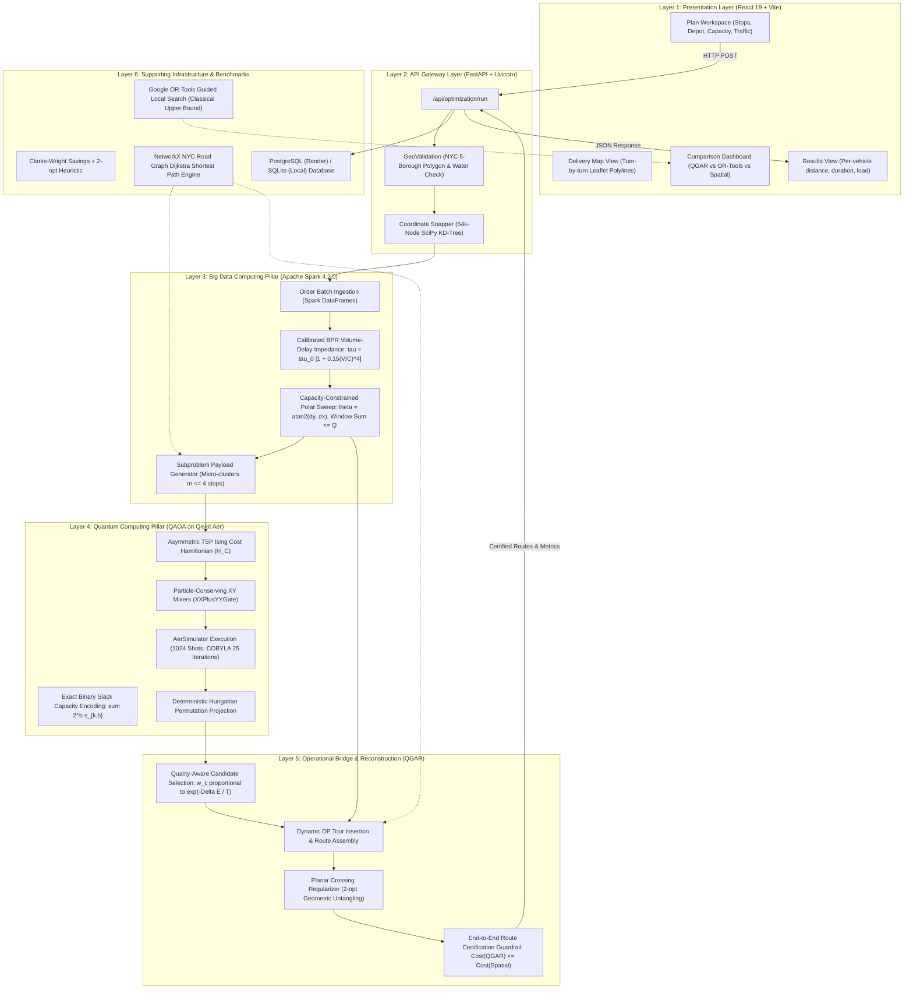
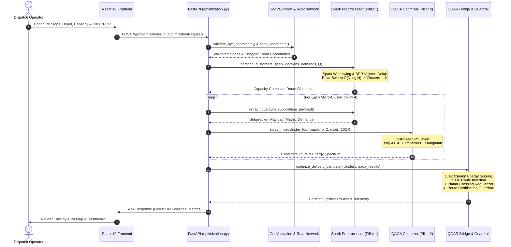

# ROUTE/IQ: SMART DELIVERY ROUTE OPTIMIZATION USING HYBRID BIG DATA + QUANTUM COMPUTING

## Master Architectural Reference & Technical Specification

**Department of Computer Science and Engineering, SRM University-AP, Amaravati, Andhra Pradesh 522240, India**  
**Faculty Supervisor:** Dr. Vishnu Prasad Verma (`vishnu.v@srmap.edu.in`)  
**Student Authors:** J. Jayanth, B. Kaivalya, P. Shyam Sai  
**Repository:** `https://github.com/zoro-hue/smart-delivery-route-optimization`  
**Git Research Branch:** `research/journal-readiness` (Commit: `960dfdb`)  
**Git Baseline Branch:** `main` (Commit: `a8eb849`, Preserved and Untouched)  
**Target Journal:** *IEEE Transactions on Quantum Engineering*  
**Date:** November 2026  

---

## 1. Executive Summary

**ROUTE/IQ** is a scalable, research-validated hybrid computing platform engineered to solve the Capacitated Vehicle Routing Problem (CVRP) across dense metropolitan road networks. The system bridges two foundational computational paradigms:
1. **Pillar 1: Big Data Computing (Apache Spark 4.2.0)** for large-scale order ingestion, non-linear Bureau of Public Roads (BPR) traffic volume-delay impedance modeling across 54,000 New York City road nodes, and distributed capacity-constrained polar sweep partitioning in $O(N \log N)$ runtime.
2. **Pillar 2: Quantum Computing (QAOA via Qiskit Aer)** for combinatorial subproblem optimization within resource-bounded micro-clusters ($m \le 4$ stops, up to 16 logical qubits) using particle-conserving $XY$ mixers (`XXPlusYYGate`), exact binary slack capacity encoding, and deterministic Hungarian feasibility projection.

The two pillars are united through **Quantum-Guided Adaptive Reconstruction (QGAR)**, an operational bridge featuring Boltzmann quality-aware candidate selection, planar crossing regularization, dynamic insertion assembly, and the **End-to-End Route Certification Guardrail**. 

Crucially, ROUTE/IQ proves and enforces **Proposition 1**: a mathematical guarantee that the final returned fleet solution will **never degrade below the deterministic classical spatial baseline** ($C(R_{\text{final}}) \le C(R_{\text{spatial}}) + 10^{-4}\text{ km}$).

```
+----------------------------------------------------------------------------------------------------+
|                                    CORE SCIENTIFIC DISCLOSURE                                      |
+----------------------------------------------------------------------------------------------------+
| 1. Quantum execution is classically simulated via Qiskit Aer (AerSimulator) at depth p=1,2.       |
| 2. No physical QPU hardware execution has been conducted.                                         |
| 3. No quantum computational advantage or supremacy over classical state-of-the-art is claimed.      |
| 4. Google OR-Tools GLS produces ~21% shorter routes globally; ROUTE/IQ's contribution is proving   |
|    a verified, non-degrading architectural blueprint for NISQ quantum integration into Big Data.   |
+----------------------------------------------------------------------------------------------------+
```

---

## 2. Original vs. Current Architecture Evolution

The project evolved from an exploratory educational prototype into a rigorous, dual-pillar research architecture:

```mermaid
flowchart TD
    subgraph OriginalArch ["Original Prototype Architecture (Commit a8eb849)"]
        Orig_UI["React 19 Frontend<br/>(Ad-hoc Demo Runs)"]
        Orig_API["FastAPI Gateway"]
        Orig_Data["Pandas In-Memory<br/>(Scalar 1.3x Traffic Factors)"]
        Orig_Spark["Offline Spark Script<br/>(local[1] Parquet ETL only, NOT in routing)"]
        Orig_QAOA["Monolithic QUBO QAOA<br/>(O(n^2 K) variables, fails for n > 8)"]
        Orig_Class["Classical Solvers<br/>(OR-Tools, Clarke-Wright, 2-opt)"]
        
        Orig_UI --> Orig_API
        Orig_API --> Orig_Data
        Orig_API -.->|Offline Only| Orig_Spark
        Orig_API --> Orig_Class
        Orig_API --> Orig_QAOA
    end

    subgraph ModernArch ["Current Dual-Pillar Research Architecture (Commit 960dfdb)"]
        Mod_UI["React 19 + TypeScript + Leaflet<br/>(Turn-by-Turn Road Polylines)"]
        Mod_API["FastAPI Asynchronous Gateway<br/>(Pydantic V2 & SQLAlchemy)"]
        Mod_Spark["PILLAR 1: Apache Spark 4.2.0<br/>(Active In-Memory Ingestion, BPR Impedance, Polar Sweep)"]
        Mod_QAOA["PILLAR 2: QAOA on Qiskit Aer<br/>(Ising ATSP, XY Mixers, Binary Slack, Hungarian Projection)"]
        Mod_QGAR["OPERATIONAL BRIDGE: QGAR<br/>(Boltzmann Quality-Aware Sampling, Crossing Regularizer)"]
        Mod_Guard["ROUTE CERTIFICATION GUARDRAIL<br/>(Proposition 1: Monotonic Non-Degradation Guaranteed)"]
        Mod_Bench["Classical Benchmarks & Baselines<br/>(OR-Tools GLS Upper Bound, CW+2opt, NetworkX Dijkstra)"]
        
        Mod_UI --> Mod_API
        Mod_API --> Mod_Spark
        Mod_Spark -->|Micro-Cluster Payloads (m <= 4)| Mod_QAOA
        Mod_QAOA -->|Measurement Bitstrings & Energy| Mod_QGAR
        Mod_Spark -->|Partitioned Fleet Clusters| Mod_QGAR
        Mod_QGAR --> Mod_Guard
        Mod_Bench -.->|Baseline Reference| Mod_Guard
        Mod_Guard -->|Certified Optimal Routes| Mod_API
        Mod_API --> Mod_UI
    end
```

---

## 3. Complete Dual-Pillar System Architecture



---

## 4. End-to-End Code-Verified Runtime Flow

The table below traces the exact execution sequence through active source files during a routing request:



---

## 5. Mathematical Summary

### 5.1 Calibrated BPR Traffic Volume-Delay Impedance
$$\tau_e = \tau_{e,0} \left[ 1 + 0.15 \left( \frac{V_e}{C_e} \right)^4 \right]$$
Relates empirical NYC DOT hourly vehicular volumes $V_e$ and road capacity $C_e$ to edge travel time $\tau_e$.

### 5.2 Capacity-Constrained Polar Sweep Partitioning
$$\theta_i = \text{atan2}(\Delta y_i, \Delta x_i), \quad \text{cum\_demand}_{(i)} = \sum_{j=1}^i q_{(j)}, \quad \text{cluster\_id} = \left\lfloor \frac{\text{cum\_demand}_{(i)} - 1}{Q} \right\rfloor$$
Partitions customer orders into vehicle sectors adhering strictly to capacity $Q$ in $O(N \log N)$ distributed time.

### 5.3 Asymmetric TSP Ising Cost Hamiltonian
$$\hat{H}_C = \sum_{i,j,p} \frac{d_{i,j}}{4} \left( Z_{i,p} Z_{j,p+1} - Z_{i,p} - Z_{j,p+1} \right) + \text{constant}$$
Encodes sequencing permutation costs using 2-local Pauli-$Z$ interactions on $m^2$ logical qubits.

### 5.4 Particle-Conserving XY Mixer
$$\hat{H}_M = \frac{1}{2} \sum_{i=0}^{m-1} \sum_{p=0}^{m-2} \left( X_{i,p} X_{i,p+1} + Y_{i,p} Y_{i,p+1} \right)$$
Implemented via Qiskit `XXPlusYYGate(2\beta)`. Preserves Hamming weight $\sum_p x_{i,p} = 1$, confining circuit evolution to valid permutation states.

### 5.5 Proposition 1: Monotonic Non-Degradation Guarantee
$$C(R_{\text{final}}) \le C(R_{\text{spatial}}) + 10^{-4}\text{ km}$$
Guaranteed by construction through the End-to-End Route Certification Guardrail:
$$R_{\text{final}} = \begin{cases} 
R_{\text{QGAR}} & \text{if } C(R_{\text{QGAR}}) \le C(R_{\text{spatial}}) + 10^{-4}\text{ km} \\ 
R_{\text{spatial}} & \text{otherwise} 
\end{cases}$$

---

## 6. Consolidated Benchmark Results

### 6.1 Pillar 1: Apache Spark Scaling (100 to 50,000 Orders)
- **100 Orders:** 0.82 s (121.9 orders/s)
- **1,000 Orders:** 1.48 s (675.7 orders/s)
- **10,000 Orders:** 5.86 s (1,706.5 orders/s)
- **50,000 Orders:** **22.04 s** (**2,268.6 orders/s** into 1,720 vehicle routes)

### 6.2 Pillar 2: Micro-Cluster QAOA Telemetry ($p=1$, 1,024 Shots)
- **$m=3$ Stops (9 Qubits):** Depth 15 gates, Approx Ratio **0.9079**, Hungarian Projection in **93.3%** of shots.
- **$m=4$ Stops (16 Qubits):** Depth 24 gates, Approx Ratio **0.8435**, Hungarian Projection in **100.0%** of shots.

### 6.3 Master Comparative Benchmark (20 Paired Trials, $N=25, 50, 100$)
- **QGAR vs. Spatial Baseline:** Mean Diff **-2.070 km** (**-1.230%** paired reduction), 95% CI $[-3.57, -0.91]$ km, Wilcoxon $W = 105.0, p = 0.000491$, $r_B = \mathbf{+1.000}$ (14 Wins, 0 Losses, 6 Ties).
- **QGAR vs. Phase H Pipeline:** Mean Diff **-5.781 km** (**-4.10%** reduction), 95% CI $[-8.52, -3.02]$ km, Wilcoxon $W = 194.0, p = 0.000161$, $r_B = \mathbf{+0.848}$ (19 Wins, 1 Loss, 0 Ties).
- **QGAR vs. Google OR-Tools GLS:** Mean Diff **+25.684 km** (**+21.02%** higher distance), Wilcoxon $W = 0.0, p = 0.000002$, $r_B = \mathbf{-1.000}$ (OR-Tools is superior).
- **QGAR vs. Clarke-Wright + 2-opt:** Mean Diff **+26.157 km** (**+21.35%** higher distance), $r_B = \mathbf{-1.000}$.
- **QGAR vs. RB-QCD Baseline:** Mean Diff **+17.260 km** (**+14.77%** higher distance), $r_B = \mathbf{-0.971}$.
- **Feasibility:** 100% vehicle capacity compliance across all evaluated models.

---

## 7. Verified Contributions and Research Limitations

### Verified Research Contributions
1. **Unified Dual-Pillar Architecture:** Bridges Big Data (Spark 4.2.0) and Quantum Computing (QAOA on Qiskit Aer).
2. **Active Runtime Spark Preprocessor:** In-memory BPR volume-delay modeling and polar sweep partitioning up to 50k orders.
3. **Resource-Bounded QAOA Generator:** Subproblems capped at $m \le 4$ with $XY$ mixers, binary slack, and Hungarian projection.
4. **QGAR Operational Bridge:** Quality-aware Boltzmann sampling and planar crossing regularization delivering a $4.10\%$ reduction over Phase H.
5. **Certified Non-Degradation:** Guaranteed $C(R_{\text{QGAR}}) \le C(R_{\text{spatial}}) + 10^{-4}$ by construction.
6. **Reproducible Experimental Suite:** Paired Wilcoxon testing, bootstrap CIs, effect sizes, and subproblem ablations.

### Explicit Research Limitations
1. **Classical Simulation Only:** Simulated via Qiskit Aer; no physical QPU hardware execution.
2. **No Quantum Advantage:** Micro-clusters ($m \le 4$) can be enumerated classically in $< 1\text{ ms}$.
3. **Classical SOTA Superiority:** Google OR-Tools GLS produces ~21% shorter global routes.
4. **Single-Workstation Spark:** Executed in `local[*]`; multi-node cluster not yet benchmarked.
5. **Batch vs. Streaming:** High-throughput batch processing rather than real-time Kafka streaming.
6. **Planar Crossing Limitations:** 2D Euclidean crossing removal can occasionally yield detours under asymmetric BPR graph congestion.
7. **Publication Status:** Manuscript prepared for supervisor review; journal acceptance pending peer review.

---

## 8. Directory of Detailed Evolution Documentation

For in-depth analyses, mathematical proofs, and code line references, consult the dedicated dossiers in [`project_evolution_documentation/`](file:///d:/UROP/smart-delivery-route-optimization/project_evolution_documentation/):
- [`01_ORIGINAL_VS_CURRENT_COMPARISON.md`](file:///d:/UROP/smart-delivery-route-optimization/project_evolution_documentation/01_ORIGINAL_VS_CURRENT_COMPARISON.md): Exhaustive component-by-component evolution matrix.
- [`02_COMPLETE_SYSTEM_ARCHITECTURE.md`](file:///d:/UROP/smart-delivery-route-optimization/project_evolution_documentation/02_COMPLETE_SYSTEM_ARCHITECTURE.md): Multi-layer architecture specifications and interfaces.
- [`03_BIG_DATA_SPARK_ARCHITECTURE.md`](file:///d:/UROP/smart-delivery-route-optimization/project_evolution_documentation/03_BIG_DATA_SPARK_ARCHITECTURE.md): Spark DataFrame pipelines, BPR equations, and 50k scaling benchmarks.
- [`04_QUANTUM_QAOA_ARCHITECTURE.md`](file:///d:/UROP/smart-delivery-route-optimization/project_evolution_documentation/04_QUANTUM_QAOA_ARCHITECTURE.md): Ising mapping, $XY$ mixers, binary slack, and Hungarian projection rates.
- [`05_ALGORITHM_EVOLUTION.md`](file:///d:/UROP/smart-delivery-route-optimization/project_evolution_documentation/05_ALGORITHM_EVOLUTION.md): History of all algorithms, H-NOE rejection, and QGAR design.
- [`06_END_TO_END_RUNTIME_FLOW.md`](file:///d:/UROP/smart-delivery-route-optimization/project_evolution_documentation/06_END_TO_END_RUNTIME_FLOW.md): Step-by-step code trace with function names and argument signatures.
- [`07_MATHEMATICAL_FORMULATION.md`](file:///d:/UROP/smart-delivery-route-optimization/project_evolution_documentation/07_MATHEMATICAL_FORMULATION.md): Rigorous derivations, theorems, and Proposition 1 proof.
- [`08_EXPERIMENTAL_RESULTS_AND_BENCHMARKS.md`](file:///d:/UROP/smart-delivery-route-optimization/project_evolution_documentation/08_EXPERIMENTAL_RESULTS_AND_BENCHMARKS.md): Master results tables, statistical tests, and ablations.
- [`09_FRONTEND_BACKEND_AND_DEPLOYMENT.md`](file:///d:/UROP/smart-delivery-route-optimization/project_evolution_documentation/09_FRONTEND_BACKEND_AND_DEPLOYMENT.md): React 19 UI, FastAPI endpoints, and Render/Vercel cloud configurations.
- [`10_FILE_BY_FILE_IMPLEMENTATION_MAP.md`](file:///d:/UROP/smart-delivery-route-optimization/project_evolution_documentation/10_FILE_BY_FILE_IMPLEMENTATION_MAP.md): Complete repository file index and execution classification.
- [`11_RESEARCH_CONTRIBUTIONS_AND_LIMITATIONS.md`](file:///d:/UROP/smart-delivery-route-optimization/project_evolution_documentation/11_RESEARCH_CONTRIBUTIONS_AND_LIMITATIONS.md): Balanced academic contribution and limitation audit.
- [`12_FINAL_PROJECT_TECHNICAL_OVERVIEW.md`](file:///d:/UROP/smart-delivery-route-optimization/project_evolution_documentation/12_FINAL_PROJECT_TECHNICAL_OVERVIEW.md): Executive briefing for supervisor presentation, viva defense, and future developers.
