# ROUTE/IQ: COMPLETE OLD VERSION VS NEW VERSION FORENSIC SYSTEM AUDIT

## Master Synthesis & End-to-End Software Comparative Audit

**Department of Computer Science and Engineering, SRM University-AP, Amaravati, Andhra Pradesh 522240, India**  
**Faculty Supervisor:** Dr. Vishnu Prasad Verma (`vishnu.v@srmap.edu.in`)  
**Student Authors:** J. Jayanth, B. Kaivalya, P. Shyam Sai  
**Repository:** `https://github.com/zoro-hue/smart-delivery-route-optimization`  
**Git Research Branch:** `research/journal-readiness` (Commit: `feb0920`)  
**Git Baseline Branch:** `main` (Commit: `a8eb849`, Preserved and Untouched)  
**Target Journal:** *IEEE Transactions on Quantum Engineering*  
**Audit Date:** November 5, 2026  

---

## 1. Executive Summary & Forensic Scorecard

This document represents the master forensic audit of **ROUTE/IQ**, providing an exhaustive, source-code-grounded comparison between the **original version** (as preserved on branch `main` at commit `a8eb849`) and the **current final research version** (on branch `research/journal-readiness` at commit `feb0920`).

The investigation audited every sector of the application: 11 frontend pages, 27 REST API endpoints, 14 backend service modules, 3 relational database tables, 5 filesystem storage tiers, 38 automated test cases, and 8 scientific benchmark scripts.

```
====================================================================================================
                             ROUTE/IQ FORENSIC SYSTEM AUDIT SCORECARD
====================================================================================================
Repository Location:             D:\UROP\smart-delivery-route-optimization
Git Research Branch:             research/journal-readiness (Commit: feb0920)
Git Baseline Branch:             main (Commit: a8eb849 - Pristine, Untouched)
Total Files Audited:             118 files across frontend, backend, data, and scripts
Total Lines of Code Examined:    ~32,000 lines (TypeScript, Python, SQL, LaTeX, Markdown)
Backend Test Suite Status:       38 of 38 unit & integration tests passing (100% pass rate in 71.62s)
Architecture Evolution:          Transitioned from an exploratory web prototype with isolated solvers
                                 into a formalized Dual-Pillar Hybrid Computing Routing Architecture
Pillar 1: Big Data Computing:    Apache Spark 4.2.0 (Active runtime preprocessor, BPR traffic volume
                                 delay, polar sweep partitioning validated up to 50,000 orders)
Pillar 2: Quantum Computing:     QAOA on Qiskit Aer (Ising ATSP mapping, particle-conserving XY mixers,
                                 exact binary slack capacity, Hungarian feasibility projection, m <= 4)
Operational Bridge (QGAR):       Quality-Aware Boltzmann Candidate Sampling, Planar Crossing Regularizer,
                                 and Proposition 1 End-to-End Route Certification Guardrail
Monotonic Non-Degradation:       PROVEN BY CONSTRUCTION: C(R_final) <= C(R_spatial) + 1e-4 km
====================================================================================================
```

---

## 2. High-Level Summary of What Changed

```mermaid
flowchart TD
    subgraph OldSystem ["Original Prototype (main @ a8eb849)"]
        O1["Frontend Web Demo (React 19)"]
        O2["FastAPI Solver Dispatcher"]
        O3["In-Memory Pandas (Scalar 1.3x Traffic)"]
        O4["Offline PySpark ETL (local[1], Parquet only)"]
        O5["Monolithic QUBO QAOA (O(n^2 K) vars, <= 8 stops)"]
        O6["Classical Solvers (OR-Tools, Clarke-Wright, 2-opt)"]
        
        O1 --> O2
        O2 --> O3
        O2 --> O6
        O2 --> O5
        O2 -.->|Admin Trigger Only| O4
    end

    subgraph NewSystem ["Current Research System (research/journal-readiness @ feb0920)"]
        N1["Enhanced React 19 Cockpit (Leaflet Polylines)"]
        N2["FastAPI Asynchronous Gateway"]
        N3["PILLAR 1: SparkRoutingPreprocessor (local[*])<br/>(BPR Impedance + Polar Sweep O(N log N) up to 50k)"]
        N4["PILLAR 2: QAOASubproblemOptimizer (Qiskit Aer)<br/>(Ising ATSP + XY Mixers + Hungarian Projection, m <= 4)"]
        N5["OPERATIONAL BRIDGE: QGAR Pipeline<br/>(Boltzmann Quality-Aware Sampling + Crossing Regularizer)"]
        N6["ROUTE CERTIFICATION GUARDRAIL<br/>(Proposition 1: Monotonic Non-Degradation Guaranteed)"]
        N7["Rigorous Evaluation Suite (OR-Tools Upper Bound)"]
        
        N1 --> N2
        N2 --> N3
        N3 -->|Micro-Clusters m <= 4| N4
        N4 -->|Sampled Bitstrings & Energy| N5
        N3 -->|Partitioned Fleet Clusters| N5
        N5 --> N6
        N7 -.->|Spatial Baseline Reference| N6
        N6 -->|Certified Optimal Routes| N2
        N2 --> N1
    end
```



### 2.1 The Ten Foundational Upgrades
1. **From Offline ETL to Active Runtime Preprocessor:** Spark transitioned from an offline utility (`bigdata_pipeline.py`) into an active in-memory preprocessor (`SparkRoutingPreprocessor`) computing volume-delay impedance and polar sweep partitioning for up to 50,000 orders in 22 seconds.
2. **From Monolithic QUBO to Resource-Bounded Micro-Clusters:** Replaced the intractable $O(n^2 K)$ global QUBO in `quantum_solver.py` with structured micro-clusters ($m \le 4$, up to 16 qubits) in `qaoa_subproblem_optimizer.py`.
3. **From Transverse-Field to Particle-Conserving $XY$ Mixers:** Replaced standard Pauli-$X$ mixers with `XXPlusYYGate` operations, preserving Hamming weight and confining state evolution to the one-hot permutation subspace.
4. **From Soft Penalties to Exact Binary Slack:** Replaced quadratic capacity penalty tuning with exact binary slack variables $\sum 2^b s_{k,b}$.
5. **From Stochastic Bitstrings to Hungarian Projection:** Bounded shallow-circuit quantum noise by using the Hungarian algorithm (bipartite matching) as a deterministic projection to guarantee 100% permutation feasibility.
6. **From Isolated Solvers to QGAR Bridge:** Developed `qgar_pipeline.py` with Boltzmann energy weighting, dynamic insertion, and planar crossing regularizers, delivering a **$4.10\%$ distance reduction** over Phase H.
7. **From Degraded Routes to Certified Non-Degradation:** Proved and enforced **Proposition 1**: the End-to-End Route Certification Guardrail guarantees that hybrid solutions never degrade below deterministic spatial baselines ($C_{\text{final}} \le C_{\text{spatial}} + 10^{-4}\text{ km}$).
8. **From Ad-Hoc Demos to Paired Statistical Testing:** Replaced single-run browser tests with 20 paired trials, bootstrap 95% CIs, Wilcoxon signed-rank tests ($p < 0.001$), effect sizes ($r_B$), and Benjamini-Hochberg FDR corrections.
9. **From Unsubstantiated Claims to Scientific Candor:** Formally disclosed that all quantum circuits execute via classical simulation on Qiskit Aer, that no physical QPU runs were performed, and that Google OR-Tools GLS produces ~21% shorter routes globally.
10. **From 12 to 38 Automated Tests:** Expanded backend test coverage by **+216%**, validating Spark DataFrames, BPR impedance, $XY$ mixers, Hungarian projection, QGAR guardrails, and H-NOE regressions.

---

## 3. Master Comparative Benchmark Results (Table 3 / Table 9 Reconciled)

Comprehensive evaluation across **20 paired benchmark trials** ($N=25, 50, 100$ stops across Manhattan, Brooklyn, and Queens) from `phase_i_qgar_benchmark_raw.csv`. All comparisons measure **QGAR minus Baseline** (negative $\Delta$ indicates QGAR produces shorter travel distance):

| Comparative Baseline | Baseline Distance (km) | QGAR Distance (km) | Paired Diff $\Delta$ (km) | Paired % Reduction | 95% Bootstrap CI (km) | Wilcoxon Signed-Rank ($W, p$) | Rank-Biserial Effect Size ($r_B$) | Outcome (Wins / Losses / Ties) |
| :--- | :---: | :---: | :---: | :---: | :---: | :---: | :---: | :---: |
| **Deterministic Spatial Baseline** | 154.340 km | 152.270 km | **-2.070 km** | **-1.230%** | $[-3.57, -0.91]$ km | $W = 105.0, p = 0.000491$ | $\mathbf{+1.000}$ | 14 Wins / 0 Losses / 6 Ties |
| **Phase H Hybrid Pipeline** | 158.051 km | 152.270 km | **-5.781 km** | **-4.10%** | $[-8.52, -3.02]$ km | $W = 194.0, p = 0.000161$ | $\mathbf{+0.848}$ | 19 Wins / 1 Loss / 0 Ties |
| **Google OR-Tools GLS** | 126.586 km | 152.270 km | **+25.684 km** | **+21.02%** | $[+18.34, +33.67]$ km | $W = 0.0, p = 0.000002$ | $\mathbf{-1.000}$ | 0 Wins / 20 Losses / 0 Ties |
| **Clarke-Wright + 2-opt** | 126.113 km | 152.270 km | **+26.157 km** | **+21.35%** | $[+18.05, +34.84]$ km | $W = 0.0, p = 0.000002$ | $\mathbf{-1.000}$ | 0 Wins / 20 Losses / 0 Ties |
| **RB-QCD Decomposition** | 135.010 km | 152.270 km | **+17.260 km** | **+14.77%** | $[+11.23, +24.03]$ km | $W = 3.0, p = 0.000010$ | $\mathbf{-0.971}$ | 1 Win / 19 Losses / 0 Ties |

---

## 4. Operational Reality Check: What is Genuinely Working

A critical finding of this audit is that ROUTE/IQ currently operates as a **two-tier architecture**:

```
[TIER 1: LIVE CLOUD WEB APPLICATION]
React 19 Frontend -> FastAPI Gateway -> Classical Solvers (OR-Tools, Clarke-Wright, 2-opt, QIGA, Legacy QAOA)
- Status: FULLY OPERATIONAL on Render & Vercel.
- Execution: 23 REST endpoints active, 54k-node road network cached, Leaflet turn-by-turn polylines rendered.

[TIER 2: SCIENTIFIC RESEARCH & BENCHMARK PIPELINE]
Automated Scripts -> Apache Spark 4.2.0 Preprocessor -> QAOA Subproblem Optimizer -> QGAR Bridge & Guardrail
- Status: FULLY IMPLEMENTED, TESTED (38/38 passing), and BENCHMARKED.
- Execution: Scales to 50k orders in Spark, simulates 16-qubit circuits in Qiskit Aer, logs paired trials.
- Integration Gap: Currently invoked via backend/scripts/ and tests, NOT wired into /api/optimization/run.
```

---

## 5. Directory of All 18 Forensic Audit Reports

For exhaustive code line references, class declarations, API schemas, and mathematical proofs, consult the 18 specialized reports in [`complete_old_vs_new_system_audit/`](file:///d:/UROP/smart-delivery-route-optimization/complete_old_vs_new_system_audit/):

1. [`01_EXECUTIVE_OLD_VS_NEW_COMPARISON.md`](file:///d:/UROP/smart-delivery-route-optimization/complete_old_vs_new_system_audit/01_EXECUTIVE_OLD_VS_NEW_COMPARISON.md): Forensic overview, scorecard, and architectural evolution.
2. [`02_COMPLETE_FRONTEND_AUDIT.md`](file:///d:/UROP/smart-delivery-route-optimization/complete_old_vs_new_system_audit/02_COMPLETE_FRONTEND_AUDIT.md): Detailed page-by-page, component-by-component frontend investigation.
3. [`03_COMPLETE_BACKEND_AUDIT.md`](file:///d:/UROP/smart-delivery-route-optimization/complete_old_vs_new_system_audit/03_COMPLETE_BACKEND_AUDIT.md): FastAPI lifespan, service layer, Pydantic schemas, and concurrency model.
4. [`04_API_ENDPOINTS_AND_INTEGRATION_AUDIT.md`](file:///d:/UROP/smart-delivery-route-optimization/complete_old_vs_new_system_audit/04_API_ENDPOINTS_AND_INTEGRATION_AUDIT.md): Complete 27-endpoint catalog, request/response models, and frontend callers.
5. [`05_DATABASE_STORAGE_AND_DATA_FLOW_AUDIT.md`](file:///d:/UROP/smart-delivery-route-optimization/complete_old_vs_new_system_audit/05_DATABASE_STORAGE_AND_DATA_FLOW_AUDIT.md): SQLite, PostgreSQL, Parquet stores, and data lifecycle.
6. [`06_BIG_DATA_SPARK_COMPLETE_AUDIT.md`](file:///d:/UROP/smart-delivery-route-optimization/complete_old_vs_new_system_audit/06_BIG_DATA_SPARK_COMPLETE_AUDIT.md): Spark DataFrame transformations, BPR model, and 50k scaling audit.
7. [`07_QUANTUM_QAOA_COMPLETE_AUDIT.md`](file:///d:/UROP/smart-delivery-route-optimization/complete_old_vs_new_system_audit/07_QUANTUM_QAOA_COMPLETE_AUDIT.md): Micro-cluster Ising mapping, $XY$ mixers, binary slack, and Hungarian projection.
8. [`08_OPTIMIZATION_AND_ROUTING_AUDIT.md`](file:///d:/UROP/smart-delivery-route-optimization/complete_old_vs_new_system_audit/08_OPTIMIZATION_AND_ROUTING_AUDIT.md): 13-algorithm comparative profiles, complexity, and status.
9. [`09_ROAD_NETWORK_TRAFFIC_WEATHER_AUDIT.md`](file:///d:/UROP/smart-delivery-route-optimization/complete_old_vs_new_system_audit/09_ROAD_NETWORK_TRAFFIC_WEATHER_AUDIT.md): 54k-node OSM graph, KD-Tree snapping, and NYC DOT traffic volume integration.
10. [`10_END_TO_END_RUNTIME_EXECUTION_AUDIT.md`](file:///d:/UROP/smart-delivery-route-optimization/complete_old_vs_new_system_audit/10_END_TO_END_RUNTIME_EXECUTION_AUDIT.md): Trace of live web runtime vs scientific benchmark execution paths.
11. [`11_DEPLOYMENT_AND_INFRASTRUCTURE_AUDIT.md`](file:///d:/UROP/smart-delivery-route-optimization/complete_old_vs_new_system_audit/11_DEPLOYMENT_AND_INFRASTRUCTURE_AUDIT.md): Vercel, Render, Docker, and 512MB RAM memory optimizations.
12. [`12_SECURITY_RELIABILITY_PERFORMANCE_AUDIT.md`](file:///d:/UROP/smart-delivery-route-optimization/complete_old_vs_new_system_audit/12_SECURITY_RELIABILITY_PERFORMANCE_AUDIT.md): Security posture, fault tolerance, fallback mechanisms, and performance metrics.
13. [`13_TESTING_AND_CODE_QUALITY_AUDIT.md`](file:///d:/UROP/smart-delivery-route-optimization/complete_old_vs_new_system_audit/13_TESTING_AND_CODE_QUALITY_AUDIT.md): 38-test audit, dead code analysis, and test coverage mapping.
14. [`14_COMPLETE_FILE_BY_FILE_CHANGELOG.md`](file:///d:/UROP/smart-delivery-route-optimization/complete_old_vs_new_system_audit/14_COMPLETE_FILE_BY_FILE_CHANGELOG.md): Itemized file-by-file changelog between commits `a8eb849` and `feb0920`.
15. [`15_ACTUAL_WORKING_STATUS_MATRIX.md`](file:///d:/UROP/smart-delivery-route-optimization/complete_old_vs_new_system_audit/15_ACTUAL_WORKING_STATUS_MATRIX.md): The essential 8-category reality check separating code existence from runtime invocation.
16. [`16_ORIGINAL_VS_CURRENT_COMPLETE_COMPARISON_MATRIX.md`](file:///d:/UROP/smart-delivery-route-optimization/complete_old_vs_new_system_audit/16_ORIGINAL_VS_CURRENT_COMPLETE_COMPARISON_MATRIX.md): 34-category consolidated technical matrix.
17. [`17_COMPLETE_ARCHITECTURE_DIAGRAMS.md`](file:///d:/UROP/smart-delivery-route-optimization/complete_old_vs_new_system_audit/17_COMPLETE_ARCHITECTURE_DIAGRAMS.md): 14 verified Mermaid system diagrams.
18. [`18_REMAINING_ISSUES_AND_UNVERIFIED_FEATURES.md`](file:///d:/UROP/smart-delivery-route-optimization/complete_old_vs_new_system_audit/18_REMAINING_ISSUES_AND_UNVERIFIED_FEATURES.md): Critical analysis of technical debt, unverified claims, and future roadmap.
