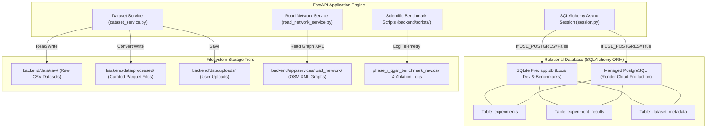

# 05 — DATABASE, STORAGE, AND PERSISTENCE AUDIT

**Project Title:** ROUTE/IQ: Smart Delivery Route Optimization Using Hybrid Big Data and Quantum Computing  
**Institution:** Department of Computer Science and Engineering, SRM University-AP  
**Original Version Baseline:** `main` at commit `a8eb849`  
**Current Research Baseline:** `research/journal-readiness` at commit `feb0920`  

---

## 1. Storage Architecture Overview

ROUTE/IQ utilizes a hybrid persistence architecture combining **relational SQL databases** (for experiment tracking, route metrics, and dataset cataloging) with **structured filesystem stores** (for OpenStreetMap graph XML, curated Parquet files, uploaded CSVs, and raw benchmark logs).



---

## 2. Relational Database Audit (SQLite vs. PostgreSQL)

### 2.1 Database Selection & Connection Lifecycle (`backend/app/db/session.py`)
The active database engine is controlled dynamically via environment variables in `backend/app/core/config.py`:
- **Local Development & Benchmarking:** Defaults to `USE_POSTGRES = False`. The database connection URL is `sqlite+aiosqlite:///./app.db`. SQLite runs locally in asynchronous mode via `aiosqlite`.
- **Render Cloud Production:** When `USE_POSTGRES = True` (or when `DATABASE_URL` starts with `postgresql://`), the backend converts the scheme to `postgresql+asyncpg://` and connects to Render's managed PostgreSQL instance.
- **Connection Engine:** Instantiated via `create_async_engine(DATABASE_URL, echo=False)`.
- **Session Factory:** Managed via `async_sessionmaker(engine, expire_on_commit=False, class_=AsyncSession)`.
- **FastAPI Dependency Injection:** Exposes `async def get_db() -> AsyncGenerator[AsyncSession, None]` used across API route handlers.

### 2.2 Relational Schema & ORM Models (`backend/app/models/models.py`)

#### Table 1: `experiments`
Stores high-level metadata for every optimization campaign executed:
- `id: String(36)`: Primary key (UUID v4).
- `name: String(255)`: Human-readable experiment label (e.g. `Optimization 20261105_194512`).
- `timestamp: DateTime(timezone=True)`: UTC execution timestamp.
- `algorithm: String(100)`: Comma-separated list of evaluated algorithms (e.g. `ortools,clarke_wright,qiga`).
- `num_customers: Integer`: Total delivery stops.
- `num_vehicles: Integer`: Total fleet vehicles allocated.
- `depot_lat: Float`, `depot_lon: Float`: Origin warehouse coordinates.
- `vehicle_capacity: Float`: Vehicle payload capacity threshold ($Q$).
- `weight_distance: Float`: Objective weighting parameter.
- `results`: One-to-many relationship linking to `experiment_results` (cascade delete enabled).

#### Table 2: `experiment_results`
Stores detailed per-algorithm solutions and vehicle routes for a specific experiment:
- `id: String(36)`: Primary key (UUID v4).
- `experiment_id: String(36)`: Foreign key referencing `experiments.id`.
- `algorithm: String(100)`: Specific algorithm key (`ortools`, `clarke_wright`, `qaoa`, etc.).
- `total_distance_km: Float`: Computed total fleet travel distance.
- `total_travel_time_min: Float`: Computed total fleet travel duration.
- `total_objective_cost: Float`: Scalar objective score.
- `computation_time_sec: Float`: Solver wall-clock runtime.
- `routes_json: JSON / Text`: Serialized JSON array of per-vehicle stop sequences, parcel loads, leg distances, and road-snapped geometries.
- `metrics_json: JSON / Text`: Detailed telemetry, including vehicle capacity utilization, solver convergence logs, and quantum circuit telemetry.

#### Table 3: `dataset_metadata`
Tracks registered and uploaded delivery datasets:
- `id: String(36)`: Primary key (deterministic hash or UUID).
- `name: String(255)`: Dataset name (e.g. `nyc_food_delivery_sample`).
- `filename: String(255)`: Physical filename on disk.
- `file_path: String(500)`: Absolute or portable relative path to file.
- `row_count: Integer`: Total customer records.
- `file_size_bytes: Integer`: File size in bytes.
- `status: String(50)`: Processing state (`raw`, `processing`, `processed`, `error`).
- `schema_json: JSON / Text`: Detected column headers and data types.

---

## 3. Filesystem Storage Audit

The platform maintains several dedicated filesystem storage directories:

| Directory Path | Contents & File Formats | Code Writer | Code Reader | Purpose & Runtime Status |
| :--- | :--- | :--- | :--- | :--- |
| `backend/data/raw/` | CSV datasets (`nyc_food_delivery.csv`, `synthetic_orders.csv`). | Bundled with repo; or saved during `POST /api/datasets/upload`. | `dataset_service.py`, `spark_routing_preprocessor.py` | Raw customer delivery orders. **Active**. |
| `backend/data/processed/` | Curated Apache Parquet files (`.parquet`). | `dataset_service.py` (`pyarrow.parquet.write_table`), `bigdata_pipeline.py`. | `optimization.py` (`get_delivery_stops`) | High-speed columnar cache. Can be queried via PyArrow without starting a JVM. **Active**. |
| `backend/data/uploads/` | Temporary uploaded CSV files. | `routes/datasets.py` (`upload_dataset`). | `dataset_service.py`. | Staging area for user-uploaded delivery files. **Active**. |
| `backend/data/results/` | Exported JSON and CSV experiment dumps. | `routes/optimization.py` (`export_experiment`). | Browser download. | Ephemeral export directory. **Active**. |
| `backend/app/services/road_network/` | OpenStreetMap XML files (`manhattan_osm.xml` ~25MB). | Bundled static asset. | `road_network_service.py` (`iterparse`). | Physical road-network street graph (54,000 nodes). **Active**. |
| Repository Root / Artifacts | Benchmark records (`phase_i_qgar_benchmark_raw.csv`, `qaoa_subproblem_ablation_results.csv`). | Benchmark scripts (`run_phase_i_qgar_benchmark.py`). | Manuscript generation scripts, audit dossiers. | Scientific evidence and empirical verification records. **Active**. |

---

## 4. End-to-End Data Flow Lifecycle

```
[1. CSV Ingestion]
User uploads CSV -> Stored in data/uploads/ -> Registered in dataset_metadata table (status: 'raw')

[2. Preprocessing & Curation]
POST /api/datasets/{id}/process -> Read CSV via PyArrow -> Validate NYC bounds ->
Convert to Parquet in data/processed/ -> Update dataset_metadata table (status: 'processed')

[3. Optimization Execution]
POST /api/optimization/run -> Read stops from Parquet/Request ->
Query OSM Graph for Dijkstra Matrix -> Execute Solver (OR-Tools / QGAR) ->
Create Experiment row in DB -> Create ExperimentResult row with routes_json -> Commit DB

[4. Client Visualization]
Frontend queries GET /api/experiments/{id} -> Reads routes_json ->
Renders Leaflet turn-by-turn road polylines on map
```
