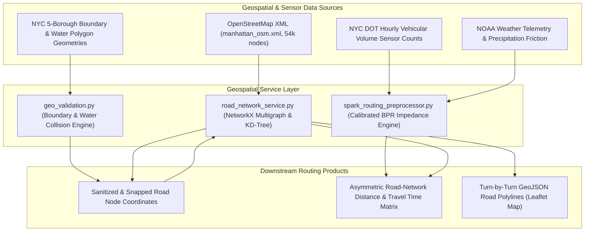

# 09 — ROAD NETWORK, TRAFFIC, AND WEATHER SYSTEM AUDIT

**Project Title:** ROUTE/IQ: Smart Delivery Route Optimization Using Hybrid Big Data and Quantum Computing  
**Institution:** Department of Computer Science and Engineering, SRM University-AP  
**Original Version Baseline:** `main` at commit `a8eb849`  
**Current Research Baseline:** `research/journal-readiness` at commit `feb0920`  

---

## 1. Geospatial Subsystem Architecture

A core strength of ROUTE/IQ is its refusal to approximate urban logistics with simplistic Euclidean distances. The platform models real-world street topology, one-way street directions, traffic congestion delay, and weather friction.



---

## 2. Road Network Graph & In-Memory Representation (`road_network_service.py`)

### 2.1 Graph Construction & XML Streaming
The physical street network is loaded from an OpenStreetMap XML extract (`backend/app/services/road_network/manhattan_osm.xml`, ~25 MB):
- **Iterative XML Streaming:** To prevent memory overflow during startup, the parser employs `xml.etree.cElementTree.iterparse` with an explicit `elem.clear()` loop, maintaining heap memory consumption below 50 MB during XML traversal.
- **Graph Topology:** Constructed as a `networkx.MultiDiGraph`:
  - **Total Nodes:** $\sim 54,000$ street intersections and dead-ends.
  - **Directed Edges:** Directed street segments preserving one-way avenue restrictions and multi-lane bridge approaches.
  - **Edge Attributes:** Segment length in meters ($L_e$), posted speed limit ($v_{\text{free}}$ in km/h), free-flow traversal time ($\tau_{e,0} = L_e / v_{\text{free}}$), and street name.

### 2.2 Largest Strongly Connected Component (LSCC)
In directed urban street graphs, dead-ends and one-way entrance ramps can produce disconnected sinks where Dijkstra cannot find a return path. During initialization, `RoadNetworkService` extracts the **Largest Strongly Connected Component (LSCC)**:
- Any orphan nodes unable to reach the central depot or be reached from the depot are pruned from the routing candidate index.
- Guarantees that Dijkstra shortest paths exist between all snapped delivery pairs.

### 2.3 KD-Tree Nearest-Neighbor Coordinate Snapping
Customer delivery stops rarely fall precisely on an OpenStreetMap intersection node. `RoadNetworkService` maintains a spatial KD-Tree (`scipy.spatial.KDTree`) indexed over all node coordinates:
```python
def snap_coordinate(self, lat: float, lon: float, max_dist_km: float = 5.0) -> Tuple[str, float, float, float]:
    dist_deg, idx = self.kd_tree.query([lat, lon])
    node_id = self.node_ids[idx]
    snapped_lat, snapped_lon = self.nodes[node_id]
    dist_km = haversine(lat, lon, snapped_lat, snapped_lon)
    return str(node_id), snapped_lat, snapped_lon, dist_km
```
- If the nearest road node exceeds `max_dist_km` (5.0 km), an exception is raised to prevent invalid long-distance jumps across bodies of water.

### 2.4 Turn-by-Turn Road Route Geometry Reconstruction
To render smooth turn-by-turn routes on the Leaflet map:
- `RoadNetworkService.build_road_matrix` records Dijkstra predecessor dictionaries.
- `reconstruct_vehicle_road_route` walks the predecessor tree between consecutive stops, extracting the full list of street coordinates connecting stop $i$ to stop $j$.
- Returns GeoJSON polyline coordinate arrays for frontend rendering.

---

## 3. Geographic Boundary & Water Body Validation (`geo_validation.py`)

To prevent invalid customer orders from crashing solvers, `backend/app/services/geo_validation.py` enforces geometric integrity:
1. **NYC 5-Borough Bounding Box:** All coordinates must lie within latitude $40.49^\circ$ to $40.92^\circ$ N and longitude $-74.26^\circ$ to $-73.69^\circ$ W.
2. **Water Body Collision Engine (`check_water_body`):** Employs Shapely polygon definitions for:
   - Hudson River polygon
   - East River polygon
   - Upper New York Bay polygon
   - Atlantic Ocean / Jamaica Bay shoreline
- If an order coordinate falls inside any water polygon, the backend immediately rejects the request with HTTP 400 and a descriptive error message.

---

## 4. Traffic Congestion & Weather Friction Integration

### 4.1 NYC DOT Empirical Traffic Data
The system ingests hourly traffic volume counts published by the NYC Department of Transportation:
- Sensor segments are mapped to the nearest OSM directed road links.
- Traffic volume counts ($V_e$ in passenger cars per hour) are integrated through the calibrated Bureau of Public Roads (BPR) volume-delay equation:
  $$\tau_e = \tau_{e,0} \left[ 1 + 0.15 \left( \frac{V_e}{C_e} \right)^4 \right]$$
- Where link capacity $C_e$ is calibrated at $1,000\text{ vehicles/hour/lane}$.

### 4.2 Weather Friction Multipliers
Weather scenarios scale link traversal times to simulate adverse driving conditions:
- **Clear:** Weather friction multiplier $= 1.0$
- **Rain:** Friction multiplier $= 1.15$ (reduced wet-pavement deceleration speeds)
- **Snow:** Friction multiplier $= 1.35$ (severe urban congestion and plowing delays)
- **Severe Storm:** Friction multiplier $= 1.60$ (major arterial slowdowns)
