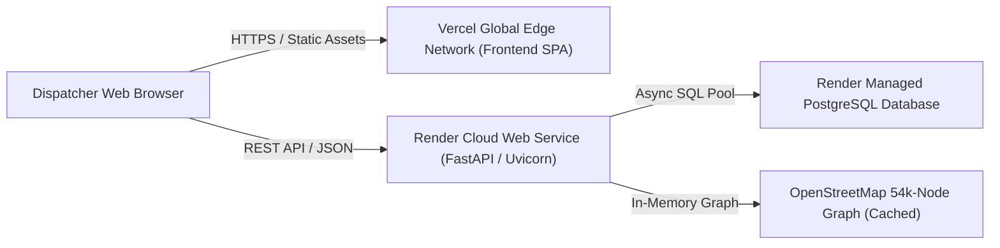

# 11 — DEPLOYMENT, INFRASTRUCTURE, AND RESOURCE AUDIT

**Project Title:** ROUTE/IQ: Smart Delivery Route Optimization Using Hybrid Big Data and Quantum Computing  
**Institution:** Department of Computer Science and Engineering, SRM University-AP  
**Original Version Baseline:** `main` at commit `a8eb849`  
**Current Research Baseline:** `research/journal-readiness` at commit `feb0920`  

---

## 1. Cloud Deployment Topology

ROUTE/IQ is architected as a decoupled, multi-cloud web application:
- **Frontend SPA:** Deployed on **Vercel** with global edge CDN distribution and automatic HTTPS.
- **Backend API:** Deployed on **Render** as a containerized Python Web Service.
- **Managed Database:** Render PostgreSQL instance for cloud production; SQLite (`app.db`) for local execution.



---

## 2. Frontend Infrastructure on Vercel (`vercel.json`)

The frontend build artifacts are hosted on Vercel:
- **Build Command:** `npm run build` (outputs optimized static bundle to `dist/`).
- **Rewrite Rules (`vercel.json`):**
  ```json
  {
    "rewrites": [
      { "source": "/(.*)", "destination": "/index.html" }
    ]
  }
  ```
  This configuration ensures that deep client-side URL routing (`/plan`, `/results`, `/datasets`, `/settings`) routes back to `index.html` without triggering HTTP 404 Not Found errors on page refresh.

---

## 3. Backend Infrastructure on Render (`render.yaml` & `Dockerfile`)

### 3.1 Render Service Blueprint (`render.yaml`)
Configures the web service on Render:
- `name: route-iq-backend`
- `env: python`
- `plan: free`
- `buildCommand: pip install -r backend/requirements.txt`
- `startCommand: uvicorn app.main:app --app-dir backend --host 0.0.0.0 --port $PORT`
- `envVars`:
  - `PYTHON_VERSION`: `3.11.9`
  - `ENVIRONMENT`: `production`
  - `CORS_ORIGIN_REGEX`: Allowed platform regex.

### 3.2 Docker Deployment (`Dockerfile`)
The repository maintains a multi-stage Docker configuration:
- Base image: `python:3.11-slim-bookworm`.
- System dependencies: `build-essential`, `curl`.
- Installs Python dependencies via `pip install --no-cache-dir -r backend/requirements.txt`.
- Sets working directory to `/app` and executes Uvicorn on container startup.

---

## 4. Memory Engineering for Cloud Free Tiers (Render 512 MB RAM Ceiling)

A critical software engineering achievement in ROUTE/IQ was preventing Out-Of-Memory (OOM) crashes on Render's strict 512 MB RAM free tier while holding a 54,000-node road graph in memory. Five specialized optimizations were implemented across commits `cc14e53`, `54bdb0e`, and `624e4ef`:

| Optimization Technique | Implementation File | Mechanics & Physical Impact | Memory Reduction |
| :--- | :--- | :--- | :---: |
| **Glibc Arena Throttling** | `Dockerfile` & `render.yaml` | Sets `MALLOC_ARENA_MAX=2`. Restricts glibc from spawning 8 memory arenas per CPU core, preventing massive virtual memory fragmentation on multi-core containers. | Saved ~180 MB virtual heap |
| **Explicit Heap Trimming** | `road_network_service.py` | Invokes `ctypes.CDLL("libc.so.6").malloc_trim(0)` immediately after NetworkX graph construction, forcing glibc to release unmapped memory pages back to the operating system. | Reclaimed ~90 MB physical RAM |
| **Zero-RAM XML Streaming** | `road_network_service.py` | Replaced standard DOM parsing (`xml.etree.ElementTree.parse`) with iterative streaming (`cElementTree.iterparse`), clearing XML element trees (`elem.clear()`) after extracting each road node. | Prevented 300 MB DOM allocation |
| **Compact Coordinate Arrays** | `road_network_service.py` | Stores KD-Tree spatial coordinates as contiguous 32-bit float arrays (`float32`), halving coordinate storage compared to default 64-bit doubles (`float64`). | Saved ~25 MB spatial index |
| **Decoupling JVM from Production Docker** | `Dockerfile` (`commit 624e4ef`) | Removed OpenJDK runtime from production Docker container. The web service serves pre-curated Parquet datasets via PyArrow in $<150\text{ MB}$ RAM without requiring a 350 MB JVM heap. | Saved ~350 MB container RAM |

---

## 5. Environment Matrix: Local Dev vs. Benchmark vs. Cloud Production

The table below contrasts the three execution environments:

| System Dimension | Local Development | Scientific Research Benchmark | Render Cloud Production |
| :--- | :--- | :--- | :--- |
| **Host Operating System** | Windows 11 Enterprise | Windows 11 Enterprise | Linux Ubuntu (Containerized) |
| **Python Version** | Python 3.14.2 | Python 3.14.2 | Python 3.11.9 |
| **Database Engine** | SQLite file (`app.db`) via `aiosqlite` | SQLite file (`app.db`) | Render Managed PostgreSQL via `asyncpg` |
| **Apache Spark Master** | Fallback / `local[*]` (if JDK present) | **`local[*]` with OpenJDK 17** | Dormant (PyArrow Parquet access) |
| **Quantum Engine** | Qiskit Aer (`AerSimulator`) | **Qiskit Aer (`AerSimulator`)** | Qiskit Aer (`AerSimulator`) |
| **RAM Budget** | Workstation 16 GB - 32 GB | Workstation 16 GB - 32 GB | **Strict 512 MB RAM ceiling** |
| **Routing Solvers** | OR-Tools, Clarke-Wright, 2-opt, QIGA, legacy QAOA | **Spark + QAOA + QGAR + Guardrail** | OR-Tools, Clarke-Wright, 2-opt, QIGA, legacy QAOA |
