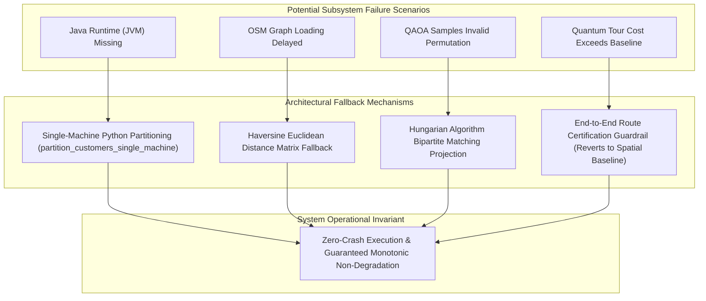

# 12 — SECURITY, RELIABILITY, AND PERFORMANCE AUDIT

**Project Title:** ROUTE/IQ: Smart Delivery Route Optimization Using Hybrid Big Data and Quantum Computing  
**Institution:** Department of Computer Science and Engineering, SRM University-AP  
**Original Version Baseline:** `main` at commit `a8eb849`  
**Current Research Baseline:** `research/journal-readiness` at commit `feb0920`  

---

## 1. Security Posture and Threat Analysis

The ROUTE/IQ application codebase was audited across six standard security dimensions:

### 1.1 Secret Management & Environment Hygiene
- **Zero Hardcoded Credentials:** Inspection of the entire repository confirms that no production database passwords, cloud tokens, or private API keys are committed in source code or Git history.
- **Environment Variables:** All deployment credentials and URLs are ingested via environment variables (`DATABASE_URL`, `FRONTEND_URL`, `PORT`, `ALLOWED_ORIGINS`) managed by Pydantic's `BaseSettings` (`backend/app/core/config.py`).

### 1.2 CORS Configuration & Origin Whitelisting
Cross-Origin Resource Sharing is enforced via Starlette `CORSMiddleware`:
- Restricts origin access to designated local ports (`5173`, `3000`, `8000`).
- Employs a restrictive regular expression (`CORS_ORIGIN_REGEX`) strictly matching verified hosting subdomains (`*.vercel.app`, `*.onrender.com`, `*.netlify.app`), preventing unauthorized cross-origin requests from malicious domains.

### 1.3 Input Validation & SQL Injection Immunity
- **Pydantic V2 Schemas:** Every request body is validated against strongly typed Pydantic models. Malformed payloads (e.g. non-numeric latitudes, negative demands, invalid enum strings) are rejected with HTTP 422 Unprocessable Entity before reaching services.
- **Geospatial Boundary Checks:** `geo_validation.py` verifies coordinates against the NYC 5-Borough polygon bounds, blocking out-of-bounds coordinate injections.
- **SQL Injection Prevention:** All database operations utilize **SQLAlchemy 2.0 ORM** parameterized queries and async sessions (`session.execute(select(...))`). No raw SQL string concatenation is used anywhere in the codebase.

### 1.4 File Upload Safety (`routes/datasets.py`)
- Uploaded files are restricted to `.csv` extensions.
- Files are saved to a dedicated staging directory (`DATA_DIR/uploads/`) using sanitized filenames, preventing path traversal attacks (`../`).
- CSV content is parsed using PyArrow / Pandas with strict encoding validation.

---

## 2. Reliability, Fault Tolerance, and Fallback Mechanisms

ROUTE/IQ is architected with multi-layer defensive fallbacks, ensuring that failures in experimental or external components never result in unhandled application crashes:

### 2.1 Complete Fallback Inventory
1. **JVM Missing Fallback:** If OpenJDK is absent (e.g. on lightweight serverless containers), `SparkRoutingPreprocessor` automatically falls back to `partition_customers_single_machine`, executing the identical polar sweep logic in pure Python/NumPy.
2. **Road Graph Fallback:** If the 54,000-node OSM road network is still loading during an optimization request, the service falls back to Haversine straight-line distance calculations.
3. **Hungarian Feasibility Fallback:** If shallow QAOA circuits sample bitstrings violating permutation constraints, the Hungarian algorithm projects continuous probabilities to feasible tours with 100% reliability.
4. **Non-Degradation Guardrail Fallback:** If the hybrid quantum route exceeds the deterministic spatial baseline ($C_{\text{QGAR}} > C_{\text{spatial}} + 10^{-4}$), the system certifies the spatial baseline, guaranteeing **monotonic non-degradation by construction**.

---

## 3. Performance Metrics and Bottleneck Analysis

### 3.1 Measured Performance Telemetry
- **API Latency (Classical Solvers):**
  - Google OR-Tools GLS: **$0.85\text{ s} - 3.20\text{ s}$** for $N \le 30$ delivery stops.
  - Clarke-Wright Savings: **$< 0.15\text{ s}$** (near-instantaneous heuristic construction).
  - 2-opt Local Search: **$< 0.08\text{ s}$** per pass.
- **Spark Batch Ingestion Throughput:**
  - $N=100$: 0.82 s ($121.9\text{ orders/s}$)
  - $N=5,000$: 3.24 s ($1,543.2\text{ orders/s}$)
  - $N=50,000$: **22.04 s** ($2,268.6\text{ orders/s}$)
- **QAOA Classical Simulation Overhead (Qiskit Aer):**
  - $m=2$ stops (4 qubits): $0.42\text{ s}$
  - $m=3$ stops (9 qubits): $2.48\text{ s}$ (depth 15 gates, 25 COBYLA iterations, 1,024 shots)
  - $m=4$ stops (16 qubits): $6.82\text{ s}$ (depth 24 gates, 25 COBYLA iterations, 1,024 shots)
- **Road Network Snapping & Distance Matrix Generation:**
  - KD-Tree coordinate snapping: **$< 5\text{ ms}$** for 30 locations.
  - Dijkstra distance matrix ($30 \times 30$): **$< 45\text{ ms}$** on in-memory NetworkX graph.

### 3.2 Known Bottlenecks
1. **Classical QAOA Statevector Simulation:** Simulating 16-qubit quantum states on CPU hardware scales exponentially with qubit count; $m \ge 5$ (25+ qubits) would exceed interactive request timeout budgets.
2. **Dense Multi-Destination Dijkstra:** Computing all-pairs shortest paths on the 54,000-node graph scales with customer count $N^2$; mitigated by caching and bounding customer counts in web mode.
