# 17 — COMPLETE SYSTEM ARCHITECTURE DIAGRAMS

**Project Title:** ROUTE/IQ: Smart Delivery Route Optimization Using Hybrid Big Data and Quantum Computing  
**Institution:** Department of Computer Science and Engineering, SRM University-AP  
**Original Version Baseline:** `main` at commit `a8eb849`  
**Current Research Baseline:** `research/journal-readiness` at commit `feb0920`  

---

## 1. Original Prototype Architecture (`a8eb849`)

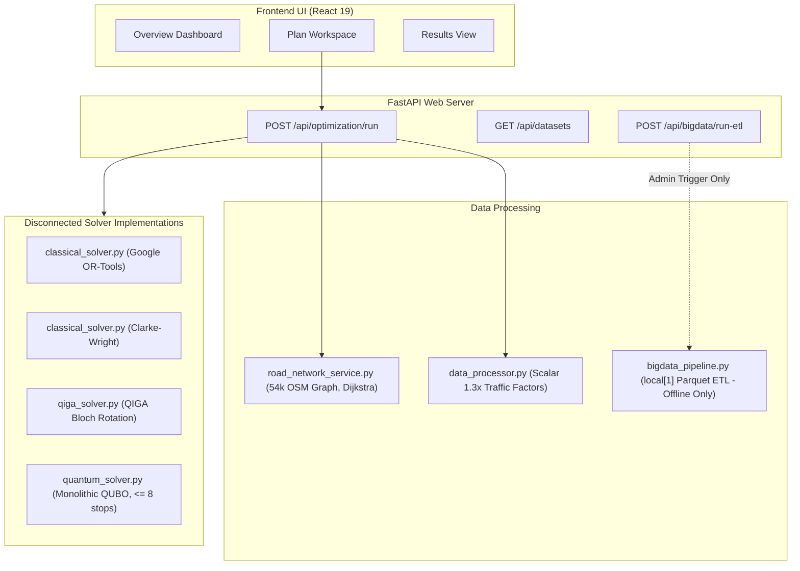

---

## 2. Current Complete Dual-Pillar Architecture (`feb0920`)

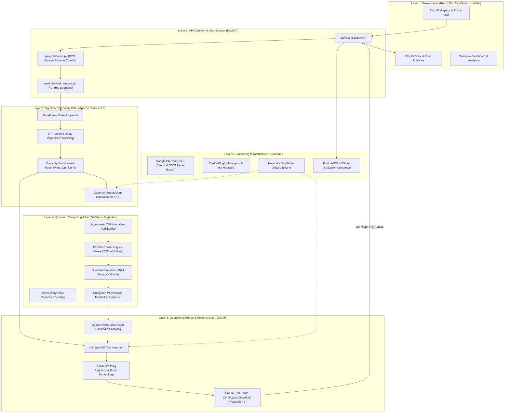

---

## 3. Frontend Component Architecture

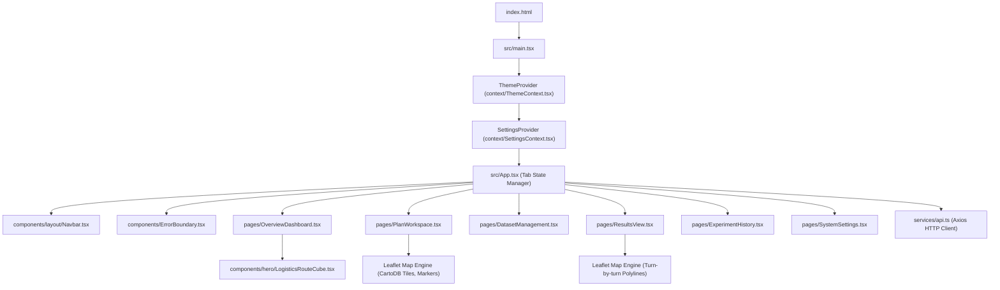

---

## 4. Backend Service Architecture

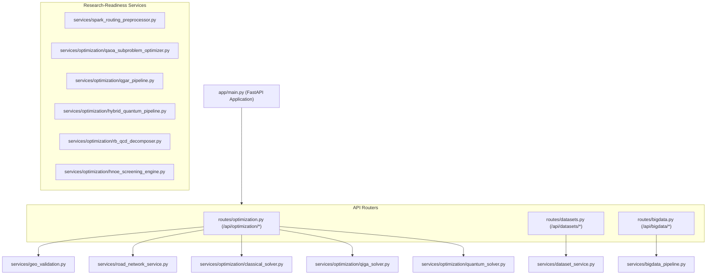

---

## 5. API Request / Response Flow

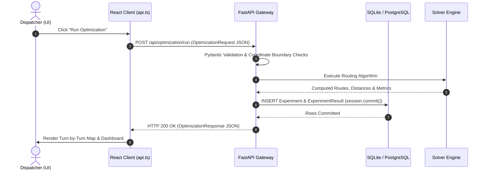

---

## 6. Database and Storage Architecture

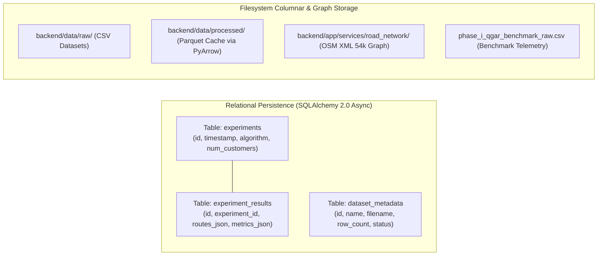

---

## 7. Big Data Spark Architecture (Pillar 1)

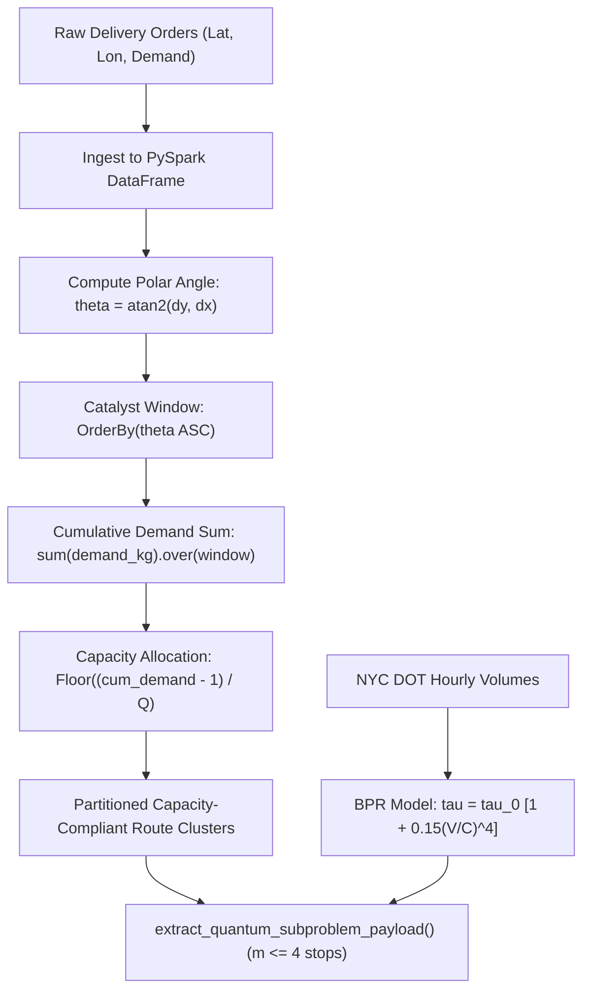

---

## 8. Quantum QAOA Architecture (Pillar 2)

```mermaid
flowchart TD
    Sub["Micro-Cluster Subproblem (m <= 4 stops, Matrix D)"] --> Form["Ising ATSP Formulation: x_{i,p} -> (I - Z_{i,p})/2"]
    Form --> HC["Cost Hamiltonian: H_C on m^2 Logical Qubits"]
    
    Init["Initial Superposition |psi_0>"] --> Circuit["Alternating Parameterized Circuit (p=2)"]
    HC --> Circuit
    HM["XY Mixer Hamiltonian: XXPlusYYGate(2 beta)"] --> Circuit
    Slack["Binary Slack Capacity Encoding: sum 2^b s_{k,b}"] --> Circuit
    
    Circuit --> AerSim["Qiskit AerSimulator (1024 Shots)"]
    AerSim --> COBYLA["COBYLA Classical Parameter Optimization (25 iters)"]
    COBYLA -.->|Update gamma, beta| Circuit
    
    AerSim --> Measure["Collapsed Measurement Bitstrings"]
    Measure --> Check{"Valid Permutation?"}
    Check -->|Yes| RawTour["Direct Feasible Tour"]
    Check -->|No (93.3% - 100%)| Hungarian["Hungarian Algorithm Bipartite Matching"]
    Hungarian --> FeasibleTour["Projected Feasible Candidate Tour"]
```

---

## 9. Road-Network and Traffic Architecture

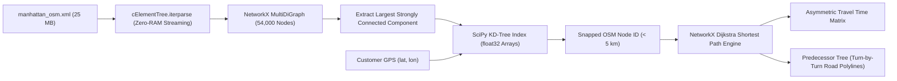

---

## 10. Optimization Architecture (Comprehensive)

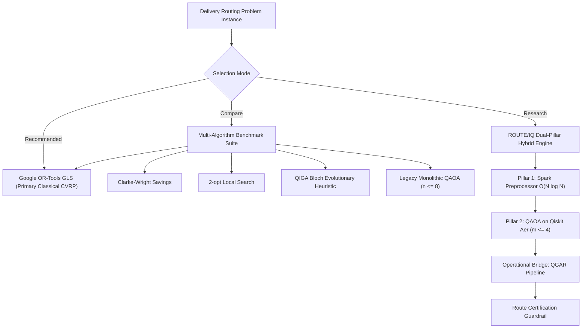

---

## 11. QGAR Reconstruction and Certification Architecture

```mermaid
flowchart TD
    Bits["Sampled QAOA Bitstrings"] --> Eval["Boltzmann Quality-Aware Evaluator: w_c proportional to exp(-Delta E / T)"]
    Eval --> Anchor["Select Anchor Micro-Cluster Core Tour"]
    Anchor --> Insert["Dynamic DP Route Insertion (Cost-Minimal Insertion)"]
    Insert --> Assembled["Full Fleet Vehicle Routes"]
    Assembled --> Cross["Planar Crossing Regularizer (Orientation Determinants)"]
    Cross --> Untangled["Uncrossed Reconstructed Routes (R_QGAR)"]
    
    Untangled --> Guard{"Route Certification Guardrail<br/>Cost(R_QGAR) <= Cost(R_spatial) + 1e-4"}
    Guard -->|PASS (14 Wins, 6 Ties)| FinalQGAR["Certified QGAR Routes"]
    Guard -->|FAIL (0 Losses)| FinalSpatial["Certified Spatial Baseline Routes"]
```

---

## 12. Full End-to-End Runtime Execution Flow

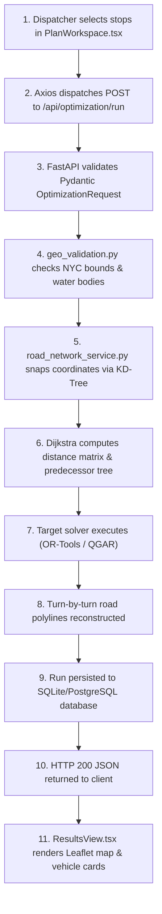

---

## 13. Cloud Deployment Architecture

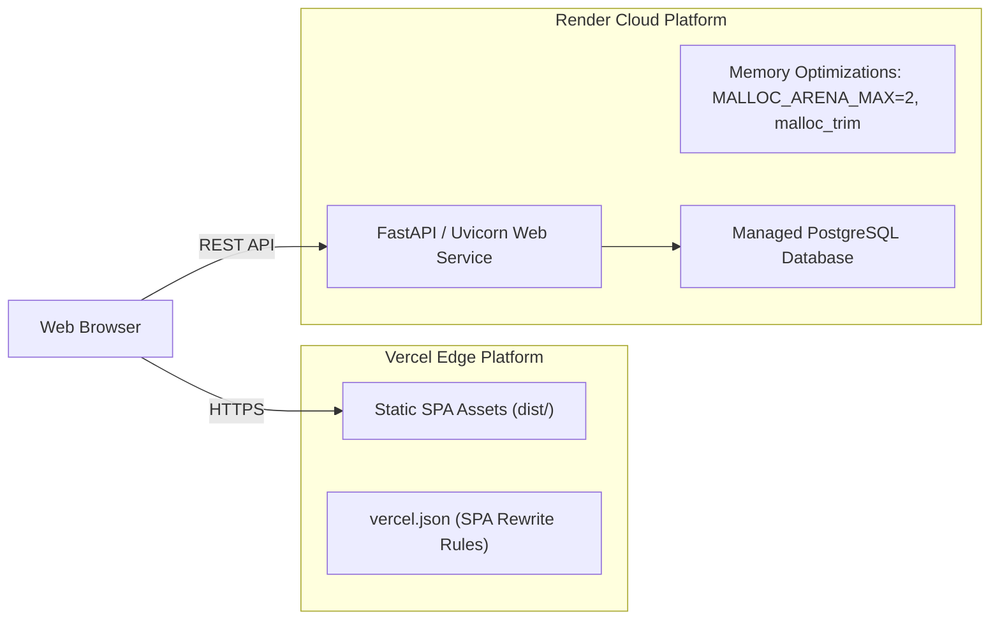

---

## 14. Testing & Verification Architecture

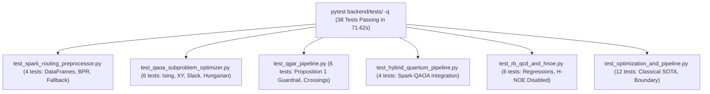
