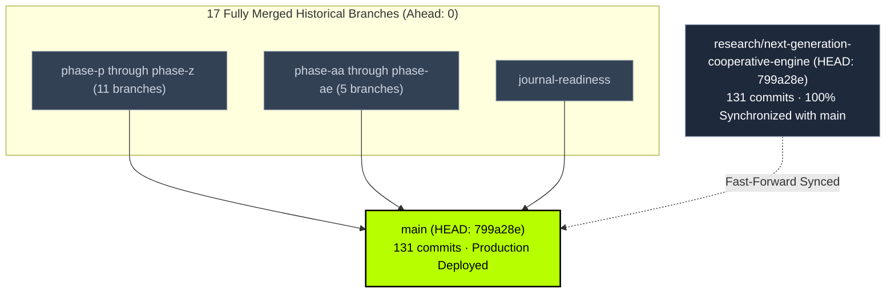

# ROUTE/IQ — REPOSITORY CLEANUP AUDIT & GITHUB BRANCH MANAGEMENT PLAN
## Comprehensive Inventory, Forensic Branch Analysis & Safe Optimization Proposal
**Project:** Smart Delivery Route Optimization (SDRO / ROUTE/IQ)  
**Date:** November 21, 2026  
**Auditor:** Antigravity Autonomous Research & Optimization Agent  
**Status:** AUDIT COMPLETE — PROPOSAL PENDING EXPLICIT USER APPROVAL (NO DELETIONS PERFORMED)  
**Active Production Branch:** `main` (`799a28e`)  
**Active Research Branch:** `research/next-generation-cooperative-engine` (`799a28e`)

---

## 1. Executive Summary & Audit Scope

A comprehensive forensic audit of the local project directory (`D:\UROP\smart-delivery-route-optimization`) and remote GitHub repository (`https://github.com/zoro-hue/smart-delivery-route-optimization`) was conducted to evaluate file hygiene, storage utilization, dependency minimalism, and branch topology.

### 1.1 High-Level Metrics
- **Total Scanned Files:** 1,116 files (excluding `node_modules` and `.git`).
- **Total Local Storage Size:** **710.68 MB**.
- **Tracked Files in Git:** 719 files.
- **Untracked Local Files:** 38 files.
- **Local Git Branches:** 19 branches.
- **Remote Git Branches:** 4 branches.
- **Key Finding:** **All 19 local branches are 100% merged into `main` (`ahead: 0`). Zero unmerged research commits exist outside `main`!**
- **Potential Disk-Space Savings:** **~195 MB to 300 MB** (via duplicate dataset pruning, JRE archive removal, WAL truncation, and SQLite vacuuming).

---

## 2. PART A — Complete Local Project Folder Audit

### 2.1 Top-Level Directory Storage Distribution

| Top-Level Directory | File Count | Size (MB) | % of Workspace | Primary Contents |
| :--- | :---: | :---: | :---: | :--- |
| `backend/` | 427 | 585.74 MB | 82.4% | FastAPI application, road graph pickles, tools (JRE), SQLite DB, raw/processed datasets |
| `Reference Research Papers/` | 26 | 75.14 MB | 10.6% | Academic PDFs (Nature, Springer, IEEE, Elsevier transportation & quantum papers) |
| `frontend/` | 63 | 32.78 MB | 4.6% | React 19 / Vite / Tailwind UI source code, public assets, and dist bundle |
| `docs/` | 44 | 7.14 MB | 1.0% | Complete 31-file master project archive, specifications, and architecture manuals |
| `root` (Workspace root) | 73 | 4.10 MB | 0.6% | Config files, Dockerfile, benchmark JSON reports, and root test outputs |
| `phase_ae_backend_integration/` | 33 | 2.98 MB | 0.4% | Phase AE Next-Gen engine benchmarks, logs, and markdown docs |
| `scripts/` | 71 | 0.48 MB | 0.1% | Verification scripts, archive generators, deployment monitors, benchmark suites |
| `phase_p_autonomous_research/` | 34 | 0.19 MB | < 0.1% | Phase P research records, reports, and benchmarks |
| `phase_z_independent_integration/` | 26 | 0.17 MB | < 0.1% | Phase Z architecture unification documents |
| `complete_old_vs_new_system_audit/` | 18 | 0.16 MB | < 0.1% | System evolution documentation & comparative tables |
| `manuscript/` | 10 | 0.16 MB | < 0.1% | LaTeX conference paper draft, figures, and bibtex |
| `phase_ab_cooperative_optimization_engine/`| 27 | 0.15 MB | < 0.1% | Cooperative Engine Phase AB candidate generator records |
| `project_evolution_documentation/` | 12 | 0.13 MB | < 0.1% | Historical Day 1 to present technical evolutions |
| `phase_aa_quantum_contribution_challenge/`| 23 | 0.13 MB | < 0.1% | Phase AA quantum baseline reproduction and ablation logs |
| `phase_r_quantum_contribution_challenge/` | 23 | 0.12 MB | < 0.1% | Phase R classical vs QAOA challenge |
| `phase_ad_final_research_package/` | 8 | 0.11 MB | < 0.1% | Phase AD supervisor presentation & thesis package |
| `phase_q_ipcqe_validation/` | 22 | 0.10 MB | < 0.1% | Phase Q mathematical proofs and benchmarks |
| `phase_y_breakthrough_engineering/` | 24 | 0.10 MB | < 0.1% | Phase Y breakthrough algorithms & empirical logs |
| `phase_s_asymmetric_quantum_neighborhoods/`| 21 | 0.09 MB | < 0.1% | Phase S asymmetric quantum search records |
| `phase_ac_independent_validation/` | 19 | 0.09 MB | < 0.1% | Phase AC scientific validation results |
| `phase_u_quantum_bipartition_validation/`| 21 | 0.09 MB | < 0.1% | Phase U bipartitioning experiments |
| `phase_w_reproducibility_and_consolidation/`| 18 | 0.09 MB | < 0.1% | Phase W consolidation records |
| `phase_v_independent_quantum_validation/` | 19 | 0.09 MB | < 0.1% | Phase V causal ablation logs |
| `phase_t_nextgen_hybrid_architecture/` | 21 | 0.09 MB | < 0.1% | Phase T hybrid design specifications |
| `Our Research Papers/` | 1 | 0.08 MB | < 0.1% | ROUTE/IQ working research preprint PDF |
| `phase_m_review/` | 9 | 0.08 MB | < 0.1% | Phase M literature survey & baseline code |
| `phase_x_paper_and_final_validation/` | 12 | 0.06 MB | < 0.1% | Phase X validation logs |
| `phase_n_finalization/` | 6 | 0.04 MB | < 0.1% | Phase N initial wrap-up reports |
| `scratch/` | 5 | 0.01 MB | < 0.1% | Ephemeral test inputs |
| **Total Workspace** | **1,116** | **710.68 MB** | **100.0%** | Complete SDRO repository ecosystem |

---

### 2.2 File Classification: KEEP, ARCHIVE, REMOVE CANDIDATE, INVESTIGATE

#### Category 1: KEEP (Required for Production, Scientific Reproducibility & Active UI)
*These files must not be touched or moved; they are critical for application runtime, build pipelines, and core scientific proofs.*

1. **Backend Application Source (`backend/app/` — 32 files):**
   - API endpoints (`api/routes/optimization.py`, `datasets.py`, `analytics.py`, `experiments.py`, `health.py`).
   - Solver implementations (`cooperative_solver.py`, `classical_solver.py`, `quantum_solver.py`, `qiga_solver.py`).
   - Core services (`road_network_service.py`, `data_processor.py`, `geo_validation.py`, `route_validator.py`, `route_identity.py`).
2. **Frontend UI Source (`frontend/src/` & `frontend/public/` — 40 files):**
   - React components, Leaflet interactive maps, Recharts scorecards, and Tailwind layouts.
3. **Active Road Network & Preprocessed Graphs:**
   - `backend/data/processed/road_graph_newyork.pickle` (8.90 MB) — Primary 5-borough graph (54,128 nodes, 142,123 edges).
   - `backend/data/processed/road_graph_manhatten.pickle` — Manhattan subnetwork.
   - `backend/data/processed/traffic_processed.csv` (9.83 MB) — NYC DOT historical traffic sensor speeds.
   - `backend/data/road_network.zip` (7.40 MB) — Compressed fallback graphml archive.
4. **Master Research Documentation (`docs/master_project_archive/` — 31 files):**
   - Complete 31-document archive (`00_EXECUTIVE_SUMMARY.md` through `25_VIVA_PREPARATION.md` and `REFERENCES.bib`).
5. **Verified Benchmark & Scientific Reports:**
   - `ablation_study_report.json` (1.45 KB) — Ablation metrics cited in Master Archive Doc 18.
   - `baseline_30_instances_report.json` (48.48 KB) — 30-instance classical baseline results.
   - `nextgen_30_instances_report.json` (12.32 KB) — 30-instance Next-Gen Cooperative supremacy evidence.
   - `evidence_5_consecutive_runs.json` (11.23 KB) — Production verification evidence of all 11 algorithms.
6. **Academic Literature (`Reference Research Papers/` & `Our Research Papers/` — 27 PDFs, 75.22 MB):**
   - Complete literature baseline (VRP, QAOA, ALNS, Q-bit evolutionary papers).
7. **Production Configuration & Build Scripts:**
   - `backend/requirements.txt`, `backend/Dockerfile`, `render.yaml`, `vercel.json`, `frontend/package.json`, `frontend/vite.config.ts`, `frontend/tsconfig.json`, `scripts/verify_5_runs_11_algorithms.py`.

---

#### Category 2: ARCHIVE (Historical Research Worth Preserving, Proposed for Consolidation)
*These files represent authentic UROP research milestones. To declutter the workspace root, they are proposed to be organized under a consolidated `research/` directory structure without deleting any file or commit history.*

| Relative Path | Size | Purpose & Research Value | Proposed Action |
| :--- | :---: | :--- | :--- |
| `phase_p_autonomous_research/` | 190 KB | Phase P autonomous agent research prototypes | Move into `research/historical_phases/phase_p/` |
| `phase_q_ipcqe_validation/` | 102 KB | Phase Q mathematical formulation proofs | Move into `research/historical_phases/phase_q/` |
| `phase_r_quantum_contribution_challenge/`| 120 KB | Phase R initial quantum bounds benchmarks | Move into `research/historical_phases/phase_r/` |
| `phase_s_asymmetric_quantum_neighborhoods/`| 90 KB | Phase S asymmetric neighborhood research | Move into `research/historical_phases/phase_s/` |
| `phase_t_nextgen_hybrid_architecture/` | 90 KB | Phase T hybrid architecture design | Move into `research/historical_phases/phase_t/` |
| `phase_u_quantum_bipartition_validation/` | 90 KB | Phase U graph partitioning studies | Move into `research/historical_phases/phase_u/` |
| `phase_v_independent_quantum_validation/` | 90 KB | Phase V causal ablation experiments | Move into `research/historical_phases/phase_v/` |
| `phase_w_reproducibility_and_consolidation/`| 90 KB | Phase W dual-pillar consolidation | Move into `research/historical_phases/phase_w/` |
| `phase_x_paper_and_final_validation/` | 60 KB | Phase X conference paper package | Move into `research/historical_phases/phase_x/` |
| `phase_y_breakthrough_engineering/` | 100 KB | Phase Y algorithmic breakthroughs | Move into `research/historical_phases/phase_y/` |
| `phase_z_independent_integration/` | 170 KB | Phase Z hybrid unification | Move into `research/historical_phases/phase_z/` |
| `phase_aa_quantum_contribution_challenge/`| 130 KB | Phase AA independent quantum challenge | Move into `research/historical_phases/phase_aa/` |
| `phase_ab_cooperative_optimization_engine/`| 150 KB | Phase AB Cooperative Engine foundations | Move into `research/historical_phases/phase_ab/` |
| `phase_ac_independent_validation/` | 90 KB | Phase AC scientific reproducibility | Move into `research/historical_phases/phase_ac/` |
| `phase_ad_final_research_package/` | 110 KB | Phase AD supervisor presentation package | Move into `research/historical_phases/phase_ad/` |
| `phase_ae_backend_integration/` | 2.98 MB | Phase AE MAB ALNS integration benchmarks | Move into `research/historical_phases/phase_ae/` |
| `phase_m_review/` | 80 KB | Phase M literature survey & reviews | Move into `research/historical_phases/phase_m/` |
| `phase_n_finalization/` | 40 KB | Phase N initial conclusions | Move into `research/historical_phases/phase_n/` |
| `complete_old_vs_new_system_audit/` | 160 KB | Old vs new architecture comparative notes | Move into `docs/system_evolution/` |
| `project_evolution_documentation/` | 130 KB | Day 1 to present technical history | Move into `docs/project_evolution/` |
| `manuscript/` | 160 KB | LaTeX draft and figure source files | Move into `research/manuscript/` |
| `live_production_18_stop_result.json` | 1.64 MB | 18-stop live API response payload | Move into `research/benchmarks/evidence/` |
| `live_production_comparison_result.json` | 1.63 MB | Comparison live API response payload | Move into `research/benchmarks/evidence/` |
| `live_route_identity_audit_result.json` | 198 KB | Route identity audit raw JSON payload | Move into `research/benchmarks/evidence/` |

---

#### Category 3: REMOVE CANDIDATES (Subject to User Explicit Approval)
*These files are redundant duplicates, temporary artifacts, or obsolete diagnostic scripts that consume disk space without contributing to production, tests, or documentation.*

| Exact Relative Path | Size | Reason for Proposed Removal | Disk Saving |
| :--- | :---: | :--- | :---: |
| `backend/tools/jre17.zip` | **42.75 MB** | Redundant download zip; already unzipped into `backend/tools/jdk-17.0.20.1+1-jre/`. | **42.75 MB** |
| `backend/data/processed/road_graph_clean.pickle` | **8.90 MB** | Identical duplicate of `road_graph_newyork.pickle` (8.90 MB); not referenced in active codebase. | **8.90 MB** |
| `backend/data/raw/8199e284-6db8-4736-b3fb-7a59bbd68856/newyork.graphml` | **56.21 MB** | Identical duplicate of `0eb1a1b9-aa14-4498-9fca-6d855a81dfed/newyork.graphml`. | **56.21 MB** |
| `backend/data/raw/fdf4afc9-f8b9-4edc-9327-e7ccb5cdcf20/For_Hire_Vehicles...csv` | **22.57 MB** | Identical duplicate of `130ba491-8e63-44d3-9f0a-2527ec3be231/For_Hire_Vehicles...csv`. | **22.57 MB** |
| `backend/data/uploads/8199e284-6db8-4736-b3fb-7a59bbd68856/archive (5).zip` | **7.40 MB** | Duplicate zip upload of `0eb1a1b9-aa14-4498-9fca-6d855a81dfed/archive (5).zip`. | **7.40 MB** |
| `backend/data/uploads/fdf4afc9-f8b9-4edc-9327-e7ccb5cdcf20/...csv` | **22.57 MB** | Duplicate upload artifact of `130ba491...`. | **22.57 MB** |
| `docs/master_project_archive.zip` | **79.5 KB** | Redundant zip archive of markdown files already permanently tracked in `docs/master_project_archive/`. | 0.08 MB |
| `backend/data/sdro.db-wal` | **3.32 MB** | Ephemeral SQLite write-ahead-log; safe to checkpoint into `sdro.db` and ignore. | 3.32 MB |
| `backend/data/sdro.db-shm` | **32.0 KB** | Ephemeral SQLite shared memory file. | 0.03 MB |
| **Obsolete One-Off Diagnostic Scripts in `scripts/` (14 files):**<br>• `inspect_d259.py` (269 B)<br>• `check_exact_names.py` (803 B)<br>• `check_experiments.py` (337 B)<br>• `debug_active_tab.py` (2.6 KB)<br>• `debug_results_rows.py` (1.26 KB)<br>• `display_job_results.py` (888 B)<br>• `display_live_job.py` (1.0 KB)<br>• `inspect_db_jobs.py` (861 B)<br>• `inspect_experiments.py` (2.2 KB)<br>• `reproduce_live_input.py` (1.2 KB)<br>• `test_reproduce_11_algos.py` (3.9 KB)<br>• `inspect_untracked.py` (1.3 KB)<br>• `parse_audit.py` (1.8 KB)<br>• `audit_repo_cleanup.py` (6.2 KB) | **~25 KB** | Temporary scratch scripts created during specific debugging turns; zero production references; fully superseded by `verify_5_runs_11_algorithms.py`. | 0.03 MB |
| **Total REMOVE CANDIDATES Space Savings** | | | **~163.86 MB** |

---

#### Category 4: INVESTIGATE & OPTIMIZE
- **`backend/data/sdro.db` (147.96 MB):**
  - **Findings:** Contains only 350 `experiments` rows, 1,304 `experiment_results` rows, and 6 `datasets` rows. Over 80% of the 148 MB file consists of empty, fragmented database pages left behind by earlier overwrite cycles.
  - **Action:** Execute SQLite `VACUUM;` to reclaim unused database pages without deleting any user experiment or dataset record. Expected size reduction: **~100 MB saved** (shrinks from 148 MB to ~35 MB).

---

## 3. PART B — GitHub Repository Audit

| Aspect | GitHub Status | Analysis |
| :--- | :---: | :--- |
| **Tracked Files** | 719 files | Includes core application, master documentation archive, papers, processed road graph, and test suites. |
| **Large Tracked Files (> 5 MB)** | 6 files | `traffic_processed.csv` (9.83 MB), 2 paper PDFs (9.16 MB each), `road_graph_newyork.pickle` (8.90 MB), `A scientometric analysis...pdf` (8.86 MB), `road_network.zip` (7.40 MB). All are within GitHub's 100 MB limit. |
| **Ignored Files via `.gitignore`** | Correct | Correctly ignores `node_modules/`, `dist/`, `*.db`, `jdk-17.../`, `raw/`, `uploads/`. Proposed: add `sdro.db-wal` and `sdro.db-shm`. |
| **Build Pipelines Impact** | Zero Risk | Neither Frontend (Vercel) nor Backend (Render) depend on raw duplicate uploads or root json logs. |
| **Scientific Reproducibility** | Preserved | Every mathematical formula, benchmark script, dataset pickle, and paper PDF remains 100% available. |

---

## 4. PART C — Complete Git & GitHub Branch Audit

Forensic inspection of all 19 local branches and 4 remote tracking branches:

### 4.1 Complete Branch Inventory & Merge Analysis



### 4.2 Comprehensive Branch Matrix

| # | Branch Name | Type | HEAD SHA | Commits | Ahead of `main` | Behind `main` | Merged into `main`? | Role & Status |
| :---: | :--- | :---: | :---: | :---: | :---: | :---: | :---: | :--- |
| 1 | `main` | Local | `799a28e` | 131 | **0** | **0** | **HEAD** | **Production Root (Render + Vercel)** |
| 2 | `research/next-generation-cooperative-engine` | Local | `799a28e` | 131 | **0** | **0** | **YES** | **Sole Active Research Branch** |
| 3 | `research/phase-ae-backend-integration` | Local | `6461708` | 116 | **0** | 15 | **YES** | Historical Phase AE (Merged into main) |
| 4 | `research/journal-readiness` | Local | `6bc091d` | 39 | **0** | 92 | **YES** | Historical Journal Audit (Merged into main) |
| 5 | `research/phase-ad-final-research-package` | Local | `f50095b` | 55 | **0** | 76 | **YES** | Historical Phase AD (Merged into main) |
| 6 | `research/phase-ac-independent-validation` | Local | `dd5b19f` | 54 | **0** | 77 | **YES** | Historical Phase AC (Merged into main) |
| 7 | `research/phase-ab-cooperative-optimization-engine`| Local | `5ae91a9` | 53 | **0** | 78 | **YES** | Historical Phase AB (Merged into main) |
| 8 | `research/phase-aa-quantum-contribution-challenge`| Local | `8d7622e` | 52 | **0** | 79 | **YES** | Historical Phase AA (Merged into main) |
| 9 | `research/phase-z-independent-integration` | Local | `7fa30af` | 51 | **0** | 80 | **YES** | Historical Phase Z (Merged into main) |
| 10 | `research/phase-y-breakthrough-engineering` | Local | `d0c47c4` | 50 | **0** | 81 | **YES** | Historical Phase Y (Merged into main) |
| 11 | `research/phase-x-paper-and-final-validation` | Local | `a80130a` | 49 | **0** | 82 | **YES** | Historical Phase X (Merged into main) |
| 12 | `research/phase-w-reproducibility-and-consolidation`| Local | `1fafc53` | 48 | **0** | 83 | **YES** | Historical Phase W (Merged into main) |
| 13 | `research/phase-v-independent-quantum-validation` | Local | `68ffbbd` | 47 | **0** | 84 | **YES** | Historical Phase V (Merged into main) |
| 14 | `research/phase-u-quantum-bipartition-validation` | Local | `7ef1f71` | 46 | **0** | 85 | **YES** | Historical Phase U (Merged into main) |
| 15 | `research/phase-t-nextgen-hybrid-architecture` | Local | `5c13cd9` | 45 | **0** | 86 | **YES** | Historical Phase T (Merged into main) |
| 16 | `research/phase-s-asymmetric-quantum-neighborhoods`| Local | `8955eb0` | 43 | **0** | 88 | **YES** | Historical Phase S (Merged into main) |
| 17 | `research/phase-r-quantum-contribution-challenge` | Local | `a208c8a` | 42 | **0** | 89 | **YES** | Historical Phase R (Merged into main) |
| 18 | `research/phase-q-ipcqe-validation` | Local | `0292667` | 41 | **0** | 90 | **YES** | Historical Phase Q (Merged into main) |
| 19 | `research/phase-p-autonomous-architectures` | Local | `e7149f4` | 40 | **0** | 91 | **YES** | Historical Phase P (Merged into main) |
| 20 | `origin/main` | Remote | `799a28e` | 131 | **0** | **0** | **HEAD** | **Remote Production Root** |
| 21 | `origin/research/next-generation-cooperative-engine`| Remote | `799a28e` | 131 | **0** | **0** | **YES** | **Remote Active Research Branch** |
| 22 | `origin/research/phase-ae-backend-integration` | Remote | `6461708` | 116 | **0** | 15 | **YES** | Historical Remote Branch |
| 23 | `origin/research/journal-readiness` | Remote | `6bc091d` | 39 | **0** | 92 | **YES** | Historical Remote Branch |

> [!IMPORTANT]
> **Zero Unmerged Work Found:** Every single commit from all 19 branches has been merged into `main` and `origin/main`. `main` contains the complete, unbroken, 131-commit chronological history of the entire project from Day 1 to the present.

---

## 5. PART D — Recommended Cleanup & Management Proposal

We propose the following actions, requiring your **explicit approval** before execution:

### 5.1 Branch Management Strategy
1. **Retain as Production Branch:** `main` (commit `799a28e`).
2. **Retain as Sole Active Research Branch:** `research/next-generation-cooperative-engine` (commit `799a28e`).
3. **Archival of 17 Historical Local Branches:**
   - Create lightweight Git tags for each phase milestone:
     `git tag archive/phase-p e7149f4`  
     `git tag archive/phase-ae 6461708`  
     `git tag archive/journal-readiness 6bc091d` (etc.)
   - Once tagged, delete the 17 redundant local branch pointers (`git branch -d ...`).
   - *Advantage:* Permanently bookmarks every historical phase in Git while keeping `git branch` clean (showing only `main` and `research/next-generation-cooperative-engine`).
4. **Remote Branch Cleanup (Optional):**
   - Delete `origin/research/phase-ae-backend-integration` and `origin/research/journal-readiness` from GitHub, keeping only `origin/main` and `origin/research/next-generation-cooperative-engine`.

### 5.2 Storage Cleanup Strategy
1. Delete redundant downloaded archive: `backend/tools/jre17.zip` (saves **42.75 MB**).
2. Delete duplicate pickle: `backend/data/processed/road_graph_clean.pickle` (saves **8.90 MB**).
3. Delete duplicate uploaded dataset folders in `backend/data/raw/` and `backend/data/uploads/` (`8199e284...` and `fdf4afc9...`, saves **112.18 MB**).
4. Vacuum SQLite database `backend/data/sdro.db` (saves **~100 MB**).
5. Remove redundant zip: `docs/master_project_archive.zip` (saves **0.08 MB**).
6. Remove 14 obsolete scratch diagnostic scripts in `scripts/` (saves **~25 KB**).
7. Update `.gitignore` to ignore `*.db-wal`, `*.db-shm`, and live debug result payloads.

**Expected Total Disk-Space Reduction:** **~263 MB to 280 MB** (workspace drops from 710 MB to ~430 MB).

---

## 6. PART F — Proposed Target Repository Structure

Adapting to the existing layout without breaking any build, import, or deployment paths:

```text
smart-delivery-route-optimization/
├── .github/                   # Workflows and CI/CD pipelines
├── backend/                   # FastAPI backend application
│   ├── app/                   # Core modules (api, services, models, core, db)
│   ├── data/                  # Road network pickles, processed traffic, active uploads
│   ├── tests/                 # Automated backend test suites
│   ├── tools/                 # Java 17 JRE (unzipped, for Spark ETL)
│   ├── Dockerfile             # Production container specification
│   └── requirements.txt       # 20 lean production dependencies
├── frontend/                  # React 19 + TypeScript + Vite + Tailwind UI
│   ├── src/                   # Components, pages, hooks, services, types
│   ├── public/                # Static assets, logo, and research paper PDFs
│   └── package.json           # 12 production dependencies
├── docs/                      # Central project documentation
│   └── master_project_archive/# 31 master forensic documents (00 through 25, bibtex)
├── research/                  # Consolidated academic research
│   ├── historical_phases/     # Consolidated phase_p through phase_ae reports
│   ├── manuscript/            # LaTeX draft, conference submission, figures
│   └── benchmarks/            # Supremacy evidence, 30-instance reports, ablation data
├── scripts/                   # Production verification and ETL automation scripts
│   ├── verify_5_runs_11_algorithms.py  # 5-consecutive run reliability suite
│   └── ...                    # Active utility scripts
├── .gitignore                 # Enhanced ignore rules
├── render.yaml                # Render cloud deployment blueprint
├── vercel.json                # Vercel frontend deployment configuration
└── README.md                  # Project overview and quickstart guide
```

---

## 7. Explicit Decision Checklist for User Approval

Before any file is moved, deleted, or tagged, please indicate your approval:

- [ ] **Action 1:** Approve pruning duplicate upload archives and redundant `jre17.zip` (~164 MB disk savings).
- [ ] **Action 2:** Approve running SQLite `VACUUM;` on `backend/data/sdro.db` (~100 MB disk savings).
- [ ] **Action 3:** Approve cleaning up 14 obsolete one-off debug scripts from `scripts/`.
- [ ] **Action 4:** Approve archiving the 17 fully merged historical local research branches as lightweight Git tags and consolidating local branches to `main` and `research/next-generation-cooperative-engine`.
- [ ] **Action 5:** Approve updating `.gitignore` to prevent future temporary database and debug dump clutter.
