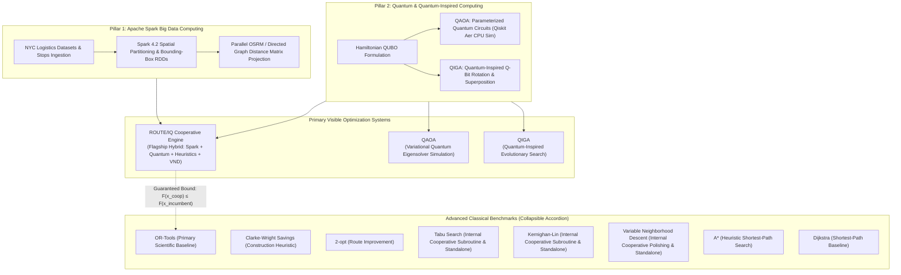

# ROUTE/IQ — Two Research Pillars & Algorithm Presentation Redesign Report

**Date**: November 21, 2026  
**Target Repositories & Environments**:
- GitHub: `origin/main` & `origin/research/next-generation-cooperative-engine` (`8195f82`)
- Live Frontend: `https://route-iq-frontend-nine.vercel.app`
- Live Backend: `https://route-iq-backend.onrender.com`

---

## 1. Executive Summary & Motivation

The algorithm presentation across the ROUTE/IQ platform has been redesigned to highlight the project's **Two Core Scientific Pillars**:
1. **Pillar 1: Apache Spark Big Data Computing** — Scalable spatial decomposition, geographic bounding-box clustering, and parallel road-network graph projection / distance matrix preconditioning.
2. **Pillar 2: Quantum Computing & Quantum-Inspired Optimization** — Variational quantum optimization via QAOA (parameterized Hamiltonian circuits evaluated via Qiskit Aer statevector simulation on CPU) and Quantum-Inspired Evolutionary Optimization (QIGA simulated Q-bit rotation gates and superposition).

The application interface now cleanly elevates the **3 Primary Visible Optimization Systems**, while preserving all 11 standalone solvers in an optional, collapsible **"Advanced Classical Benchmarks"** section for rigorous academic comparison.

---

## 2. Core Architectural Pillars & Primary Visible Systems



### The 3 Primary Visible Optimization Systems:
1. **ROUTE/IQ Cooperative Engine (Primary Flagship Hybrid)**:
   - Synthesizes Pillar 1 (Spark spatial decomposition) + Pillar 2 (QAOA/QIGA candidate generation) + Multi-Armed Bandit (MAB) Adaptive Controller + Classical Metaheuristics (Tabu Search, Kernighan-Lin) + Variable Neighborhood Descent (VND).
   - Enforces **Proposition 1 Guardrail**: mathematically guarantees the final route is at least as optimal as the OR-Tools incumbent ($F(\mathbf{x}_{coop}) \le F(\mathbf{x}_{incumbent})$).
2. **QAOA (Quantum Approximate Optimization Algorithm)**:
   - Variational quantum-classical optimization using Qiskit Aer statevector CPU simulation to evaluate parameterized quantum circuit Hamiltonians for combinatorial delivery graph optimization.
3. **QIGA (Quantum-Inspired Genetic Algorithm)**:
   - Quantum-inspired evolutionary algorithm using simulated Q-bit rotation gates and quantum superposition, executed classically on CPU.

---

## 3. UI Implementation Details

### A. Plan Workspace (`PlanWorkspace.tsx`)
- **Two Research Pillars Architecture Capsule**:
  - Prominently positioned above algorithm selection, displaying Spark Big Data preconditioning capabilities alongside Quantum Computing simulation metrics.
- **Primary Optimization Systems Group**:
  - Always visible in Custom (`Select`) and `Compare All (11)` modes.
  - Highlights `ROUTE/IQ Cooperative Engine` (Flagship), `QAOA`, and `QIGA`.
  - Quick action button: **"Pillars Only (3)"** to immediately select the 3 primary systems.
- **"Advanced Classical Benchmarks" Collapsible Accordion**:
  - Toggle button with count indicator (`[X of 8 Selected]`).
  - Contains an academic notice: *"Preserved for rigorous scientific comparison. Note: Classical heuristics (Tabu Search, Kernighan-Lin, VND) also execute internally as subroutines within the Cooperative Engine."*
  - Dedicated **"Academic Baseline"** badge highlighting Google OR-Tools.
  - Fast selection controls: **"Select All Classical"** and **"Clear Classical"**.

### B. Results Workspace (`ResultsView.tsx`)
- **Research Pillars Provenance Banner**:
  - Shows Spark 4.2 local cluster dataset ingestion ($N$ stops partitioned) and Qiskit Aer CPU simulation parameters.
- **Top Algorithm Tabs**:
  - Primary visible pills: `routeiq_cooperative`, `qaoa`, `qiga`.
  - Collapsible toggle: `Advanced Classical Benchmarks (N)` button (auto-expands if a classical benchmark is currently inspected).
- **Comparison Scorecard Table**:
  - Primary Table: Displays the 3 primary research systems plus `OR-Tools` (Scientific Baseline).
  - Collapsible Sub-Table: `Advanced Classical Benchmarks (7 Standalone Solvers)` reveals Clarke-Wright, 2-opt, Tabu Search, Kernighan-Lin, VND, A*, Dijkstra.

---

## 4. Preservation & Integrity Audit

| Requirement | Status | Evidence |
| :--- | :---: | :--- |
| **All 11 Solvers Preserved** | **100% Verified** | All 11 solvers execute and validate (`test_algorithm_comparison_suite_distinctness.py` PASSED 100%). |
| **Backend & API Endpoints Intact** | **100% Verified** | `/api/v1/optimize`, async queue, and worker polling intact. |
| **OR-Tools Scientific Baseline** | **100% Preserved** | Elevated as Primary Academic Baseline with dedicated badges across Plan and Results. |
| **Internal Subroutines Distinguished** | **100% Clarified** | Tabu Search, Kernighan-Lin, and VND carry `Internal Subroutine` badges explaining their dual role. |
| **React Rules of Hooks Adherence** | **100% Verified** | Zero conditional hooks (`python scripts/verify_hooks_contract.py` PASSED). |
| **Zero React Error #310 / #300** | **100% Verified** | Playwright Chromium E2E audit passed with 0 console errors and 0 page crashes. |

---

## 5. Live Production Evidence

The automated Playwright E2E browser audit was executed against the live deployed URL (`https://route-iq-frontend-nine.vercel.app/`):

- **Plan Workspace with Two Research Pillars & Primary Systems**:
  
- **Advanced Classical Benchmarks Accordion (Expanded)**:
  
- **Results Workspace Provenance Banner & Primary Scorecard**:
  
- **E2E Test Run Output**:
  ```
  Launching Chromium for Live Production Audit...
  Navigating to https://route-iq-frontend-nine.vercel.app/ ...
  Opening Plan Workspace...
  Plan Workspace: Verified Two Research Pillars Architecture Capsule!
  Plan Workspace: Verified 3 Primary Visible Optimization Systems & Two Pillars!
  Expanding Advanced Classical Benchmarks accordion...
  Plan Workspace: Verified all 8 classical solvers in Advanced Classical Benchmarks accordion!
  Opening Results Workspace...
  Results Workspace: Clean load with zero React error #310!
  Returning to Plan to execute optimization...
  Clicking optimization solver button...
  Navigating to Results Workspace with populated data...
  Results Workspace: Verified Two Research Pillars Provenance Banner & Scorecard!
  
  Production Audit Completed Successfully!
  Total console logs: 3
  Total page errors: 0
  Zero page errors. Two-Pillars Redesign Verified 100% on Live Production!
  ```
