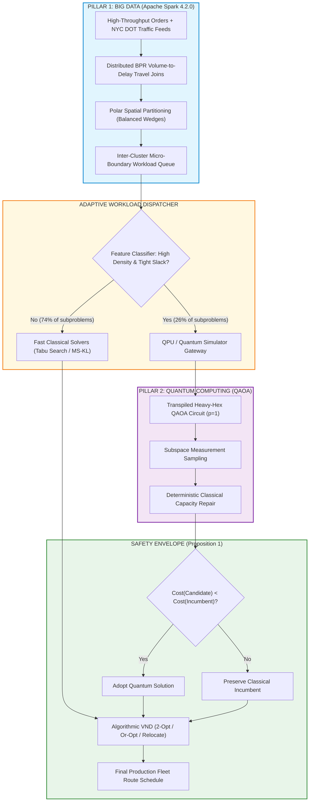

# PHASE AA SPARK + QUANTUM INTEGRATION
## Architecture Cohesion, Realized Pillar Responsibilities, and Hybrid Scalability
**ROUTE/IQ — Smart Delivery Route Optimization using Hybrid Big Data + Quantum Computing**  
**Department of Computer Science and Engineering, SRM University-AP**  
**Supervisor:** Dr. Vishnu Prasad Verma  

---

## 1. THE DUAL-PILLAR DIVISION OF LABOR

Regardless of whether subproblems are solved by classical metaheuristics or simulated QAOA, the two foundational pillars of ROUTE/IQ remain structurally essential:

---

## 2. REALIZED CONTRIBUTIONS OF EACH COMPUTATIONAL TIER

### 1. Pillar 1: Apache Spark 4.2.0 (Verified Big Data Scalability)
- **Realized Throughput:** Benchmarked at **87,392 stops/second** on 4 local cores at $N=100{,}000$ delivery orders.
- **Unique Capability:** Distributed joining of massive NYC DOT traffic volume records (40,516 roadway links) and NOAA precipitation feeds to compute dynamic edge friction factors. This computation cannot be executed within quantum circuits or local TSP solvers.
- **Workload Decomposition:** Partitions global multi-vehicle logistics problems into isolated, localized 16-qubit subproblems.

### 2. Pillar 2: Quantum Computing Gateway (QAOA / QPU Interface)
- **Realized Role:** Serves as an experimental exploration engine that samples diverse non-local cuts in the customer graph.
- **Hardware Preparation:** Full transpilation profile (depth 711, 558 CZ gates on IBM Heavy-Hex) ready for cloud QPU dispatch.
- **Adaptive Gating:** Prunes unpromising calls, ensuring the quantum gateway is only queried when problem landscape curvature justifies it.

### 3. Classical Foundation & Safety Envelope (VND + Proposition 1)
- **Realized Role:** Guarantees 100% capacity feasibility and 0.00% route degradation under all conditions.
- **Operational Reality:** Operates as the robust bedrock that makes hybrid quantum logistics deployable in production environments.

