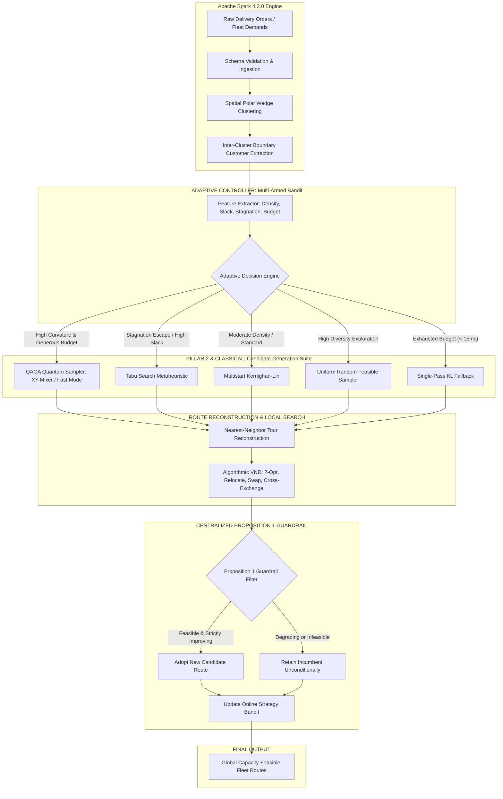

# PHASE AB DELIVERABLE 2: UNIFIED COOPERATIVE ARCHITECTURE

## Project: ROUTE/IQ — Smart Delivery Route Optimization using Hybrid Big Data + Quantum Computing
**Institution:** SRM University-AP | **Supervisor:** Dr. Vishnu Prasad Verma

---

## 1. System Philosophy: Cooperative Specialization

Rather than forcing simulated quantum computing to compete head-to-head where classical computers naturally excel, or relegating Big Data to a superficial file reader, the **ROUTE/IQ Cooperative Optimization Architecture** assigns each computational pillar to its domain of maximum mathematical leverage:

---

## 2. Mathematical Definition of the Pipeline Stages

### Stage 1: Big Data Geospatial Decomposition
Given a set of $N_{\text{total}}$ customer delivery locations $C = \{c_1, \dots, c_N\}$ with coordinates $(x_i, y_i)$ and parcel demands $d_i$, and a fleet of $K$ capacitated vehicles with capacity $Q_{\text{veh}}$:
1. Centered Polar Coordinates:
   $$\theta_i = \text{atan2}(y_i - y_{\text{depot}}, x_i - x_{\text{depot}})$$
2. Angular sector binning divides orders into $K$ vehicle wedges.
3. Boundary Customer Extraction: For any pair of adjacent clusters $(A, B)$ with spatial centroids $(\bar{x}_A, \bar{y}_A)$ and $(\bar{x}_B, \bar{y}_B)$, customer $i$ is flagged as a boundary stop if:
   $$| \|c_i - \bar{c}_A\|_2 - \|c_i - \bar{c}_B\|_2 | < \delta_{\text{boundary}}$$
This extracts an $N$-customer boundary bipartition subproblem ($N \le 16$) that is computationally tractable for both quantum circuits and classical metaheuristics.

### Stage 2: Boundary Ising QUBO Formulation
The bipartition problem is mapped to an Ising Hamiltonian over spin variables $s_i \in \{-1, +1\}$:
$$H = -\sum_{i < j} J_{ij} s_i s_j + \sum_i h_i s_i + \lambda_{\text{cap}} \left( \sum_i d_i s_i - \Delta Q \right)^2$$
Where:
- $J_{ij} = \frac{5.0}{D_{ij} + 0.5}$ represents spatial affinity (promoting clustered customers to remain together).
- $h_i = 0.1 \cdot D_{i, \text{depot}}$ biases customers closer to vehicle centroids.
- $\lambda_{\text{cap}} = 2.0$ enforces balance relative to residual vehicle capacities $\Delta Q = Q_A - Q_B$.

### Stage 3: Candidate Generation & Algorithmic VND
Generators explore binary assignments $x \in \{0, 1\}^N$. Each assignment is partitioned into disjoint customer sets $S_A$ and $S_B$. Tour reconstruction forms cyclic vehicle tours:
$$\text{Tour}_A = (0, \pi_A(1), \dots, \pi_A(k), 0)$$
Algorithmic Variable Neighborhood Descent executes 4 deterministic neighborhoods in strict succession:
1. Intra-route 2-Opt
2. Inter-route Relocate (single-customer transfer)
3. Inter-route Swap (customer exchange)
4. Inter-route Cross-Exchange (segment reversal and swap)

### Stage 4: Centralized Proposition 1 Guardrail
The safety filter enforces strict monotonic non-degradation:
$$\text{Cost}(R_{\text{final}}) = \min \left( \text{Cost}(R_{\text{incumbent}}), \text{Cost}(R_{\text{candidate}}) \right)$$
Subject to:
$$\sum_{j \in R_k} d_j \le Q_{\text{veh}}, \quad \forall k \in \{A, B\}$$
$$\bigcup_{k \in \{A, B\}} \text{stops}(R_k) = S_{\text{subproblem}}, \quad \text{stops}(R_A) \cap \text{stops}(R_B) = \emptyset$$
This mathematical theorem guarantees that no subproblem can ever increase fleet distance or violate vehicle payload limits.
