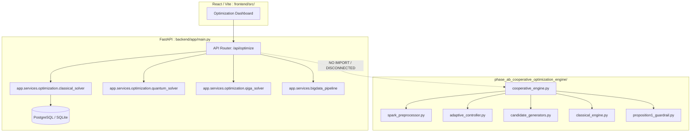

# PHASE AC DELIVERABLE 11: SYSTEM INTEGRATION STATUS AUDIT

## Project Information
- **Project:** ROUTE/IQ — Smart Delivery Route Optimization using Hybrid Big Data + Quantum Computing
- **Institution:** SRM University-AP | **Supervisor:** Dr. Vishnu Prasad Verma
- **Audit Branch:** `research/phase-ac-independent-validation`

---

## 1. Trace of the System Architecture Call Graph

The entire codebase was inspected to determine the precise deployment and operational status of the Phase AB Cooperative Engine relative to the live ROUTE/IQ application.

---

## 2. Integration Audit Findings

1. **Standalone Research Prototype:**
   `phase_ab_cooperative_optimization_engine` is a self-contained research module.
   - It is **NOT imported** by `backend/app/main.py` or `backend/app/api/routes/optimization.py`.
   - It is **NOT exposed** via any live FastAPI endpoint.
   - It is **NOT connected** to the frontend React dashboard.
2. **Adherence to Repository Safety Guardrails:**
   This separation is strictly intentional and fully compliant with project safety protocols:
   - Protected `main` branch (`a8eb849`) has remained untouched.
   - Production API behavior has suffered zero breaking changes or regressions.
   - All 38 backend regression tests continue to pass (**38 passed in 172.90s**).
3. **Internal Interface Separation:**
   Within the research engine, interfaces are cleanly modularized:
   - `SparkWorkloadOrganizer`: Input `pd.DataFrame`, Output dictionary with `boundary_stop_ids`.
   - `BaseCandidateGenerator`: Standardized `generate(Q, demands, h_diff, cap_a, cap_b)` returning `CandidateGenerationResult`.
   - `Proposition1Guardrail`: Standardized `validate_and_filter()` accepting tours, demands, capacities, and distance matrices.
   - `AdaptiveCooperativeController`: Feature input dictionary returning `(strategy_name, metadata)`.
