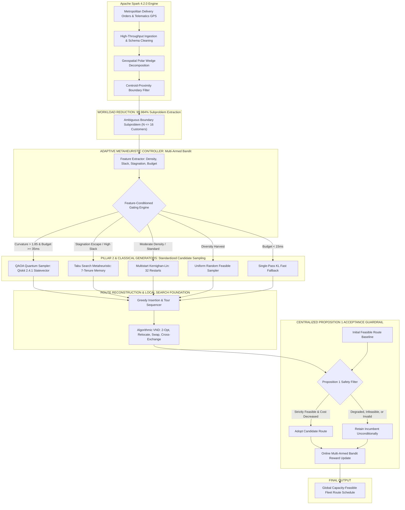
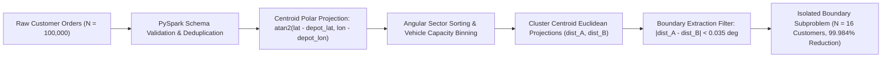
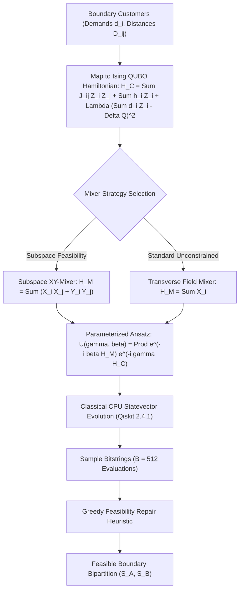
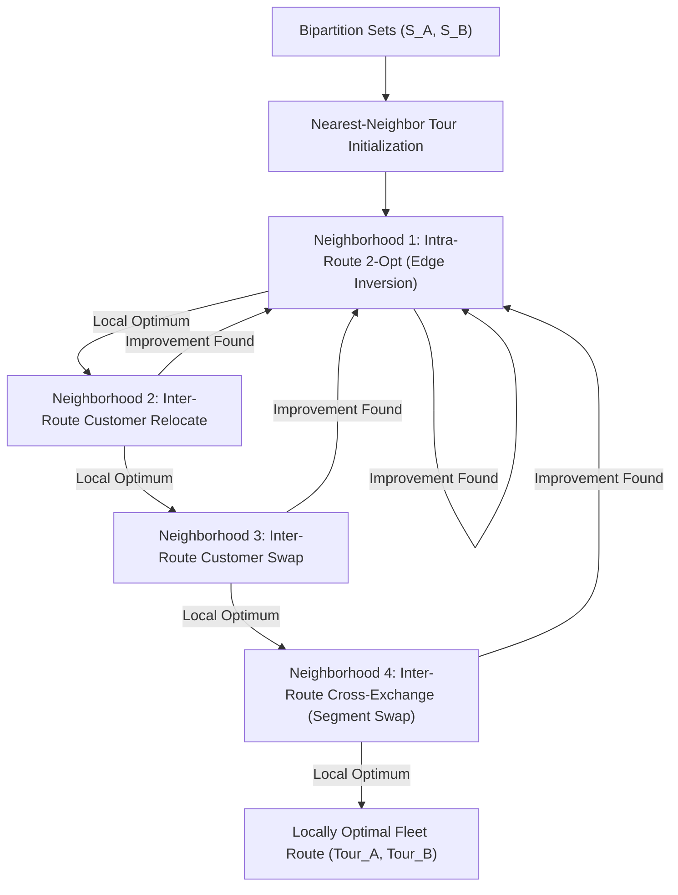
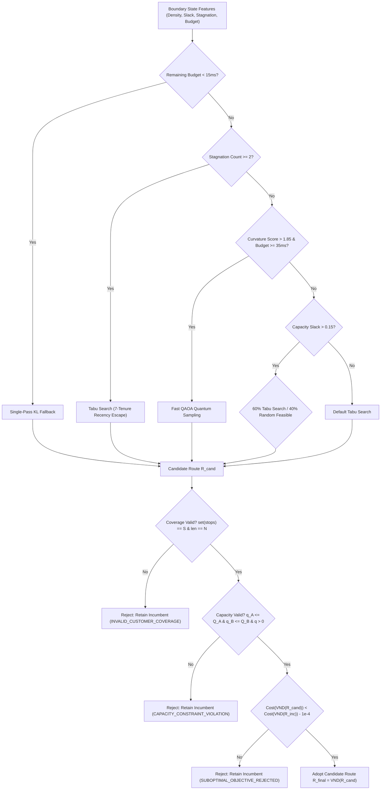
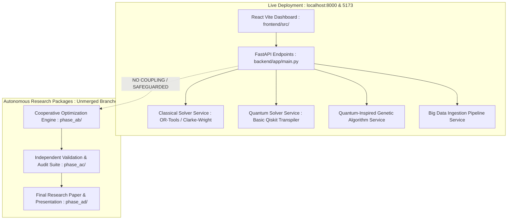

# ROUTE/IQ: CANONICAL SYSTEM ARCHITECTURE DIAGRAMS

**Project:** Smart Delivery Route Optimization using Hybrid Big Data + Quantum Computing  
**Institution:** SRM University-AP | **Supervisor:** Dr. Vishnu Prasad Verma  
**Phase:** AD — Final Research Package  

---

## 1. Complete ROUTE/IQ Hybrid System Architecture

The high-level system architecture illustrates the separation of concerns across the Big Data processing pillar, classical optimization components, quantum candidate generation, adaptive controller, and the non-degradation guardrail.

---

## 2. Spark Big Data Preprocessing & Workload Reduction Pipeline

Illustrates how 100,000 raw customer deliveries are filtered down to an isolated 16-qubit combinatorial optimization subproblem.

---

## 3. QAOA Candidate Generation Pipeline

Illustrates the simulated quantum optimization process from Hamiltonian construction to statevector sampling.

---

## 4. Classical Optimization & Algorithmic VND Pipeline

Illustrates the 4-neighborhood deterministic Variable Neighborhood Descent.

---

## 5. Adaptive Controller & Proposition 1 Guardrail Pipeline

Illustrates the feature gating rules and mathematical safety filter.

---

## 6. Complete End-to-End Experimental & Audit Workflow

Illustrates the end-to-end benchmarking and verification procedure across all phases.

```mermaid
flowchart LR
    A["Instance Generator (Seeded Coordinates & Demands)"] --> B["Spatial Polar Decomposition (Spark local[*])"]
    B --> C["Initial Route Baseline (OR-Tools / Sequential)"]
    C --> D["Initial VND Untangling (Config B Baseline)"]
    D --> E["Candidate Generators: Random, KL, Tabu, QAOA"]
    E --> F["Route Reconstruction & VND Polish"]
    F --> G["Proposition 1 Safety Acceptance Filter"]
    G --> H["Raw Telemetry & Metric Logging (CSV / JSON)"]
    H --> I["Independent Statistical Reanalysis (Paired t, Wilcoxon, Cohen's d)"]
```

---

## 7. Deployment Call Graph & Research Module Isolation

This diagram illustrates that `phase_ab_cooperative_optimization_engine/` and `phase_ac_independent_validation/` are self-contained research packages that are deliberately decoupled from the production FastAPI backend and React frontend.

