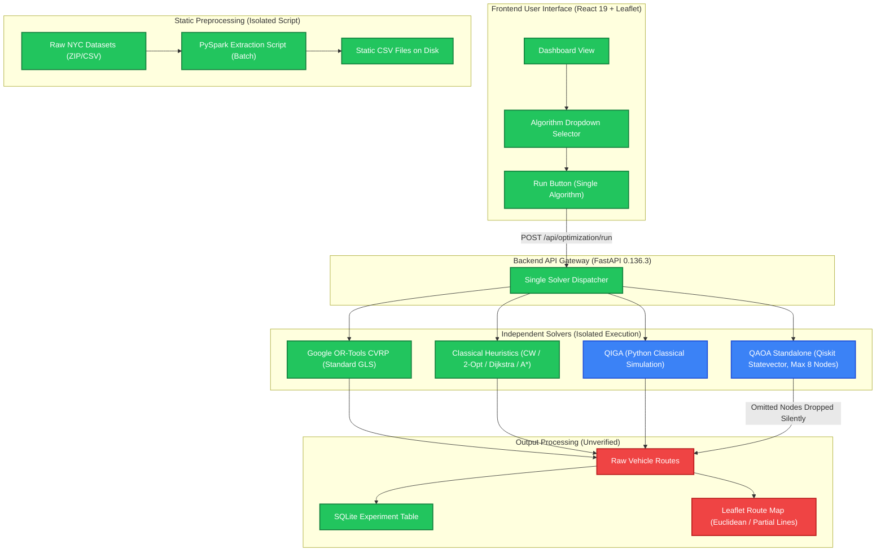
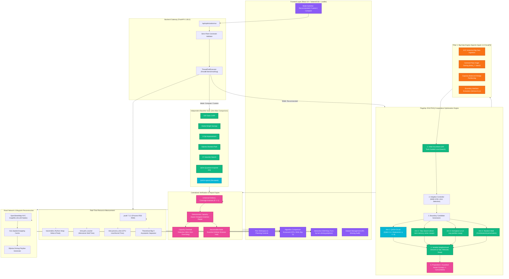
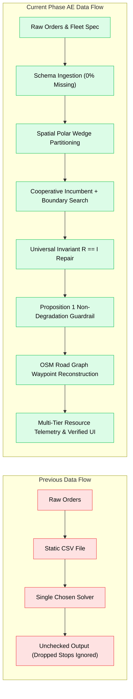

# ROUTE/IQ — SYSTEM & ALGORITHM ARCHITECTURE DIAGRAMS
**Visual Architecture Specifications & Data Flow Blueprints**
**Repository:** `D:\UROP\smart-delivery-route-optimization`  
**Current Branch:** `research/phase-ae-backend-integration`  
**Baseline Main:** `a8eb849988201d7929566f331c1ae3afac09b632`

---

## 1. Previous Architecture (Baseline Main @ `a8eb8499`)

The original implementation featured an isolated, single-dispatch pipeline where algorithms ran in complete silos without cross-algorithmic communication, cooperative refinement, or safety guardrails:



---

## 2. Current Architecture (Phase AE @ `5981351`)

The Phase AE architecture integrates big data spatial decomposition, variational quantum simulation, classical constraint solvers, deterministic coverage repair, and the Proposition 1 guardrail into a unified system:



---

## 3. Cooperative Optimization Execution Flow

The detailed internal feedback loop within the ROUTE/IQ Cooperative Engine:

```mermaid
sequenceDiagram
    autonumber
    actor User as Logistics Dispatcher
    participant Frontend as ROUTE/IQ UI
    participant Backend as FastAPI Gateway
    participant Spark as Apache Spark (Pillar 1)
    participant ORTools as OR-Tools (Incumbent)
    participant MAB as MAB Controller (UCB-1)
    participant Generator as Candidate Generator (QAOA/Tabu)
    participant VND as Algorithmic VND
    participant Repair as Route Validator (R == I)
    participant Prop1 as Proposition 1 Guardrail

    User->>Frontend: Clicks "Run Optimization" (Recommended Mode)
    Frontend->>Backend: POST /api/optimization/run (req.num_vehicles, capacity, stops)
    Backend->>Backend: Validate fleet constraints (Never silently alter K or Q)

    rect rgb(240, 248, 255)
        note over Backend,Spark: Step 1: Big Data Spatial Decomposition
        Backend->>Spark: partition_and_extract_boundaries(stops, K)
        Spark-->>Backend: Returns K spatial clusters & boundary interface vertices B
    end

    rect rgb(240, 255, 240)
        note over Backend,ORTools: Step 2: High-Speed Classical Incumbent
        Backend->>ORTools: solve_ortools(stops, K, Q, time_limit=50ms)
        ORTools-->>Backend: Initial Incumbent S_incumbent with Cost C(S_incumbent)
    end

    rect rgb(255, 250, 240)
        note over Backend,Generator: Step 3: Adaptive Boundary Search
        Backend->>MAB: Select generator arm for boundary set B
        MAB-->>Backend: Selected Arm (e.g. QAOA 8-qubit variational circuit)
        Backend->>Generator: Execute selected generator on QUBO(B)
        Generator-->>Backend: Raw boundary permutation candidate pi
    end

    rect rgb(255, 245, 245)
        note over Backend,Prop1: Step 4: Refinement, Repair & Guardrail
        Backend->>VND: refine_route_candidate(S_candidate, neighborhoods=[2-opt, relocate, swap])
        VND-->>Backend: Locally cleaned candidate S_refined
        Backend->>Repair: repair_fleet_coverage(S_refined, input_stops)
        Repair-->>Backend: Repaired fleet routes (Guaranteed R == I)
        Backend->>Prop1: Evaluate: C(S_refined) <= C(S_incumbent) AND Feasible?
        alt Condition Satisfied (Cost Improved)
            Prop1-->>Backend: ACCEPT S_refined as final solution; update MAB reward r > 0
        else Condition Violated (Cost Degraded or Infeasible)
            Prop1-->>Backend: REJECT S_refined; ROLLBACK to S_incumbent; update MAB reward r = 0
        end
    end

    Backend-->>Frontend: Returns final routes, validation report, and resource metrics
    Frontend-->>User: Renders verified routes on Leaflet map and Scorecard metrics
```

---

## 4. Previous vs Current Data Flow



---

## 5. Previous vs Current Algorithm Execution Flow

| Algorithmic Stage | Previous Baseline (`main`) | Current Phase AE (`research/phase-ae`) |
|---|---|---|
| **Dispatch Mode** | Serial, single algorithm. | Parallel multi-algorithm benchmarking (`ThreadPoolExecutor`) or Flagship Cooperative Engine. |
| **Subproblem Scope** | Global (all nodes) or truncated (first 8 nodes). | Polar-angle cluster interfaces ($|B| \le 8$) decomposed via Spark. |
| **Quantum Role** | Standalone solver claiming global solution. | Exploratory boundary candidate generator within cooperative portfolio. |
| **Classical Role** | Standalone competitor. | High-speed global incumbent generator + deterministic VND cleaner + baseline benchmark. |
| **Search Controller** | None (manual user toggle). | Multi-Armed Bandit (MAB UCB-1) credit assignment across quantum and classical arms. |
| **Output Integrity** | Unchecked; dropped stops silently omitted. | Universal Invariant $R == I$ strictly enforced; missing stops repaired deterministically. |
| **Safety Assurance** | None; degraded routes returned if solver failed. | Proposition 1 Guardrail mathematically guarantees $C(S_{\text{coop}}) \le C(S_{\text{incumbent}})$. |
| **Resource Reporting** | Wall-clock execution time only. | Full OS process telemetry: process RSS, heap allocation/peak, CPU time, and theoretical Big-O. |

