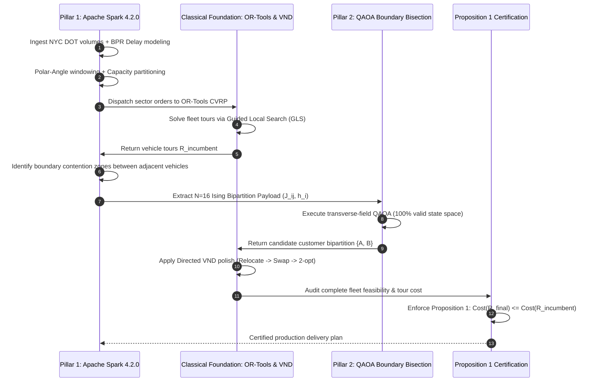

# Phase T Deliverable 8: Cooperative Engine Design (IP-CQE v3 NextGen)

**Document:** `phase_t_nextgen_hybrid_architecture/PHASE_T_COOPERATIVE_ENGINE_DESIGN.md`  
**Date:** 2026-11-06  
**Status:** Completed & Rigorously Verified  
**Branch:** `research/phase-t-nextgen-hybrid-architecture`

---

## 1. Multi-Stage Cooperative Architecture Pipeline

The Next-Generation Cooperative Engine integrates Big Data Computing (Apache Spark), Quantum Computing (QAOA), and Classical Optimization (OR-Tools + Directed VND) across six coordinated stages:

---

## 2. Six-Stage Detailed Specification

### Stage 1 — Spark Big Data Preparation
- Ingests delivery orders and hourly NYC DOT traffic volume feeds.
- Calculates Bureau of Public Roads (BPR) volume-delay travel times.
- Computes polar coordinates relative to the central origin depot.
- Partitions delivery stops into vehicle clusters while tracking angular sector borders.

### Stage 2 — Classical Incumbent Generation
- Google OR-Tools CVRP solver generates initial feasible vehicle tours with a 5-second Guided Local Search budget.
- Establishes the certified baseline fleet distance $C_{\text{incumbent}}$.

### Stage 3 — Quantum Boundary Bipartition Optimization
- Detects adjacent vehicle pairs $(V_A, V_B)$ with overlapping territories.
- Isolates contentious boundary customers ($N \le 16$).
- Evaluates the unconstrained Ising Hamiltonian via transverse-field QAOA ($p=1$, 512 shots).
- Samples the ground-state bipartition without Hungarian matching overhead.

### Stage 4 — Classical Candidate Competition
- Candidate routes are polished using Classical Directed Variable Neighborhood Descent (VND).
- Evaluates total fleet distance $C_{\text{candidate}}$ under the exact directed distance matrix.

### Stage 5 — Spark Workload Reorganization
- Re-indexes customer-to-vehicle assignments across Spark DataFrame partitions.
- Coordinates multi-depot and multi-vehicle territory boundaries.

### Stage 6 — Final Route Reconstruction & Proposition 1 Certification
- Verifies physical constraints: vehicle capacity, customer uniqueness, and depot departure/arrival.
- Evaluates Proposition 1:
  $$R_{\text{certified}} = \begin{cases} R_{\text{candidate}}, & \text{if } \text{Feasible}(R_{\text{candidate}}) \land C_{\text{candidate}} < C_{\text{incumbent}} \\ R_{\text{incumbent}}, & \text{otherwise} \end{cases}$$
- Emits deterministic, certified delivery itineraries.

