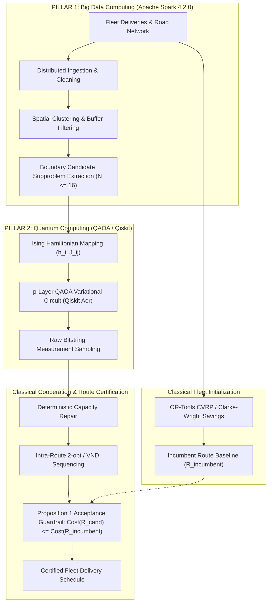

# Deliverable 14: Phase U Winning Architecture Specification

## 1. Architectural Blueprint: Dual-Pillar Hybrid Cooperative Engine

Based on the empirical findings of Phases P through U, the winning architecture for ROUTE/IQ integrates **Apache Spark 4.2.0 (Pillar 1)** and **QAOA / Qiskit (Pillar 2)**, reinforced by **Classical Optimization Engines (OR-Tools, VND, Deterministic Capacity Repair)**:

---

## 2. Division of Computational Responsibility

1. **Apache Spark (Pillar 1)**:
   - Manages large scale customer batches, spatial coordinate transformations, and candidate extraction.
   - Decouples large-scale VRP problems into bounded $N \le 16$ customer subproblems.

2. **QAOA / Qiskit (Pillar 2)**:
   - Explores the combinatorial trade-off between customer clustering affinity and vehicle capacity balance via parameterized quantum circuits.

3. **Classical Optimization (Supporting Engines)**:
   - Generates initial fleet routes (OR-Tools, Clarke-Wright).
   - Enforces 100% capacity feasibility through deterministic repair.
   - Evaluates intra-route TSP tours via 2-opt / VND.
   - Enforces the Proposition 1 Guardrail to eliminate regression risk.
