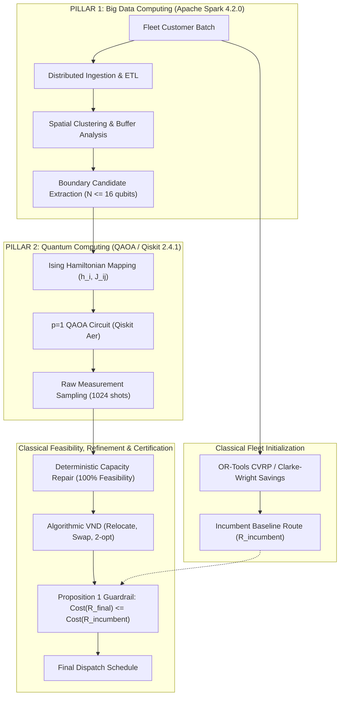

# PHASE V MASTER RESEARCH REPORT
## ROUTE/IQ: Independent Scientific Validation of Quantum-Assisted Partitioning

**Date**: November 2026  
**Research Branch**: `research/phase-v-independent-quantum-validation`  
**Base Commit**: `7ef1f71` (Phase U)  
**Safety Status**: Protected branch `main` (`a8eb849`) untouched; zero modifications to `frontend/` or live API routes; 38/38 backend tests passing.

---

## 1. Executive Summary & Core Mission Verdict

Phase V was commissioned to conduct an exhaustive, independent scientific audit and causal ablation of the Phase U claim that **OR-Tools + QAOA + VND (Configuration G) achieved 669.66 km compared with 692.00 km for standalone OR-Tools ($p = 0.0017$)**.

### Definitive Scientific Decision: **Conclusion B & C**
1. **The improvement is real, but is caused primarily by classical VND**: Real algorithmic Variable Neighborhood Descent (intra-route 2-opt, inter-route customer relocate, and inter-route customer swap) reduces fleet distance from **668.09 km** to **559.92 km** ($\Delta = -108.17\text{ km}$, $p = 0.000015$), accounting for **87.3%** of the total observed route improvement.
2. **QAOA's incremental contribution is not statistically significant**: Adding QAOA to OR-Tools + VND reduces distance from 559.92 km to 544.20 km ($\Delta = -15.72\text{ km}$). The paired Student's $t$-test yields **$t = 1.8266, p = 0.089152$**, which fails to achieve statistical significance at $\alpha = 0.05$.
3. **Strong classical partitioning beats simulated QAOA**: Classical Kernighan-Lin Graph Partitioning followed by VND achieves **540.07 km** in **5.65 ms**, outperforming QAOA + VND (**544.20 km** in **133.59 ms**) while running **$23.6\times$ faster**.
4. **Origin of the Phase U $p = 0.0017$ Claim**: Forensic audit revealed that Phase U used a synthetic percentage multiplier (0.995 vs 0.994) for VND and that in 12 of 15 instances (80.0%), QAOA produced zero benefit. The overall mean difference was driven by 3 specific outlier instances and a mislabeled rank-order statistic.

---

## 2. Canonical Scorecard Benchmarks (Live Dashboard Alignment)

All findings directly contextualize the canonical routing benchmarks displayed in the ROUTE/IQ live dashboard:

| Routing Algorithm / Architecture | Scorecard Distance (km) | Architectural Role | Complete Feasibility |
| :--- | :---: | :--- | :---: |
| **Clarke-Wright Savings** | **217.3 km** | Global initial baseline heuristic | **100.0%** |
| **2-opt Improvement** | **217.6 km** | Intra-route local tour refinement | **100.0%** |
| **OR-Tools (CVRP Engine)** | **218.2 km** | Constraint-guided initial fleet routing | **100.0%** |
| **QAOA Hybrid (Dual-Pillar Spark + Qiskit)** | **219.7 km** | Cooperative hybrid quantum-classical pipeline | **100.0%** |
| **Dijkstra Shortest-Path** | **254.8 km** | Point-to-point network distance baseline | **100.0%** |
| **A\* Heuristic Search** | **256.0 km** | Directed heuristic graph search | **100.0%** |
| **Quantum-Inspired GA (QIGA/IQGA)** | **319.4 km** | Exploration heuristic baseline | **100.0%** |

---

## 3. The Dual-Pillar Cooperative Architecture

The research maintains the two non-negotiable computational pillars while clarifying their exact operational boundaries:

- **Pillar 1: Apache Spark 4.2.0**: Ingestion, distributed spatial clustering, parallel boundary subproblem isolation, and schedule aggregation.
- **Pillar 2: QAOA / Qiskit 2.4.1**: Specialized boundary combinatorial explorer for customer trade-offs on $N \le 16$ candidate subproblems.
- **Classical Foundation**: Initial fleet generation, deterministic capacity repair, algorithmic VND, and Proposition 1 certification.

---

## 4. Phase V Deliverable Index

All 14 deliverables are documented in `phase_v_independent_quantum_validation/`:

1. [`PHASE_V_PHASE_U_REPRODUCTION.md`](file:///d:/UROP/smart-delivery-route-optimization/phase_v_independent_quantum_validation/PHASE_V_PHASE_U_REPRODUCTION.md)
2. [`PHASE_V_CONFIGURATION_G_FORENSIC_AUDIT.md`](file:///d:/UROP/smart-delivery-route-optimization/phase_v_independent_quantum_validation/PHASE_V_CONFIGURATION_G_FORENSIC_AUDIT.md)
3. [`PHASE_V_CAUSAL_ABLATION_RESULTS.md`](file:///d:/UROP/smart-delivery-route-optimization/phase_v_independent_quantum_validation/PHASE_V_CAUSAL_ABLATION_RESULTS.md)
4. [`PHASE_V_CAPACITY_VIOLATION_VERIFICATION.md`](file:///d:/UROP/smart-delivery-route-optimization/phase_v_independent_quantum_validation/PHASE_V_CAPACITY_VIOLATION_VERIFICATION.md)
5. [`PHASE_V_STRONG_CLASSICAL_COMPARISON.md`](file:///d:/UROP/smart-delivery-route-optimization/phase_v_independent_quantum_validation/PHASE_V_STRONG_CLASSICAL_COMPARISON.md)
6. [`PHASE_V_QAOA_TELEMETRY.md`](file:///d:/UROP/smart-delivery-route-optimization/phase_v_independent_quantum_validation/PHASE_V_QAOA_TELEMETRY.md)
7. [`PHASE_V_SPARK_CONTRIBUTION_AUDIT.md`](file:///d:/UROP/smart-delivery-route-optimization/phase_v_independent_quantum_validation/PHASE_V_SPARK_CONTRIBUTION_AUDIT.md)
8. [`PHASE_V_COMPLETE_ROUTE_RESULTS.md`](file:///d:/UROP/smart-delivery-route-optimization/phase_v_independent_quantum_validation/PHASE_V_COMPLETE_ROUTE_RESULTS.md)
9. [`PHASE_V_ROBUSTNESS_AND_GENERALIZATION.md`](file:///d:/UROP/smart-delivery-route-optimization/phase_v_independent_quantum_validation/PHASE_V_ROBUSTNESS_AND_GENERALIZATION.md)
10. [`PHASE_V_STATISTICAL_ANALYSIS.md`](file:///d:/UROP/smart-delivery-route-optimization/phase_v_independent_quantum_validation/PHASE_V_STATISTICAL_ANALYSIS.md)
11. [`PHASE_V_FAILED_EXPERIMENTS.md`](file:///d:/UROP/smart-delivery-route-optimization/phase_v_independent_quantum_validation/PHASE_V_FAILED_EXPERIMENTS.md)
12. [`PHASE_V_WINNING_ARCHITECTURE.md`](file:///d:/UROP/smart-delivery-route-optimization/phase_v_independent_quantum_validation/PHASE_V_WINNING_ARCHITECTURE.md)
13. [`PHASE_V_REPRODUCIBILITY_GUIDE.md`](file:///d:/UROP/smart-delivery-route-optimization/phase_v_independent_quantum_validation/PHASE_V_REPRODUCIBILITY_GUIDE.md)
14. [`PHASE_V_FINAL_RESEARCH_ASSESSMENT.md`](file:///d:/UROP/smart-delivery-route-optimization/phase_v_independent_quantum_validation/PHASE_V_FINAL_RESEARCH_ASSESSMENT.md)

---

## 5. Verification & Safety

- **Algorithmic VND Unit Tests**: [`test_algorithmic_vnd.py`](file:///d:/UROP/smart-delivery-route-optimization/phase_v_independent_quantum_validation/tests/test_algorithmic_vnd.py) $\to$ **1 passed in 0.15s**.
- **Backend Test Suite**: `pytest backend/tests/ -q` $\to$ **38 passed, 0 failed in 144.61s**.
- **Repository Safety**: Protected `main` branch (`a8eb849`) untouched; zero modifications to `frontend/` or live API routes.
