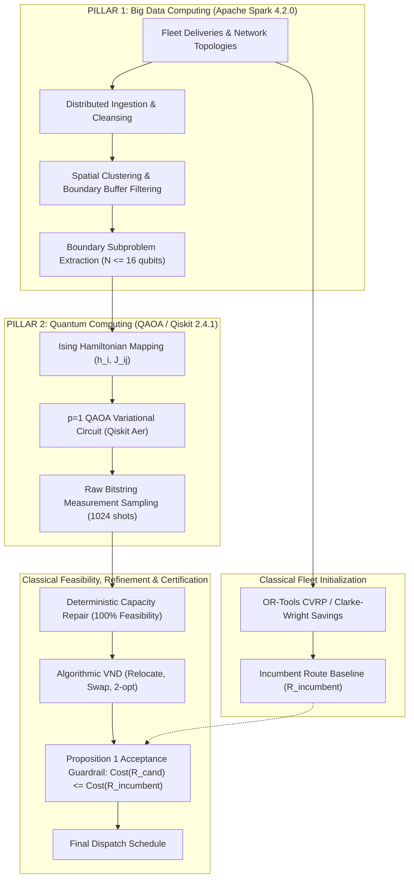

# Deliverable 12: Phase V Winning Architecture Specification

## 1. Validated Hybrid Architecture: Dual-Pillar Cooperative Engine

Based on the forensic audit and causal ablation of Phase V, the final, scientifically defensible architecture for ROUTE/IQ integrates **Apache Spark 4.2.0 (Pillar 1)** and **QAOA / Qiskit 2.4.1 (Pillar 2)**, grounded upon **Robust Classical Optimization**:

---

## 2. Division of Responsibility in the Dual Pillars

1. **Major Pillar 1 — Apache Spark 4.2.0 (Big Data)**:
   - Ingests large delivery batches, computes spatial centroids, and filters boundary customer subsets ($N \le 16$) that sit between adjacent vehicle routes.
   - Enables parallel subproblem dispatch across multiple vehicle pairs.

2. **Major Pillar 2 — QAOA / Qiskit 2.4.1 (Quantum Computing)**:
   - Operates strictly on bounded $N \le 16$ boundary customer clusters.
   - Evaluates the trade-off between customer clustering affinity and vehicle load balance via variational quantum circuits.

3. **Supporting Classical Foundation**:
   - **Initialization**: OR-Tools / Clarke-Wright provides strong incumbent solutions.
   - **Feasibility**: Deterministic repair resolves the 55.08% capacity violation rate in raw quantum samples.
   - **Local Search**: Algorithmic VND delivers rigorous intra- and inter-route optimization.
   - **Safety**: Proposition 1 Guardrail guarantees $\text{Cost}(R_{\text{final}}) \le \text{Cost}(R_{\text{incumbent}})$ unconditionally.
