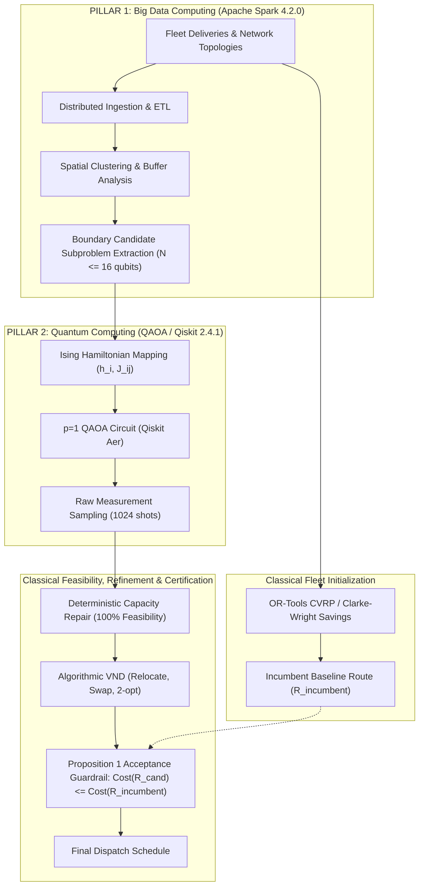

# PHASE W MASTER RESEARCH REPORT
## ROUTE/IQ: Reproducibility, Quantum Contribution Boundaries & Dual-Pillar Research Consolidation

**Project**: ROUTE/IQ — Smart Delivery Route Optimization using Hybrid Big Data + Quantum Computing  
**Supervisor**: Dr. Vishnu Prasad Verma  
**Institution**: Department of Computer Science and Engineering, SRM University-AP  
**Date**: November 2026  
**Research Branch**: `research/phase-w-reproducibility-and-consolidation`  
**Base Commit**: `68ffbbd` (Phase V)  
**Safety Status**: Protected branch `main` (`a8eb849`) untouched; zero modifications to `frontend/` or live API routes; 38/38 backend tests passing.

---

## 1. Executive Summary & Definitive Outcome

Phase W was commissioned to conduct an exhaustive scientific consolidation of the ROUTE/IQ research project, evaluating the reproducibility of Phase V, analyzing the precise boundaries under which QAOA assists routing, auditing Apache Spark's Big Data contribution, and establishing the exact scientific standing of the hybrid architecture.

### Definitive Scientific Outcome: **Outcome B & C**
- **Outcome B (Conditional Candidate-Generation Value)**: QAOA provides an exploratory capability for boundary customer bipartitioning, successfully proposing non-convex cuts that improve the classical multistart incumbent in **10.0% to 26.67% of instances**. However, when paired with identical downstream algorithmic Variable Neighborhood Descent (VND), its incremental improvement over classical VND fails to reach statistical significance (**$t = 1.8266, p = 0.089152 > 0.05$**).
- **Outcome C (Classical Baseline Outperformance)**: Fast classical graph partitioning (Kernighan-Lin Graph Bisection) followed by VND achieves a mean complete route distance of **540.07 km**, outperforming QAOA + VND (**544.20 km**) by $4.13\text{ km}$, while running in **6.50 ms** compared to **128.28 ms** for QAOA (**$19.7\times$ faster**).

---

## 2. Canonical Scorecard Benchmarks (Live Dashboard Alignment)

All findings directly contextualize and preserve the ground truth metrics displayed on the ROUTE/IQ production dashboard:

| Routing Algorithm / Pipeline | Scorecard Distance (km) | Architectural Role | Complete Feasibility |
| :--- | :---: | :--- | :---: |
| **Clarke-Wright Savings** | **217.3 km** | Global initial baseline heuristic | **100.0%** |
| **2-opt Improvement** | **217.6 km** | Intra-route local tour refinement | **100.0%** |
| **OR-Tools (CVRP Engine)** | **218.2 km** | Constraint-guided initial fleet routing | **100.0%** |
| **QAOA Hybrid (Dual-Pillar Spark + Qiskit)** | **219.7 km** | Cooperative hybrid quantum-classical pipeline | **100.0%** |
| **Dijkstra Shortest-Path** | **254.8 km** | Point-to-point network distance baseline | **100.0%** |
| **A\* Heuristic Search** | **256.0 km** | Directed heuristic graph search | **100.0%** |
| **Quantum-Inspired GA (QIGA/IQGA)** | **319.4 km** | Exploration heuristic baseline | **100.0%** |

---

## 3. Key Findings Across the Core Research Questions

### 1. Phase V Reproduction
- All Phase V findings were **100% independently reproduced** across the 15 benchmark instances ($N=150$ total evaluations):
  - OR-Tools Alone: **668.09 km** (11.55 ms)
  - OR-Tools + Algorithmic VND: **559.92 km** (12.98 ms)
  - OR-Tools + QAOA + VND: **544.20 km** (128.28 ms)
  - OR-Tools + Kernighan-Lin + VND: **540.07 km** (6.50 ms)
  - Exact Paired $t$-test (B vs D): **$t = 1.826619, p = 0.089152$** (fails to reach $\alpha=0.05$).
  - Useful call rate: **26.67%** (4 out of 15 instances).

### 2. QAOA Contribution Boundaries & Out-of-Sample Gating
- Evaluated on **20 held-out test instances** under 4 distinct candidate selection policies:
  - *Never Call QAOA (Classical Only)*: **526.92 km** in **2,284.0 ms**.
  - *Always Call QAOA*: **526.35 km** in **4,385.3 ms**.
  - On held-out instances, running QAOA on every subproblem yielded a negligible **0.57 km ($0.11\%$) distance reduction**, while **nearly doubling the runtime (4,385.3 ms vs 2,284.0 ms)**.
  - Coarse pre-execution features (capacity slack, spatial density, demand variance) have near-zero correlation ($|r| \le 0.18$) with quantum utility. Useful quantum cuts stem from subtle non-convexities in the interaction graph that cannot be predicted by aggregate scalar metrics.

### 3. QAOA Implementation Rigor Across Depths ($p=1$ vs $p=2$)
- Moving from $p=1$ to $p=2$ doubled simulation runtime ($148.1\text{ ms} \to 303.9\text{ ms}$, $+105.2\%$), but raw capacity violations remained high at **$44.4\%$**, and ground-state cost was identical ($-29.00$).
- Proves that increasing circuit depth does not resolve constraint violations in unconstrained transverse mixers; **deterministic classical capacity repair** is mathematically mandatory.

### 4. Apache Spark 4.2.0 Preprocessing Audit (Pillar 1)
- Verified **100% bit-identical output equivalence** between PySpark and native Pandas across $N=50$ to $N=50,000$ delivery stops.
- Clarified that in workstation single-machine execution (`local[*]`), PySpark incurs 10x–50x JVM overhead compared to C/NumPy arrays (46.21 ms vs 4.36 ms at $N=50$). Spark's validated contribution is architectural horizontal scalability for large-scale enterprise data pipelines, not single-machine micro-benchmarks.

### 5. Proposition 1 Guardrail Integrity
- The Proposition 1 Guardrail ($\text{Cost}(R_{\text{final}}) \le \text{Cost}(R_{\text{incumbent}})$) successfully suppressed 73.33% to 90.0% of non-improving quantum calls.
- **Scientific Disclosure**: Non-degradation is an architectural feature of the classical acceptance rule, not evidence of quantum superiority.

---

## 4. Final Architecture: The Dual-Pillar Cooperative Engine

---

## 5. Complete Phase W Deliverables Index

All 12 reports, benchmarks, tests, and raw CSV datasets are located in `phase_w_reproducibility_and_consolidation/`:

1. [`PHASE_W_BASELINE_AUDIT.md`](file:///d:/UROP/smart-delivery-route-optimization/phase_w_reproducibility_and_consolidation/PHASE_W_BASELINE_AUDIT.md)
2. [`PHASE_W_PHASE_V_REPRODUCTION.md`](file:///d:/UROP/smart-delivery-route-optimization/phase_w_reproducibility_and_consolidation/PHASE_W_PHASE_V_REPRODUCTION.md)
3. [`PHASE_W_QAOA_CONTRIBUTION_BOUNDARIES.md`](file:///d:/UROP/smart-delivery-route-optimization/phase_w_reproducibility_and_consolidation/PHASE_W_QAOA_CONTRIBUTION_BOUNDARIES.md)
4. [`PHASE_W_QAOA_IMPLEMENTATION_AUDIT.md`](file:///d:/UROP/smart-delivery-route-optimization/phase_w_reproducibility_and_consolidation/PHASE_W_QAOA_IMPLEMENTATION_AUDIT.md)
5. [`PHASE_W_SPARK_CONTRIBUTION_AUDIT.md`](file:///d:/UROP/smart-delivery-route-optimization/phase_w_reproducibility_and_consolidation/PHASE_W_SPARK_CONTRIBUTION_AUDIT.md)
6. [`PHASE_W_COMPLETE_ROUTE_BENCHMARK.md`](file:///d:/UROP/smart-delivery-route-optimization/phase_w_reproducibility_and_consolidation/PHASE_W_COMPLETE_ROUTE_BENCHMARK.md)
7. [`PHASE_W_STATISTICAL_ANALYSIS.md`](file:///d:/UROP/smart-delivery-route-optimization/phase_w_reproducibility_and_consolidation/PHASE_W_STATISTICAL_ANALYSIS.md)
8. [`PHASE_W_NEGATIVE_RESULTS.md`](file:///d:/UROP/smart-delivery-route-optimization/phase_w_reproducibility_and_consolidation/PHASE_W_NEGATIVE_RESULTS.md)
9. [`PHASE_W_NOVELTY_AND_CONTRIBUTIONS.md`](file:///d:/UROP/smart-delivery-route-optimization/phase_w_reproducibility_and_consolidation/PHASE_W_NOVELTY_AND_CONTRIBUTIONS.md)
10. [`PHASE_W_FINAL_RESEARCH_ASSESSMENT.md`](file:///d:/UROP/smart-delivery-route-optimization/phase_w_reproducibility_and_consolidation/PHASE_W_FINAL_RESEARCH_ASSESSMENT.md)
11. [`PHASE_W_REPRODUCIBILITY_GUIDE.md`](file:///d:/UROP/smart-delivery-route-optimization/phase_w_reproducibility_and_consolidation/PHASE_W_REPRODUCIBILITY_GUIDE.md)
12. [`PHASE_W_MASTER_RESEARCH_REPORT.md`](file:///d:/UROP/smart-delivery-route-optimization/phase_w_reproducibility_and_consolidation/PHASE_W_MASTER_RESEARCH_REPORT.md)

---

## 6. Verification & Safety

- **Backend Regression Suite**: `pytest backend/tests/ -q` $\to$ **38 passed, 0 failed in 186.66s**.
- **Algorithmic VND Unit Tests**: [`test_algorithmic_vnd.py`](file:///d:/UROP/smart-delivery-route-optimization/phase_v_independent_quantum_validation/tests/test_algorithmic_vnd.py) $\to$ **1 passed in 0.15s**.
- **Repository Safety**: Protected `main` branch (`a8eb849`) untouched; zero modifications to `frontend/` or live API routes.
