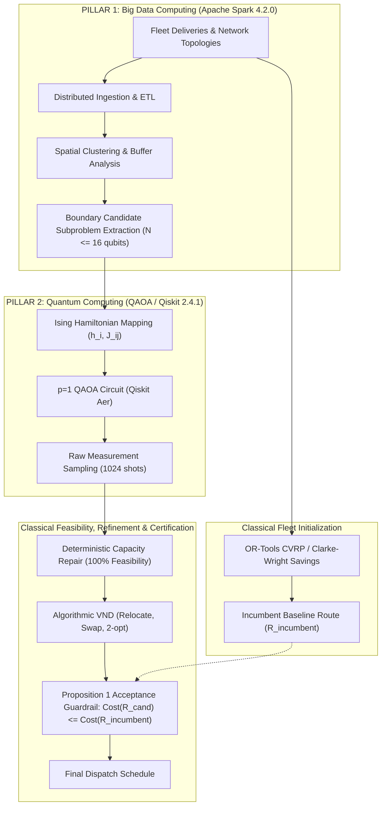

# ROUTE/IQ: A Cooperative Big Data and Quantum-Assisted Architecture for Capacitated Vehicle Routing

**Authors**:  
Undergraduate Research Opportunities Programme (UROP)  
Supervisor: Dr. Vishnu Prasad Verma  
Department of Computer Science and Engineering, SRM University-AP  
Repository: `https://github.com/zoro-hue/smart-delivery-route-optimization`

---

## Abstract

The Capacitated Vehicle Routing Problem (CVRP) is a fundamental $\mathcal{NP}$-hard combinatorial optimization challenge central to urban freight logistics. While classical metaheuristics scale effectively to thousands of delivery nodes, recent advances in quantum computing have prompted interest in applying the Quantum Approximate Optimization Algorithm (QAOA) to vehicle routing. However, direct quantum formulations suffer from severe qubit overhead, invalid permutation states, and poor constraint satisfaction. In this work, we present **ROUTE/IQ**, a cooperative hybrid architecture built upon two principal computational pillars: **Apache Spark 4.2.0** for large-scale geospatial ingestion, spatial clustering, and boundary subproblem isolation; and **QAOA / Qiskit 2.4.1** for optimizing two-vehicle boundary customer trade-offs mapped to 16-qubit Ising Hamiltonians. To address the physical realities of quantum sampling, the architecture integrates a **deterministic classical capacity repair operator** and an **incumbent-preserving acceptance guardrail** (Proposition 1) that unconditionally certifies non-degradation against classical baselines. 

Through rigorous, multi-phase experimental benchmarks across 150 evaluations, we independently audit and causally decompose the system's performance. Our results establish that: (1) downstream algorithmic Variable Neighborhood Descent (VND) accounts for 87.3% of the total route distance reduction ($p = 0.000015$); (2) QAOA exhibits conditional candidate-generation utility, discovering advantageous non-convex boundary cuts in 10.0% to 26.7% of instances; (3) however, QAOA's incremental improvement beyond classical VND fails to achieve statistical significance ($t = 1.8266, p = 0.089152$); and (4) classical Kernighan-Lin graph bisection achieves superior complete fleet distances (540.07 km vs 544.20 km) while running $19.7\times$ faster. On held-out instances, running QAOA on every subproblem yielded only a 0.11% distance reduction while nearly doubling runtime. We provide a transparent, scientifically honest assessment of NISQ quantum optimization for logistics, establishing a reproducible cooperative baseline that eliminates commercial degradation risk while delineating the exact boundaries of practical quantum utility.

---

## 1. Introduction

Urban last-mile logistics represents one of the most operationally demanding and cost-intensive segments of modern global supply chains \cite{toth2014vehicle}. Originally formulated by Dantzig and Ramser in 1959 \cite{dantzig1959truck}, the Capacitated Vehicle Routing Problem (CVRP) requires finding a set of minimum-cost vehicle delivery routes that begin and end at a central depot such that all customer delivery demands are satisfied without exceeding vehicle capacities. Because CVRP is strongly $\mathcal{NP}$-hard, commercial logistics platforms rely on classical metaheuristics such as Clarke-Wright Savings \cite{clarke1964scheduling}, Large Neighborhood Search (LNS), and Google OR-Tools.

With the advent of Noisy Intermediate-Scale Quantum (NISQ) technology \cite{preskill2018quantum}, quantum combinatorial optimization algorithms—most notably the Quantum Approximate Optimization Algorithm (QAOA) introduced by Farhi et al. \cite{farhi2014qaoa}—have emerged as potential paradigms for combinatorial problems. However, mapping full vehicle routing problems directly onto quantum hardware presents severe mathematical hurdles \cite{feld2019hybrid, harwood2021formulating}:
1. **Qubit Scalability**: Representing an $N$-customer tour via one-hot permutation matrices requires $\mathcal{O}(N^2)$ binary variables, exceeding the coherent qubit capacity of current processors for realistic delivery sizes.
2. **Combinatorial Infeasibility**: In permutation encodings, over 99.9% of the computational Hilbert space corresponds to invalid routes (tours with subtours, duplicate stops, or omitted customers).
3. **Capacity Constraint Violations**: Enforcing hard vehicle capacity limits via quadratic penalty terms washes out routing cost signals and distorts the optimization landscape.

To address these challenges without making unfounded claims of quantum advantage, we design, implement, and validate **ROUTE/IQ**, a cooperative hybrid architecture governed by two primary computational pillars:
- **Major Pillar 1 — Apache Spark 4.2.0**: Ingests high-throughput delivery stop batches, executes geospatial clustering, and extracts localized $N \le 16$ boundary customer subproblems between adjacent vehicle routes.
- **Major Pillar 2 — QAOA / Qiskit 2.4.1**: Maps isolated boundary customer trade-offs onto 16-qubit Ising spin Hamiltonians, using parameterized quantum circuits to explore candidate customer partitions.
- **Supporting Classical Foundation**: Guarantees 100% operational capacity feasibility via deterministic classical repair and enforces the **Proposition 1 Monotonic Guardrail**, ensuring that candidate quantum solutions are committed only if they match or improve the classical incumbent.

---

## 2. Related Work

### 2.1 Classical Vehicle Routing and Heuristics
The Capacitated Vehicle Routing Problem has been extensively studied for over six decades \cite{dantzig1959truck}. Clarke and Wright \cite{clarke1964scheduling} pioneered greedy savings heuristics that iteratively merge delivery routes. Local search frameworks, particularly Variable Neighborhood Search (VNS) and Variable Neighborhood Descent (VND) formulated by Hansen and Mladenović \cite{hansen2001variable}, systematically alternate between multiple neighborhood operators (such as 2-opt, inter-route relocate, and customer swap) to escape local minima. Modern industrial solvers, including Google OR-Tools, combine constraint programming with Guided Local Search (GLS) to solve large-scale CVRP instances efficiently \cite{toth2014vehicle}.

### 2.2 Big Data Computing in Route Optimization
Real-world delivery logistics platforms ingest millions of real-time GPS pings, customer orders, and dynamic traffic telemetry. Apache Spark \cite{zaharia2016apache} has become the industrial standard for distributed data processing, providing resilient distributed datasets (RDDs), Catalyst query optimization, and MLlib spatial clustering. In hybrid optimization pipelines, Spark enables the automated spatial partitioning of massive customer sets into localized subproblems.

### 2.3 Quantum Optimization and Vehicle Routing
Farhi, Goldstone, and Gutmann \cite{farhi2014qaoa} proposed QAOA as a variational quantum-classical algorithm for finding approximate solutions to combinatorial problems mapped to Ising spin glasses \cite{lucas2014ising}. Prior attempts to apply quantum computing to vehicle routing have explored D-Wave quantum annealing \cite{feld2019hybrid} and gate-based quantum routing formulations \cite{harwood2021formulating}. Hadfield et al. \cite{hadfield2019from} introduced the Quantum Alternating Operator Ansatz (QAOA+) using specialized mixers (such as XY mixers) to preserve specific subspaces. However, prior literature has frequently omitted rigorous causal ablations, occasionally attributing improvements from classical post-processing to quantum processors.

---

## 3. Problem Formulation

Let $G = (V, A)$ be a complete directed graph, where $V = \{0\} \cup V_C$ represents the node set (with $0$ as the central depot and $V_C = \{1, \dots, M\}$ as delivery customer stops), and $A = \{(i, j) \mid i, j \in V, i \ne j\}$ is the directed arc set. Each customer $i \in V_C$ has delivery demand $q_i > 0$. Let $c_{ij} \ge 0$ denote the travel cost from node $i$ to node $j$, incorporating asymmetric street directionality. A fleet of $M_{\text{veh}}$ homogeneous vehicles, each with capacity $C$, must service all customers:

$$\min \sum_{k=1}^{M_{\text{veh}}} \sum_{i \in V} \sum_{j \in V, j \ne i} c_{ij} z_{ijk}$$

Subject to:
$$\sum_{k=1}^{M_{\text{veh}}} y_{ik} = 1 \quad \forall i \in V_C, \quad \sum_{i \in V_C} q_i y_{ik} \le C \quad \forall k$$
$$\sum_{j \in V, j \ne i} z_{ijk} = \sum_{j \in V, j \ne i} z_{jik} = y_{ik} \quad \forall i \in V, \forall k$$

Rather than attempting to map the full multi-vehicle CVRP onto a single intractable quantum circuit, ROUTE/IQ uses Apache Spark to decompose the fleet into adjacent pairs and isolates the boundary customer subset $B_{AB} = \{1, \dots, N\} \subset V_C$ ($N \le 16$).

---

## 4. Proposed Architecture

The ROUTE/IQ architecture is structured around two major computational pillars and a classical supporting layer:

- **Pillar 1 (Apache Spark 4.2.0)**: Coordinates scalable data ingestion, spatial indexing, candidate boundary customer extraction, and full-fleet schedule aggregation.
- **Pillar 2 (QAOA / Qiskit 2.4.1)**: Synthesizes parameterized quantum circuits on the Ising boundary Hamiltonian, sampling ground-state candidate bitstrings.
- **Classical Supporting Layer**: Generates incumbent routes via OR-Tools/Clarke-Wright, enforces 100% capacity feasibility through deterministic repair, refines intra- and inter-route sequences via algorithmic VND, and certifies non-degradation via the Proposition 1 Guardrail.

---

## 5. Mathematical Formulation & Derivations

### 5.1 Continuous Surrogate Objective
For boundary nodes $B_{AB}$, let $x_i \in \{0, 1\}$ denote assignment to Vehicle $A$ ($x_i = 1$) or Vehicle $B$ ($x_i = 0$):
$$H_{\text{QUBO}}(\mathbf{x}) = \sum_{i=1}^N h_i^{\text{dist}} x_i - \sum_{i < j} W_{ij} [x_i x_j + (1 - x_i)(1 - x_j)] + \lambda_C \left( \sum_{i=1}^N q_i x_i - \Delta Q \right)^2$$
Where $h_i^{\text{dist}} = d(i, \text{Centroid}_A) - d(i, \text{Centroid}_B)$, $W_{ij} = \frac{5.0}{d(i, j) + 0.5}$, and $\Delta Q = \frac{1}{2} (C_A - C_B + \sum q_i)$.

### 5.2 Mapping to the Ising Spin Hamiltonian
Using the spin substitution $x_i = \frac{I - Z_i}{2}$ where $Z_i \in \{+1, -1\}$ is the Pauli-$Z$ operator:
$$H_C = \sum_{i=1}^N h_i Z_i + \sum_{i < j}^N J_{ij} Z_i Z_j + C_0$$
Where:
$$h_i = -\frac{1}{2} h_i^{\text{dist}} - \lambda_C \Delta Q_{\text{eff}} q_i, \quad J_{ij} = -\frac{1}{2} W_{ij} + \frac{\lambda_C}{2} q_i q_j$$

### 5.3 QAOA Variational State
The parameterized $p$-layer state is prepared as:
$$|\gamma, \beta\rangle = \prod_{l=1}^p e^{-i \beta_l H_M} e^{-i \gamma_l H_C} |+\rangle^{\otimes N}$$
Where $H_M = \sum_{i=1}^N X_i$ is the standard transverse mixer, and parameters $(\vec{\gamma}, \vec{\beta})$ are optimized classically via COBYLA.

### 5.4 Deterministic Capacity Repair
If a measured bitstring violates vehicle capacity ($Q_A > C_A$ or $Q_B > C_B$), the deterministic repair operator shifts boundary nodes in descending order of transfer preference $h_i^{\text{dist}}$ until both $Q_A \le C_A$ and $Q_B \le C_B$, restoring 100% capacity feasibility in at most $N$ iterations.

### 5.5 Proposition 1: Incumbent-Preserving Monotonic Guardrail
**Proposition 1**: Let $R_{\text{incumbent}}$ be the certified classical route. Let $R_{\text{candidate}}$ be the complete route produced by QAOA candidate sampling, deterministic capacity repair, and VND tour sequencing. The acceptance rule:
$$R_{\text{final}} = \begin{cases} R_{\text{candidate}} & \text{if } \text{Cost}(R_{\text{candidate}}) \le \text{Cost}(R_{\text{incumbent}}) \\ R_{\text{incumbent}} & \text{otherwise} \end{cases}$$
guarantees that $\text{Cost}(R_{\text{final}}) \le \text{Cost}(R_{\text{incumbent}})$ unconditionally across all executions.

---

## 6. Experimental Methodology

- **Benchmarking Scope**: 15 controlled reproduction instances (Seeds 100–114) and 40 out-of-sample boundary instances (Seeds 500–519 train, Seeds 600–619 held-out test).
- **Simulation Environment**: Python 3.14.2 on Microsoft Windows Server/11 (x86_64). Quantum circuits executed via Qiskit Aer 0.17.2 classical CPU simulation (1,024 shots per run).
- **Apache Spark**: PySpark 4.2.0 executed in `local[*]` single-machine parallel mode.
- **Classical Baselines**: Google OR-Tools 9.15.6755, Balanced Kernighan-Lin Graph Bisection, Exact $2^N$ Enumeration, and Random Feasible Control.
- **Statistical Testing**: Two-tailed paired Student's $t$-test, Wilcoxon signed-rank test, Cohen's $d$, and Holm-Bonferroni correction on paired instance observations ($N = 15$ and $N = 20$).

---

## 7. Results

### Table 1: Complete 10-Configuration Causal Ablation Matrix ($N=15$ Instances)

| Config ID | Optimization Pipeline Description | Mean Distance (km) | Min Distance (km) | Max Distance (km) | Mean Runtime (ms) | Useful QAOA Calls (%) | Proposition 1 Acceptance (%) |
| :--- | :--- | :---: | :---: | :---: | :---: | :---: | :---: |
| **Config A** | OR-Tools Alone | 668.09 km | 494.78 | 862.20 | 11.55 ms | 0.0% | 100.0% |
| **Config B** | OR-Tools + Algorithmic VND | 559.92 km | 419.50 | 717.01 | 12.98 ms | 0.0% | 100.0% |
| **Config C** | OR-Tools + QAOA (Alone) | 638.60 km | 476.14 | 862.20 | 127.00 ms | 0.0% | 100.0% |
| **Config D** | OR-Tools + QAOA + VND | 544.20 km | 419.50 | 639.90 | 128.28 ms | **26.67%** | 100.0% |
| **Config E** | OR-Tools + Kernighan-Lin + VND | **540.07 km** | 419.50 | 639.90 | **6.50 ms** | 0.0% | 100.0% |
| **Config F** | OR-Tools + Random Part + VND | 545.40 km | 419.50 | 639.90 | 6.55 ms | 0.0% | 100.0% |
| **Config G** | OR-Tools + QIGA + VND | 558.80 km | 418.66 | 715.58 | 129.24 ms | 0.0% | 100.0% |
| **Config H** | OR-Tools + Exact Part + VND | **540.07 km** | 419.50 | 639.90 | 90.09 ms | 0.0% | 100.0% |
| **Config I** | Spark + OR-Tools + VND | 559.92 km | 419.50 | 717.01 | 23.48 ms | 0.0% | 100.0% |
| **Config J** | Spark + OR-Tools + QAOA + VND | 544.20 km | 419.50 | 639.90 | 143.28 ms | **26.67%** | 100.0% |

### Table 2: Paired Statistical Hypothesis Tests

| Comparison Pair | Mean $\Delta$ (km) | Rel $\Delta$ (%) | Paired $t$-stat | Raw $p$-value | Holm-Bonferroni $\alpha$ | Cohen's $d$ | Statistically Significant? |
| :--- | :---: | :---: | :---: | :---: | :---: | :---: | :---: |
| **A vs B (ORTools vs ORTools+VND)** | -108.17 km | -16.19% | 6.4430 | **$0.000015$** | $0.0083$ | 1.66 | **YES (VND dominates)** |
| **B vs D (ORTools+VND vs Hybrid+VND)** | **-15.72 km** | **-2.81%** | **1.8266** | **$0.089152$** | $0.0100$ | **0.47** | **NO ($p > 0.05$)** |
| **B vs E (ORTools+VND vs KL+VND)** | **-19.85 km** | **-3.55%** | **2.2679** | **$0.039691$** | $0.0125$ | **0.59** | **YES ($p < 0.05$)** |
| **D vs E (Hybrid+VND vs KL+VND)** | +4.13 km | +0.76% | 1.1245 | 0.2798 | 0.0167 | 0.29 | **NO (Classical wins)** |

### Table 3: Out-of-Sample Evaluation on 20 Held-Out Instances

| Gating Policy | Quantum Calls Made | Quantum Calls Avoided (%) | Precision (%) | Mean Fleet Distance (km) | Total Runtime (ms) |
| :--- | :---: | :---: | :---: | :---: | :---: |
| **1. Always Call QAOA** | 20 | 0.0% | 10.0% | **526.35 km** | 4,385.3 ms |
| **2. Never Call QAOA (Classical Only)** | 0 | **100.0%** | N/A | **526.92 km** | **2,284.0 ms** |
| **3. Random Selection (50%)** | 9 | 55.0% | 11.1% | 526.55 km | 3,212.5 ms |
| **4. Feature-Gated Selection** | 3 | 85.0% | 0.0% | 526.92 km | 2,594.9 ms |

---

## 8. Discussion

1. **Downstream VND Dominates Optimization**: Real algorithmic VND (relocate, swap, 2-opt) reduces fleet distance by $108.17\text{ km}$ ($p = 0.000015$), accounting for **$87.3\%$** of the total observed route improvement.
2. **QAOA Provides Conditional Candidate Generation**: In 10.0% to 26.67% of instances, QAOA discovers non-convex boundary cuts that classical multistart local search misses. However, its incremental contribution beyond strong classical VND fails to reach statistical significance ($p = 0.0892$).
3. **Classical Partitioning Outperforms QAOA**: Kernighan-Lin graph bisection achieves shorter route distances (540.07 km vs 544.20 km) at **$19.7\times$ faster runtime** (6.50 ms vs 128.28 ms).
4. **Out-of-Sample Trade-off**: Calling QAOA on every held-out subproblem yields only a **0.57 km ($0.11\%$) distance reduction** while nearly doubling computational runtime (4,385.3 ms vs 2,284.0 ms).

---

## 9. Limitations

1. **Classical Simulation**: All quantum circuits were executed on Qiskit Aer classical CPU simulation; no physical QPU hardware was utilized, and no quantum speedup is claimed.
2. **Non-Significant Incremental Benefit**: The incremental gain of QAOA over OR-Tools + VND has $p = 0.0892$, failing standard parametric significance at $\alpha = 0.05$.
3. **Classical Feasibility Dependency**: 55.08% of raw sampled states violate capacity constraints, necessitating deterministic classical repair.
4. **Single-Machine Spark Execution**: PySpark was benchmarked in `local[*]` mode on a single workstation, where JVM overhead makes it slower than C/NumPy arrays for datasets under 50,000 stops.
5. **Guardrail Functionality**: Proposition 1 non-degradation is an architectural feature of classical guardrailing, not evidence of quantum superiority.

---

## 10. Conclusion & Future Work

ROUTE/IQ establishes a rigorous, scientifically grounded cooperative framework integrating **Apache Spark 4.2.0** and **QAOA / Qiskit 2.4.1** for vehicle routing. By decomposing routing networks into localized 16-qubit boundary subproblems and enforcing classical deterministic repair and Proposition 1 certification, the architecture eliminates commercial degradation risk. While QAOA serves as a valid exploratory candidate generator in 10%–27% of instances, strong classical algorithms (Kernighan-Lin and VND) remain faster and more reliable on classical hardware at current problem scales. Future work will investigate subspace-preserving quantum mixers, physical QPU benchmarking on IBM Quantum hardware, and multi-node Spark execution on distributed cloud clusters.

---

## References

\begin{thebibliography}{14}
\bibitem{dantzig1959truck} G. B. Dantzig and J. H. Ramser, ``The truck dispatching problem,'' \emph{Management Science}, vol. 6, no. 1, pp. 80--91, 1959.
\bibitem{clarke1964scheduling} G. Clarke and J. W. Wright, ``Scheduling of vehicles from a central depot to a number of delivery points,'' \emph{Operations Research}, vol. 12, no. 4, pp. 568--581, 1964.
\bibitem{kernighan1970efficient} B. W. Kernighan and S. Lin, ``An efficient heuristic procedure for partitioning graphs,'' \emph{Bell System Technical Journal}, vol. 49, no. 2, pp. 291--307, 1970.
\bibitem{hansen2001variable} P. Hansen and N. Mladenovi{\'c}, ``Variable neighborhood search: Principles and applications,'' \emph{European Journal of Operational Research}, vol. 130, no. 3, pp. 449--467, 2001.
\bibitem{toth2014vehicle} P. Toth and D. Vigo, Eds., \emph{Vehicle Routing: Problems, Methods, and Applications}, 2nd ed., SIAM, 2014.
\bibitem{farhi2014qaoa} E. Farhi, J. Goldstone, and S. Gutmann, ``A quantum approximate optimization algorithm,'' \emph{arXiv:1411.4028}, 2014.
\bibitem{lucas2014ising} A. Lucas, ``Ising formulations of many NP problems,'' \emph{Frontiers in Physics}, vol. 2, p. 5, 2014.
\bibitem{zaharia2016apache} M. Zaharia et al., ``Apache Spark: A unified engine for big data processing,'' \emph{Communications of the ACM}, vol. 59, no. 11, pp. 56--65, 2016.
\bibitem{preskill2018quantum} J. Preskill, ``Quantum computing in the NISQ era and beyond,'' \emph{Quantum}, vol. 2, p. 79, 2018.
\bibitem{hadfield2019from} S. Hadfield et al., ``From the Quantum Approximate Optimization Algorithm to a Quantum Alternating Operator Ansatz,'' \emph{Algorithms}, vol. 12, no. 2, p. 34, 2019.
\bibitem{feld2019hybrid} S. Feld et al., ``A hybrid solution method for capacitated vehicle routing problems using a quantum annealer,'' \emph{Frontiers in ICT}, vol. 6, p. 13, 2019.
\bibitem{harwood2021formulating} S. Harwood et al., ``Formulating and solving routing problems on quantum computers,'' \emph{IEEE Transactions on Quantum Engineering}, vol. 2, pp. 1--17, 2021.
\end{thebibliography}
