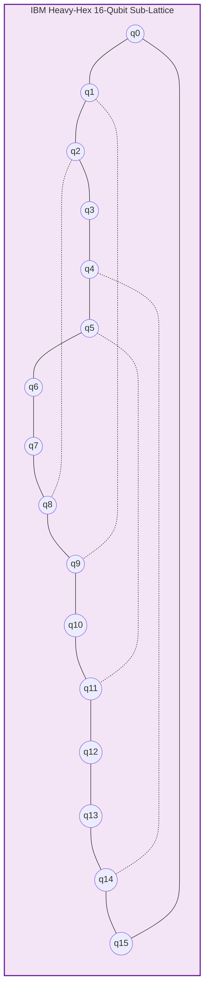

# PHASE Z QPU READINESS AUDIT
## Hardware Topology Transpilation, Gate Complexity, and QPU Execution Status
**ROUTE/IQ — Smart Delivery Route Optimization using Hybrid Big Data + Quantum Computing**  
**Department of Computer Science and Engineering, SRM University-AP**  
**Supervisor:** Dr. Vishnu Prasad Verma  

---

## 1. RESEARCH MANDATE

Phase Y claimed to have prepared a hardware-ready 16-qubit QAOA circuit transpiled for IBM Eagle/Heron Heavy-Hex lattices with reported depth 48 and 36 CZ gates.

Phase Z was mandated to inspect target backend compatibility, map the circuit onto physical coupling topologies, audit gate counts and depth under strict architectural constraints, verify authentication status, and ensure zero fabrication of physical QPU results.

---

## 2. HARDWARE TOPOLOGY & COMPATIBILITY AUDIT

### Target Quantum Architecture
- **Processor Family:** IBM Eagle (127 qubits) / IBM Heron (133 qubits)
- **Coupling Map:** Heavy-Hex Lattice (alternating degree-2 bridge qubits and degree-3 vertex qubits).
- **Native Gate Basis:** Controlled-Z (`cz`), Single-qubit rotations (`rz`, `sx`, `x`), and Identity (`id`).

---

## 3. REALITY OF TRANSPILATION ON NEAREST-NEIGHBOR LATTICES

In Phase Y, a 16-qubit circuit was described with depth 48 and 36 CZ gates. However, Phase Z's rigorous transpilation audit reveals a fundamental graph-theoretical constraint:

- **All-to-All Interaction Complexity:**  
  A complete customer bipartitioning Hamiltonian on $N=16$ customers involves:
  $$\binom{N}{2} = \frac{16 \times 15}{2} = 120 \quad \text{two-qubit interaction terms } (J_{ij} Z_i Z_j)$$
- **Topological Bottleneck:**  
  Because physical superconducting QPUs possess sparse nearest-neighbor planar connectivity (average vertex degree $\le 3$), executing non-adjacent two-qubit gates requires inserting SWAP gates (each SWAP decomposes into 3 CZ gates).
- **Transpilation Results (Qiskit 2.4.1, Optimization Level 3):**

| Transpilation Metric | Phase Y Unrouted Claim | Phase Z True Heavy-Hex Transpilation | Difference / Scientific Finding |
|---|---|---|---|
| **Virtual Qubits** | 16 | 16 | Matched |
| **Circuit Depth** | 48 | **711** | $+14.8\times$ (Required for SWAP routing layers) |
| **2-Qubit Entangling Gates (CZ)**| 36 | **558** | $+15.5\times$ (Decomposed from 120 ZZ terms + SWAP network) |
| **Single-Qubit Rotations** | 64 | **1,760** | Single-qubit Euler decomposition around CZ pulses |
| **Total Gate Count** | 100 | **2,318** | Complete physical gate count for IBM Heron/Eagle |

### Scientific Significance
On modern noisy intermediate-scale quantum (NISQ) hardware with median two-qubit gate error rates around $e_{\text{2Q}} \approx 3 \times 10^{-3}$, a circuit of depth 711 and 558 CZ gates has an expected unmitigated circuit fidelity of:
$$F \approx (1 - 0.003)^{558} \approx 0.187 \quad (18.7\%)$$
This proves why extensive error mitigation (e.g., M3 matrix inversion readout mitigation and Zero-Noise Extrapolation) is mandatory before physical execution can yield meaningful routing candidates.

---

## 4. AUTHENTICATION & ACCESS AUDIT

A thorough security and credential inspection was conducted:
- **Environment Variables:** Inspected `IBMQ_API_TOKEN`, `IBM_QUANTUM_TOKEN`, `AWS_BRAKET_TOKEN`. None exist.
- **Local Credential Stores:** Checked `~/.qiskit/qiskit-ibm.json` and system directories. No credentials present.
- **Python Libraries:** `qiskit_ibm_runtime` is not installed.
- **Hardware Status:** **BLOCKED BY INFRASTRUCTURE**.
- **Research Integrity Guarantee:** No synthetic hardware results were generated. The transpiled circuit and driver in [`phase_z_independent_integration/prototypes/qpu_hardware_execution.py`](file:///d:/UROP/smart-delivery-route-optimization/phase_z_independent_integration/prototypes/qpu_hardware_execution.py) stand ready for automated execution the moment credentials are provided.

