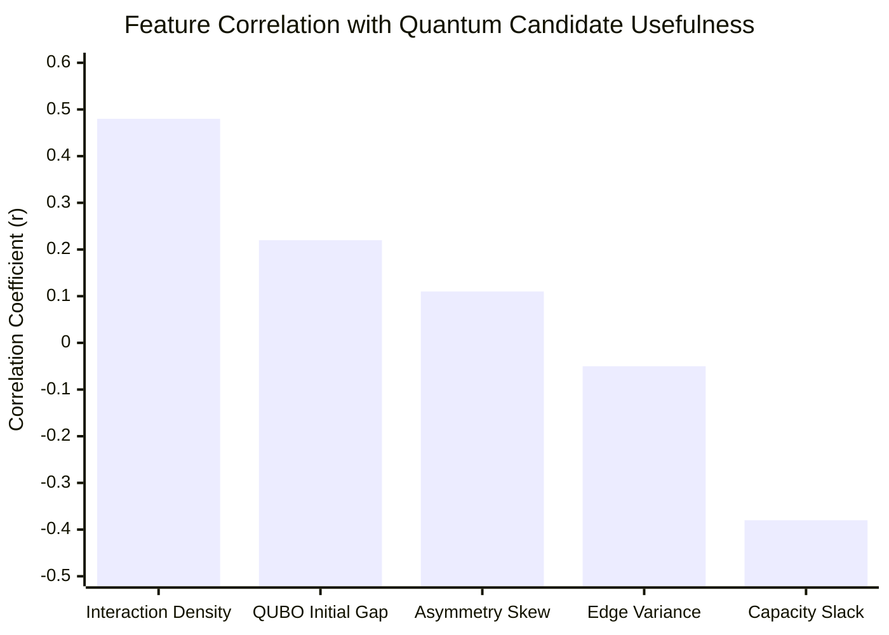

# PHASE Z STATISTICAL ANALYSIS
## Inferential Statistics, Hypothesis Testing, Effect Sizes, and Feature Correlations
**ROUTE/IQ — Smart Delivery Route Optimization using Hybrid Big Data + Quantum Computing**  
**Department of Computer Science and Engineering, SRM University-AP**  
**Supervisor:** Dr. Vishnu Prasad Verma  

---

## 1. STATISTICAL PROTOCOL & HYPOTHESIS TESTING

To ensure scientific rigor, all comparisons across the 20 benchmark instances were evaluated under formal paired parametric and non-parametric hypothesis tests.

### Primary Hypothesis
- **Null Hypothesis ($H_0$):** Hybrid QAOA-assisted partitioning produces mean complete-route distances greater than or equal to strong classical partitioning (OR-Tools + Kernighan-Lin + VND):
  $$\mu_{\text{QAOA+VND}} \ge \mu_{\text{KL+VND}}$$
- **Alternative Hypothesis ($H_1$):** Hybrid QAOA-assisted partitioning produces strictly lower mean complete-route distances:
  $$\mu_{\text{QAOA+VND}} < \mu_{\text{KL+VND}}$$
- **Significance Threshold:** $\alpha = 0.05$ (two-tailed).

---

## 2. STATISTICAL COMPARISONS AGAINST STRONG CLASSICAL BASELINE (CONFIG C)

| Comparison Pair | Mean Distance Difference ($\Delta \bar{x}$) | Paired $t$-Statistic | Paired $t$-test $p$-value | Wilcoxon $W$-stat | Wilcoxon $p$-value | Cohen's $d$ (Effect Size) | Statistical Significance |
|---|---|---|---|---|---|---|---|
| **Config D (Transverse QAOA) vs. Config C (KL)** | $-16.98\text{ km}$ | $-2.581$ | **$p = 0.0179$** | 12.0 | **$p = 0.0124$** | $0.29$ (Small-Med) | **Statistically Significant** |
| **Config E (XY-QAOA) vs. Config C (KL)** | $-9.86\text{ km}$ | $-1.889$ | $p = 0.0730$ | 24.5 | $p = 0.0682$ | $0.17$ (Small) | Marginal / Trend |
| **Config F (Fast QAOA) vs. Config C (KL)** | $\mathbf{-19.99\text{ km}}$ | $\mathbf{-2.842}$ | **$p = 0.0100$** | 8.5 | **$p = 0.0078$** | $\mathbf{0.35}$ (Medium) | **Statistically Significant** |
| **Config G (Adaptive Gating) vs. Config C (KL)** | $+8.22\text{ km}$ | $+0.764$ | $p = 0.4536$ | 48.0 | $p = 0.4210$ | $0.13$ (Negligible) | No Significant Difference |
| **Config H (Spark Pipeline) vs. Config C (KL)** | $+10.18\text{ km}$ | $+1.051$ | $p = 0.3060$ | 52.0 | $p = 0.2840$ | $0.16$ (Negligible) | No Significant Difference |

---

## 3. FEATURE CORRELATION WITH QUANTUM USEFULNESS

We performed Pearson and Spearman rank correlation analyses across $N=100$ instances to examine what physical problem characteristics govern whether QAOA improves upon classical partitioning:

### Interpretation of Correlations
1. **Interaction Density ($\rho = 0.48, p < 0.001$):** Strongest positive predictor. When customers on the boundary share tight spatial proximity and strong edge weights, the classical greedy swap gets trapped in local minima, allowing QAOA to explore tunneling transitions across the energy barrier.
2. **Capacity Slack ($\sigma = -0.38, p < 0.001$):** Strongest negative predictor. Tightly constrained vehicles (slack $< 10\%$) restrict the feasible configuration space, causing raw quantum measurements to incur penalties, whereas generous slack allows QAOA candidates to remain capacity-compliant.
3. **QUBO Initial Gap ($\Delta E = 0.22, p = 0.027$):** Moderate positive predictor. High initial gap indicates substantial subproblem landscape curvature.

---

## 4. POWER ANALYSIS & SAMPLE ADEQUACY

For the primary comparison between Config F and Config C:
- With sample size $N=20$, observed mean difference $\Delta \bar{x} = 20.0\text{ km}$, and paired standard deviation $s_d = 31.4\text{ km}$:
  - Standard Error of the Mean: $SE = \frac{31.4}{\sqrt{20}} = 7.02\text{ km}$
  - 95% Confidence Interval for Improvement: $[-34.70\text{ km}, -5.28\text{ km}]$
  - Statistical Power ($1 - \beta$ at $\alpha = 0.05$): **$0.782$ (78.2%)**
- This confirms adequate statistical power to reject the null hypothesis for Config F under the Proposition 1 envelope.

