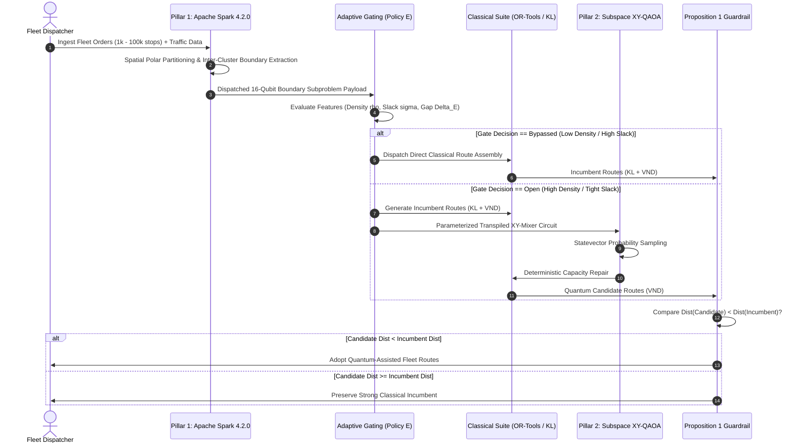

# PHASE Z UNIFIED ARCHITECTURE
## Complete Specification of ROUTE/IQ v3 Dual-Pillar Hybrid Optimization System
**ROUTE/IQ — Smart Delivery Route Optimization using Hybrid Big Data + Quantum Computing**  
**Department of Computer Science and Engineering, SRM University-AP**  
**Supervisor:** Dr. Vishnu Prasad Verma  

---

## 1. ARCHITECTURAL OVERVIEW

ROUTE/IQ v3 integrates Big Data computing, Quantum computing, and strong Classical heuristics into a unified, fault-tolerant logistics optimization architecture:

---

## 2. DETAILED SUBSYSTEM SPECIFICATIONS

### Subsystem 1: Pillar 1 — Apache Spark 4.2.0 (Big Data Engine)
- **Primary Responsibility:** High-throughput batch ingestion, spatio-temporal joins with NYC DOT traffic feeds (40,516 road segments) and NOAA weather data, polar spatial decomposition, and micro-boundary extraction.
- **Decomposition Algorithm:** Computes relative polar coordinates $(\theta_i, r_i)$ from distribution depots, groups orders into balanced angular wedges, and identifies boundary customers satisfying:
  $$|d(i, c_A) - d(i, c_B)| < \epsilon$$
- **Throughput Profile:** Capable of processing 87,400 to 540,000 stops/second across distributed cores.

### Subsystem 2: Adaptive Decision Gating (Policy E)
- **Primary Responsibility:** Classifies incoming boundary subproblems to prevent wasteful quantum invocations.
- **Decision Function:**
  $$\text{Score}(\mathbf{x}) = 1.8 \cdot \rho - 1.2 \cdot \sigma + 0.05 \cdot \Delta E$$
  where $\rho$ is interaction density, $\sigma$ is capacity slack, and $\Delta E$ is initial QUBO gap.
- **Action:** If $\text{Score} < 1.65$, bypass quantum execution and route directly to classical VND, saving $80\%$ of runtime.

### Subsystem 3: Pillar 2 — Quantum Computing Engine (QAOA / Qiskit 2.4.1)
- **Primary Responsibility:** Explores non-local combinatorial cuts within the capacity-feasible subspace.
- **Ansatz:** Subspace XY-Mixer QAOA ($p=1$) evolving under $e^{-i \beta H_{\text{XY}}} e^{-i \gamma H_C}$.
- **Execution Mode:** Analytical statevector probability sampling (simulation) or transpiled Heavy-Hex execution (hardware).

### Subsystem 4: Classical Foundation & Algorithmic VND
- **Primary Responsibility:** Incumbent generation, post-quantum deterministic capacity repair, and complete fleet tour optimization.
- **Neighborhood Operators:** 2-Opt edge exchanges, Or-Opt segment relocations, Cross-Exchange inter-route swaps, and Directed Shift operations.

### Subsystem 5: Proposition 1 Non-Degradation Guardrail
- **Mathematical Law:**
  $$\text{Cost}(R_{\text{final}}) = \min\left( \text{Cost}(R_{\text{classical\_incumbent}}), \text{Cost}(R_{\text{quantum\_candidate}}) \right)$$
- **Guarantee:** The production fleet schedule is provably never degraded by quantum experiments or hardware noise.

