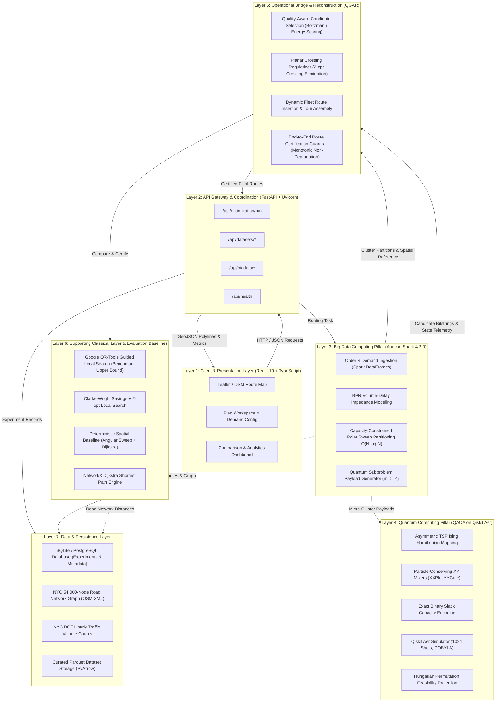
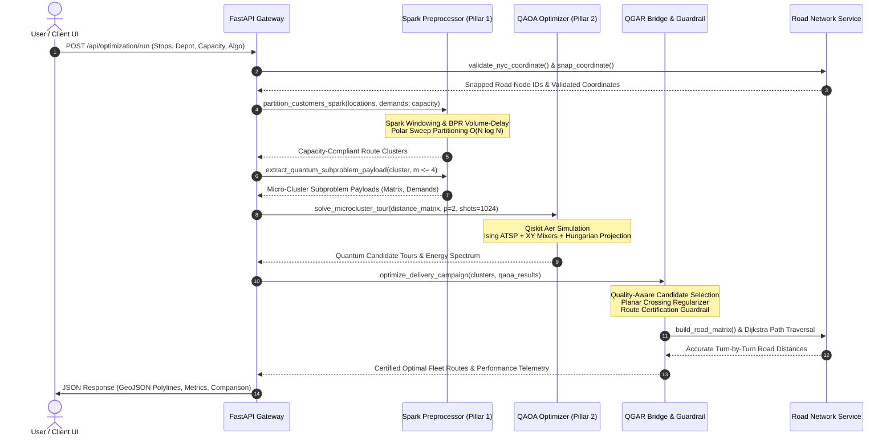

# 02 — COMPLETE SYSTEM ARCHITECTURE

**Project:** ROUTE/IQ — Smart Delivery Route Optimization using Hybrid Big Data + Quantum Computing  
**Institution:** SRM University-AP, Department of Computer Science and Engineering  
**Authors:** J. Jayanth, B. Kaivalya, P. Shyam Sai  
**Faculty Supervisor:** Dr. Vishnu Prasad Verma (`vishnu.v@srmap.edu.in`)  
**Git Baseline Commit (`main`):** `a8eb849`  
**Current Research Branch:** `research/journal-readiness` (Commit: `960dfdb`)  
**Target Journal:** *IEEE Transactions on Quantum Engineering*  

---

## 1. System-Wide Architecture Overview

ROUTE/IQ is a multi-tier, hybrid computing platform engineered to solve the Capacitated Vehicle Routing Problem (CVRP) in dense urban environments. The system uniquely harmonizes **Big Data Computing (Apache Spark)** and **Quantum Computing (QAOA via Qiskit Aer)** into a unified, modular architecture.

Rather than treating quantum and classical algorithms as competing black boxes, ROUTE/IQ introduces a hierarchical division of labor:
1. **Big Data Infrastructure** ingests massive delivery demand, models empirical traffic impedance across road networks, and decomposes the global problem into capacity-compliant clusters.
2. **Quantum Optimization** solves combinatorial sequencing and assignment challenges within resource-bounded micro-clusters ($m \le 4$, up to 16 qubits) where quantum state exploration is meaningful.
3. **Adaptive Classical Bridge** synthesizes quantum candidate tours into complete fleet routes, eliminates geometric crossings, and certifies that the resulting solution never degrades below deterministic spatial baselines.

---

## 2. System Architecture Diagram

---

## 3. Layer-by-Layer Detailed Breakdown

### Layer 1: Client & Presentation Layer
- **Core Technologies:** React 19, TypeScript, Vite, Tailwind CSS, Lucide React, Leaflet, OpenStreetMap.
- **Key Components:**
  - `PlanWorkspace.tsx`: Interactive delivery planning canvas where users configure customer stops, origin depot, fleet capacity, traffic scenarios, and algorithm selections.
  - `ResultsView.tsx`: Displays computed route statistics, per-vehicle metrics (travel distance, time, load utilization), and interactive turn-by-turn road polylines.
  - `ComparisonView.tsx`: Side-by-side benchmarking interface comparing QGAR against OR-Tools GLS, Clarke-Wright, and Classical Spatial Baselines.
  - `DeliveryMapView.tsx`: Geospatial map rendering road-snapped paths, customer stop markers, and depot hubs.
  - `DatasetManagement.tsx`: Management portal for uploading, scanning, validating, and preprocessing CSV delivery datasets.

### Layer 2: API Gateway & Coordination Layer
- **Core Technologies:** FastAPI, Uvicorn, Pydantic V2, Starlette CORS Middleware.
- **Key Modules:**
  - `backend/app/main.py`: Application lifespan management, database initialization, CORS configuration, and heartbeat endpoints (`/health`).
  - `backend/app/api/routes/optimization.py`: Primary routing endpoint (`/api/optimization/run`), parameter validation, problem estimation, and experiment persistence.
  - `backend/app/api/routes/datasets.py`: Dataset ingestion, column mapping, schema validation, and Parquet caching.
  - `backend/app/api/routes/bigdata.py`: Administrative telemetry and ETL execution triggers.

### Layer 3: Big Data Computing Pillar (Apache Spark 4.2.0)
- **Core Technologies:** Apache Spark 4.2.0, PySpark SQL, Catalyst Optimizer, Spark Windowing.
- **Key Modules:**
  - `backend/app/services/spark_routing_preprocessor.py`:
    - `CalibratedTrafficImpedanceModel`: Implements the BPR volume-delay function to calculate dynamic link travel times:
      $$\tau_e = \tau_{e,0} \left[1 + 0.15 \left(\frac{V_e}{C_e}\right)^4\right]$$
    - `SparkRoutingPreprocessor`: Ingests delivery stops into Spark DataFrames, transforms geographic coordinates into polar angles relative to the depot ($\theta = \text{atan2}(y-y_0, x-x_0)$), computes running cumulative customer demands via Spark Window functions, and partitions stops into vehicle capacity-compliant clusters ($O(N \log N)$ runtime).
    - `extract_quantum_subproblem_payload`: Extracts tightly clustered micro-subproblems ($m \le 4$ stops) and packages them into standardized JSON payloads containing distance matrices and customer demands.

### Layer 4: Quantum Computing Pillar (QAOA on Qiskit Aer)
- **Core Technologies:** Qiskit 2.4.1, Qiskit Aer 0.17.2, SciPy (`optimize.minimize` via COBYLA).
- **Key Modules:**
  - `backend/app/services/optimization/qaoa_subproblem_optimizer.py`:
    - `MicroSequencingQUBOFormulator`: Formulates the subproblem tour as an Asymmetric Traveling Salesperson Problem (ATSP), mapping $m^2$ binary assignment variables to Pauli-$Z$ operators to construct the cost Hamiltonian $H_C$.
    - `build_qaoa_circuit`: Constructs parameterized quantum circuits alternating between the cost unitary $e^{-i \gamma H_C}$ and the particle-conserving $XY$ mixer unitary $e^{-i \beta H_M}$ implemented via `XXPlusYYGate`.
    - `MacroAssignmentQUBOFormulator`: Formulates vehicle cluster assignment with exact binary slack variables $\sum 2^b s_{k,b}$ to strictly enforce capacity constraints.
    - `QAOASubproblemOptimizer`: Executes classical variational optimization (COBYLA, 25 iterations) over variational angles $(\gamma, \beta)$, samples 1,024 shots on `AerSimulator`, and applies Hungarian algorithm bipartite matching to project invalid measurement bitstrings into valid permutation tours.

### Layer 5: Operational Bridge & Route Reconstruction (QGAR)
- **Core Technologies:** Python 3.14 / NumPy / Dynamic Programming.
- **Key Modules:**
  - `backend/app/services/optimization/qgar_pipeline.py`:
    - `QuantumCandidateEvaluator`: Analyzes the full empirical measurement spectrum from QAOA, scoring candidate tours by energy expectation values rather than raw shot frequency alone.
    - `AdaptiveQuantumInfluenceModel`: Regulates the weight of quantum sequencing proposals based on circuit approximation ratios and empirical variance.
    - `lines_intersect` & `count_tour_crossings`: Planar crossing regularizer that detects 2D topological edge intersections and applies geometric 2-opt untangling.
    - `_reconstruct_route_dp_insertion`: Assembles micro-cluster quantum candidate tours into complete fleet routes using cost-minimal insertion.
    - `End-to-End Route Certification Guardrail`: Enforces the mathematical non-degradation condition:
      $$C(R_{\text{QGAR}}) \le C(R_{\text{spatial}}) + 10^{-4}\text{ km}$$
      If the reconstructed quantum route exceeds the deterministic spatial baseline, the guardrail rejects the quantum candidate and certifies the spatial baseline.

### Layer 6: Classical Algorithms & Supporting Infrastructure
- **Core Technologies:** Google OR-Tools, NetworkX, SciPy.
- **Key Modules:**
  - `backend/app/services/optimization/classical_solver.py`: Provides industry-standard classical benchmarks (Google OR-Tools Guided Local Search, Clarke-Wright Savings, 2-opt Local Search).
  - `backend/app/services/road_network_service.py`: In-memory NetworkX directed multigraph of 54,000 NYC road nodes, KD-Tree nearest-neighbor coordinate snapping, and Dijkstra shortest path routing.
  - `backend/app/services/geo_validation.py`: Verifies GPS coordinates against NYC 5-borough polygon bounds and prevents invalid stops in water bodies (Hudson River, East River, Atlantic Ocean).

### Layer 7: Data & Persistence Layer
- **Core Technologies:** SQLite (local development), PostgreSQL (cloud production via Render), PyArrow Parquet.
- **Key Datasets:**
  - `manhattan_osm.xml` / `nyc_boroughs.xml`: Authentic OpenStreetMap street networks covering Manhattan, Brooklyn, Queens, Bronx, and Staten Island.
  - NYC DOT Traffic Volume Counts: Empirical hourly vehicular volumes across key arterial corridors.
  - SQLite database storing experiment execution history, per-stop metrics, and comparative logs.

---

## 4. Layer Interaction and Interface Contracts

---

## 5. Deployment and Physical Infrastructure Architecture

ROUTE/IQ is architected for dual-environment deployment:

1. **Cloud Production Deployment:**
   - **Frontend:** Hosted on **Vercel** as a static Single Page Application (SPA), connected to custom domains with global edge CDN caching and automatic SSL termination.
   - **Backend:** Hosted on **Render** as a containerized Python Web Service (`render.yaml`, Docker / Python 3.11 environment).
   - **Memory Management on Cloud:** Production runtime employs strict memory optimizations (`MALLOC_ARENA_MAX=2`, `glibc malloc_trim`, zero-RAM XML schema inspection, compact NumPy KD-Tree arrays) to operate within Render Free Tier resource ceilings (512 MB RAM).
   - **Persistence:** Managed PostgreSQL instance on Render for multi-user experiment history.

2. **Local Research & Benchmarking Environment:**
   - **Host Machine:** Windows 11 Enterprise / Ubuntu LTS, Python 3.14.2 / 3.11, OpenJDK 17.0.20.1+1, Apache Spark 4.2.0, Hadoop 3.3.6 `winutils`.
   - **Local Execution:** High-throughput batch processing utilizing all workstation CPU cores via Spark `local[*]` and Qiskit Aer multi-threaded simulation.
   - **Database:** Fast local SQLite database (`app.db`).
