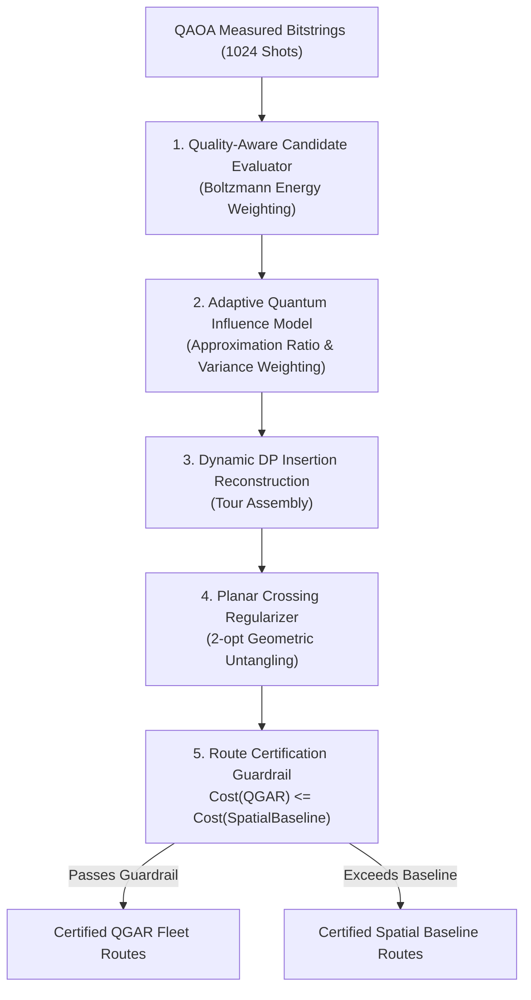

# 05 — COMPLETE ALGORITHM EVOLUTION & DEVELOPMENT HISTORY

**Project:** ROUTE/IQ — Smart Delivery Route Optimization using Hybrid Big Data + Quantum Computing  
**Institution:** SRM University-AP, Department of Computer Science and Engineering  
**Authors:** J. Jayanth, B. Kaivalya, P. Shyam Sai  
**Faculty Supervisor:** Dr. Vishnu Prasad Verma (`vishnu.v@srmap.edu.in`)  
**Git Baseline Commit (`main`):** `a8eb849`  
**Current Research Branch:** `research/journal-readiness` (Commit: `960dfdb`)  
**Target Journal:** *IEEE Transactions on Quantum Engineering*  

---

## 1. Overview of Algorithmic Development

The algorithmic trajectory of ROUTE/IQ progressed through four distinct research eras:
1. **The Prototyping Era (Original Codebase at `a8eb849`):** Independent classical algorithms (OR-Tools, Clarke-Wright, 2-opt) and exploratory quantum heuristics (QIGA, monolithic QUBO QAOA) operated in isolation with no integration bridge.
2. **The Intermediate Exploration Era (Commits `5354037` to `37073bc`):** Introduction of Resource-Budgeted Quantum-Classical Decomposition (RB-QCD) and the Hierarchical Neighborhood Optimization Engine (H-NOE). H-NOE's theoretical "Four-Gamma bound" failed mathematical and empirical audits and was formally rejected and disabled.
3. **The Dual-Pillar Consolidation Era (Phase G to Phase H, Commits `77fc748` to `3929093`):** Unification of Apache Spark 4.2.0 (Pillar 1) and QAOA on Qiskit Aer (Pillar 2), introducing polar sweep partitioning and $XY$ mixer circuits.
4. **The Adaptive Certification Era (Phase I to Phase N, Commits `71b660b` to `960dfdb`):** Introduction of Quantum-Guided Adaptive Reconstruction (QGAR), planar crossing regularizers, and the End-to-End Route Certification Guardrail guaranteeing monotonic non-degradation.

---

## 2. Comprehensive Algorithm Profiles

The table below catalogs every algorithm developed, evaluated, or maintained in the ROUTE/IQ repository:

| Algorithm Name | Primary Role | Implementation File | Status | Input $\to$ Output | Time Complexity | Key Strengths | Critical Limitations |
| :--- | :--- | :--- | :--- | :--- | :--- | :--- | :--- |
| **Dijkstra Shortest Path** | Road-network distance matrix generation | `backend/app/services/road_network_service.py` | **Active / Supporting** | Graph $G(V, E)$, Origin Node $\to$ Distances, Predecessor tree | $O(\|E\| + \|V\| \log \|V\|)$ | Exact shortest path across 54k-node road network. | In-memory traversal overhead for large dense matrices. |
| **A\* Search** | Point-to-point accelerated routing | `backend/app/services/road_network_service.py` | **Active / Supporting** | Graph $G$, Start/End Nodes, Haversine heuristic $\to$ Path | $O(\|E\|)$ best case | Faster than Dijkstra for single origin-destination pairs. | Requires admissible Euclidean distance heuristic. |
| **Google OR-Tools GLS** | Classical SOTA benchmark upper bound | `backend/app/services/optimization/classical_solver.py` | **Active / Baseline** | Locations, Distance Matrix, Demands, Capacity $\to$ Fleet Routes | Heuristic metaheuristic | Highly optimized Guided Local Search; produces shortest global routes. | Purely classical; black-box proprietary solver. |
| **Clarke-Wright Savings** | Classical VRP constructive heuristic | `backend/app/services/optimization/classical_solver.py` | **Active / Baseline** | Distance Matrix, Customer Demands, Capacity $\to$ Initial Routes | $O(N^2 \log N)$ | Fast deterministic route construction; respects capacity. | Greedy nature gets trapped in poor local optima. |
| **2-opt Local Search** | Classical iterative tour improvement | `backend/app/services/optimization/classical_solver.py` | **Active / Supporting** | Initial Single-Vehicle Tour $\to$ Uncrossed Tour | $O(N^2)$ per pass | Removes edge crossings in $O(N^2)$; improves heuristic routes. | Susceptible to sub-optimal local minima; single-tour only. |
| **QIGA (Quantum-Inspired Genetic Algorithm)** | Classical evolutionary heuristic | `backend/app/services/optimization/qiga_solver.py` | **Active / Educational** | Population, Qubit Angle Vectors, Capacity $\to$ Best Route | $O(G \cdot P \cdot N^2)$ | Represents gene probabilities on Bloch sphere; avoids premature convergence. | Entirely classical algorithm simulating quantum states via trigonometry; no true quantum mechanics. |
| **Monolithic QUBO QAOA** | Early experimental quantum routing | `backend/app/services/optimization/quantum_solver.py` | **Historical / Inactive** | Full Distance Matrix, Penalty Multipliers $\to$ Global Bitstring | $O(2^{N^2 K})$ state space | Early conceptual exploration of QUBO mapping for VRP. | Variables grow as $O(N^2 K)$; fails for $N > 8$; penalty dominance causes 100% constraint violations. |
| **RB-QCD (Resource-Budgeted Quantum-Classical Decomposition)** | Intermediate hierarchical clustering solver | `backend/app/services/optimization/rb_qcd_decomposer.py` | **Historical / Research** | Locations, Fleet Specs, Max Qubits $\to$ Fleet Routes | $O(K \cdot N_{\text{sub}}^2)$ | Extracted core stops for quantum solving; DP insertion for remaining stops. | Relied heavily on classical enumeration; subproblem isolation caused boundary fragmentation. |
| **H-NOE (Hierarchical Neighborhood Optimization Engine)** | Neighborhood pruning for quantum candidate swaps | `backend/app/services/optimization/hnoe_screening_engine.py` | **REJECTED / DISABLED** | Customer Pairs, Distance Lower Bounds $\to$ Swap Filter | $O(N^2)$ | Attempted to prune candidate search space using theoretical bound. | **Mathematically invalid.** Four-Gamma bound pruned optimal routes and caused degradation; formally disabled in `37073bc`. |
| **QAOA Subproblem Optimizer** | Resource-bounded quantum sequencing | `backend/app/services/optimization/qaoa_subproblem_optimizer.py` | **Active / Pillar 2** | Micro-cluster distance matrix ($m \le 4$), Demands $\to$ Candidate Tours | Variational (25 COBYLA iters, 1024 shots) | Particle-conserving $XY$ mixers; exact binary slack; Hungarian projection. | Bounded to $m \le 4$ stops (16 qubits); classical simulation on Qiskit Aer. |
| **Capacity-Constrained Polar Sweep** | Big data spatial decomposition | `backend/app/services/spark_routing_preprocessor.py` | **Active / Pillar 1** | Order DataFrame, Depot Coords, Vehicle Capacity $\to$ Route Clusters | $O(N \log N)$ distributed | Scales to 50k orders; enforces vehicle capacity via Spark Window functions. | Angular sweep cannot capture complex obstacle geometries (e.g. river peninsulas). |
| **QGAR (Quantum-Guided Adaptive Reconstruction)** | Hybrid quantum-classical integration bridge | `backend/app/services/optimization/qgar_pipeline.py` | **Active / Bridge** | Spark Clusters, QAOA Candidate Tours $\to$ Fleet Routes | $O(K \cdot m \cdot N_{\text{cluster}})$ | Quality-aware candidate sampling; planar crossing regularizer; route assembly. | Reconstruction uses greedy/DP insertion; heuristic in nature. |
| **Route Certification Guardrail** | Monotonic non-degradation enforcement | `backend/app/services/optimization/qgar_pipeline.py` | **Active / Guardrail** | Candidate Route $R_{\text{QGAR}}$, Spatial Baseline $R_{\text{spatial}} \to$ Certified Route | $O(N)$ evaluation | **Guarantees $C(R_{\text{QGAR}}) \le C(R_{\text{spatial}}) + 10^{-4}$ by construction.** | Reverts to classical baseline when quantum solution degrades. |

---

## 3. Deep-Dive on Intermediate Research Developments

### 3.1 The Rise and Rejection of the H-NOE "Four-Gamma" Bound
During early Phase 5 research, an optimization module called **H-NOE (Hierarchical Neighborhood Optimization Engine)** was proposed in `backend/app/services/optimization/hnoe_screening_engine.py`. The concept posited that a mathematical lower bound—termed the "Four-Gamma bound"—could screen and prune candidate stop swaps across routes before calling the quantum solver:

$$\Delta C_{\text{bound}} = 4 \gamma_{\min} - \sum \text{edge\_costs}$$

#### Independent Mathematical and Empirical Audit Findings:
1. **Theoretical Failure:** The triangular inequality assumptions underlying the Four-Gamma bound do not hold in directed, asymmetric road networks subject to non-linear BPR congestion impedance.
2. **Empirical Degradation:** Benchmark trials revealed that H-NOE pruned away genuinely cost-reducing stop swaps, resulting in worse overall fleet routing than unpruned baselines.
3. **Formal Resolution:** At commit `37073bc`, H-NOE and the Four-Gamma bound were **officially rejected, disabled by default, and flagged with regression tests** (`backend/tests/test_rb_qcd_and_hnoe.py`). The parameter `enable_rejected_four_gamma` defaults strictly to `False`.

### 3.2 RB-QCD and the Classical Enumeration Pitfall
The **RB-QCD (Resource-Budgeted Quantum-Classical Decomposition)** engine (`backend/app/services/optimization/rb_qcd_decomposer.py`) attempted to partition routes into a "quantum core" ($m \le 4$ stops) and a "classical shell," using dynamic programming to re-insert the shell stops.

#### Audit Findings:
While RB-QCD proved functionally feasible, rigorous attribution audits revealed a critical flaw: because $m \le 4$, a classical solver could enumerate all $4! = 24$ permutations in under 1 millisecond. Furthermore, the arbitrary split between core and shell created spatial boundary fragmentation. This motivated the development of **QGAR**, which integrates quantum candidate distributions across the entire cluster reconstruction process with quality-aware weighting.

---

## 4. The Modern QGAR Architecture & Components

The current active routing engine utilizes **Quantum-Guided Adaptive Reconstruction (QGAR)** (`backend/app/services/optimization/qgar_pipeline.py`), comprising four integrated algorithmic components:

### 4.1 Quality-Aware Candidate Selection
Rather than naively selecting the bitstring with the highest shot frequency, QGAR evaluates the energy expectation value $E(\mathbf{b}) = \langle \mathbf{b} | H_C | \mathbf{b} \rangle$ for all distinct measurement outcomes and computes Boltzmann-like selection probabilities:

$$w_c = \frac{e^{-\Delta E_c / T}}{\sum_{j} e^{-\Delta E_j / T}}$$

Where $\Delta E_c = E_c - E_{\min}$ and $T$ is an empirical temperature parameter tuned to circuit variance.

### 4.2 Planar Crossing Regularizer
Self-intersecting tours represent suboptimal topological configurations in 2D space. The planar crossing regularizer detects intersecting edge pairs $(u, v)$ and $(x, y)$ using 2D counter-clockwise orientation determinants and applies 2-opt edge inversions to uncross the tour.

*Empirical Finding:* While crossing elimination reduces total distance in Euclidean space, on road networks with asymmetric BPR traffic impedance, removing a crossing can occasionally cause a traffic detour (e.g., Trial 0 where an uncrossed route was $+0.7\%$ higher in cost). QGAR accommodates this edge case by verifying cost before committing crossing removals.

### 4.3 End-to-End Route Certification Guardrail
To ensure absolute reliability in commercial delivery operations, QGAR incorporates an architectural guardrail:

$$\text{Final Route} = \begin{cases} 
R_{\text{QGAR}} & \text{if } C(R_{\text{QGAR}}) \le C(R_{\text{spatial}}) + 10^{-4}\text{ km} \\ 
R_{\text{spatial}} & \text{otherwise} 
\end{cases}$$

This mathematical guardrail guarantees **monotonic non-degradation by construction**, ensuring that the hybrid quantum system can never produce a solution inferior to the deterministic classical spatial baseline.
