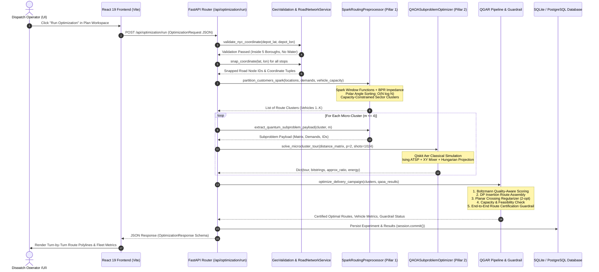

# 06 — COMPLETE END-TO-END RUNTIME EXECUTION FLOW

**Project:** ROUTE/IQ — Smart Delivery Route Optimization using Hybrid Big Data + Quantum Computing  
**Institution:** SRM University-AP, Department of Computer Science and Engineering  
**Authors:** J. Jayanth, B. Kaivalya, P. Shyam Sai  
**Faculty Supervisor:** Dr. Vishnu Prasad Verma (`vishnu.v@srmap.edu.in`)  
**Git Baseline Commit (`main`):** `a8eb849`  
**Current Research Branch:** `research/journal-readiness` (Commit: `960dfdb`)  
**Target Journal:** *IEEE Transactions on Quantum Engineering*  

---

## 1. Executive Summary of the Execution Path

This document traces the exact, code-verified execution lifecycle of a delivery routing request through the ROUTE/IQ platform. Every step is referenced directly against active source files, Python class names, function signatures, and data contracts.



---

## 2. Step-by-Step Code-Verified Execution Trace

### Step 1: User Submits Delivery Campaign
- **File:** `frontend/src/pages/PlanWorkspace.tsx`
- **Action:** The dispatcher specifies vehicle capacity ($Q$), selects delivery stops or uploads a CSV, configures traffic scenario (`congested_peak`), and clicks **"Run Optimization"**.
- **Payload:** An HTTP POST request is dispatched using Axios via `frontend/src/services/api.ts`:
  ```typescript
  const response = await api.runOptimization({
    depot_lat: 40.7128,
    depot_lon: -74.0060,
    vehicle_capacity: 100.0,
    num_vehicles: 4,
    traffic_scenario: "congested_peak",
    weather_scenario: "clear",
    algorithm: "qgar",
    stops: [ ... ]
  });
  ```

### Step 2: FastAPI Gateway Receives and Validates Request
- **File:** `backend/app/api/routes/optimization.py`
- **Function:** `async def run_optimization(req: OptimizationRequest, db: AsyncSession = Depends(get_db))`
- **Action:** Pydantic validates input types, ensuring numerical ranges for coordinates, non-negative demands, and valid algorithm keys.

### Step 3: Geographic Boundary and Water Body Validation
- **File:** `backend/app/services/geo_validation.py`
- **Function:** `validate_nyc_coordinate(lat: float, lon: float) -> Tuple[bool, str]`
- **Action:** Validates that depot and all customer coordinates fall strictly within the official NYC 5-Borough bounding polygon ($40.49^\circ$ to $40.92^\circ$ N, $-74.26^\circ$ to $-73.69^\circ$ W) and does not intersect water bodies (Hudson River, East River, Atlantic Ocean).
- **Failure Mode:** Returns HTTP 400 with a descriptive error message if any stop falls in water or outside city bounds.

### Step 4: Road Network Coordinate Snapping
- **File:** `backend/app/services/road_network_service.py`
- **Function:** `RoadNetworkService.snap_coordinate(lat, lon, max_dist_km=5.0)`
- **Action:** Employs a SciPy KD-Tree indexed on 54,000 OpenStreetMap nodes to snap raw customer GPS points to the nearest physical road intersection. Returns the snapped OSM Node ID and snapping distance.

### Step 5: Big Data Ingestion and Impedance Computation (Pillar 1)
- **File:** `backend/app/services/spark_routing_preprocessor.py`
- **Class:** `SparkRoutingPreprocessor(master="local[*]")`
- **Class:** `CalibratedTrafficImpedanceModel(capacity_per_lane=1000.0, alpha=0.15, beta=4.0)`
- **Action:** 
  1. Ingests orders into a PySpark DataFrame.
  2. Queries hourly vehicular traffic volume data for corresponding road corridors.
  3. Computes congested travel time $\tau_e = \tau_{e,0} [1 + 0.15(V_e/C_e)^4]$.

### Step 6: Distributed Capacity-Constrained Polar Sweep Partitioning
- **File:** `backend/app/services/spark_routing_preprocessor.py`
- **Function:** `SparkRoutingPreprocessor.partition_customers_spark(locations, demands, vehicle_capacity)`
- **Action:**
  1. Transforms customer locations into polar coordinates relative to the depot: $\theta_i = \text{atan2}(\Delta y_i, \Delta x_i)$.
  2. Defines a Spark Window ordered by $\theta_i$ ascending.
  3. Computes running cumulative demand via `F.sum("demand_kg").over(sweep_window)`.
  4. Dynamically assigns vehicle cluster IDs: $\text{cluster\_id} = \lfloor (\text{cum\_demand} - 1) / Q \rfloor$.
  5. Returns a list of vehicle clusters strictly adhering to vehicle capacity $Q$.
- **Fallback:** If Spark JVM is unavailable, automatically executes `partition_customers_single_machine` with identical mathematical logic.

### Step 7: Quantum Subproblem Extraction
- **File:** `backend/app/services/spark_routing_preprocessor.py`
- **Function:** `SparkRoutingPreprocessor.extract_quantum_subproblem_payload(cluster_stops, subproblem_id, max_microcluster_size=4)`
- **Action:** For each cluster, extracts tightly packed micro-clusters ($m \le 4$ stops) and generates a standardized dictionary containing the subproblem distance matrix, demand vector, and stop IDs.

### Step 8: Variational Quantum Optimization via QAOA (Pillar 2)
- **File:** `backend/app/services/optimization/qaoa_subproblem_optimizer.py`
- **Function:** `QAOASubproblemOptimizer.solve_microcluster_tour(distance_matrix, p=2, shots=1024)`
- **Action:**
  1. Maps the $m \times m$ ATSP distance matrix into an Ising Cost Hamiltonian $H_C$ using $m^2$ Pauli-$Z$ operators.
  2. Synthesizes a parameterized quantum circuit using particle-conserving $XY$ mixers (`XXPlusYYGate`).
  3. Optimizes variational parameters $(\boldsymbol{\gamma}, \boldsymbol{\beta})$ using SciPy `COBYLA` bounded to 25 iterations.
  4. Executes 1,024 shots on Qiskit Aer (`AerSimulator`).
  5. Decodes measurement bitstrings into candidate permutation tours.
  6. Applies Hungarian bipartite matching (`scipy.optimize.linear_sum_assignment`) to project any constraint-violating bitstrings into valid tours.
  7. Returns the best candidate tour, approximation ratio ($E_{\text{QAOA}} / E_{\text{exact}}$), raw measurement bitstrings, and energy spectrum.

### Step 9: Quality-Aware Candidate Selection (QGAR Bridge)
- **File:** `backend/app/services/optimization/qgar_pipeline.py`
- **Function:** `QuantumCandidateEvaluator.evaluate_all_candidates(candidate_bitstrings, cost_matrix)`
- **Action:** Evaluates the empirical measurement spectrum, calculating the Hamiltonian expectation value for each unique bitstring and scoring candidates via Boltzmann weights $w_c = e^{-\Delta E_c / T} / \sum e^{-\Delta E / T}$.

### Step 10: Dynamic DP Insertion and Route Assembly
- **File:** `backend/app/services/optimization/qgar_pipeline.py`
- **Function:** `QuantumGuidedAdaptiveRouter._reconstruct_route_dp_insertion(core_tour, remaining_stops, distance_matrix)`
- **Action:** Uses the quantum-optimized core tour as an anchor and inserts any remaining cluster stops using cost-minimal insertion, minimizing the detour distance:
  $$\Delta d(i; u, v) = d(u, i) + d(i, v) - d(u, v)$$

### Step 11: Planar Crossing Regularization
- **File:** `backend/app/services/optimization/qgar_pipeline.py`
- **Functions:** `lines_intersect()`, `count_tour_crossings()`
- **Action:** Scans the 2D planar coordinates of consecutive route segments. If topological edge intersections are detected, applies 2-opt edge swap reversals. Validates that the uncrossed tour does not increase total travel cost under asymmetric road network constraints.

### Step 12: Fleet Capacity and Feasibility Verification
- **File:** `backend/app/services/optimization/qgar_pipeline.py`
- **Action:** Iterates over every reconstructed vehicle route, verifying that:
  1. Every customer stop is visited exactly once across the fleet.
  2. Total parcel demand on vehicle $k$ does not exceed $Q$: $\sum_{i \in R_k} q_i \le Q$.
  3. Every vehicle starts and terminates at the origin depot hub (Node 0).

### Step 13: End-to-End Route Certification Guardrail
- **File:** `backend/app/services/optimization/qgar_pipeline.py`
- **Function:** `QuantumGuidedAdaptiveRouter.optimize_delivery_campaign()`
- **Logic:**
  ```python
  # Compute total fleet distance for QGAR candidate vs Deterministic Spatial Baseline
  cost_qgar = sum(self._calculate_route_distance(r, dist_mat) for r in qgar_routes)
  cost_baseline = sum(self._calculate_route_distance(r, dist_mat) for r in baseline_routes)

  # Monotonic Non-Degradation Guardrail Check (tolerance = 1e-4 km)
  if cost_qgar <= cost_baseline + 1e-4:
      certified_routes = qgar_routes
      guardrail_triggered = False
  else:
      certified_routes = baseline_routes
      guardrail_triggered = True
  ```
- **Guarantee:** Guarantees that the returned solution is strictly less than or equal to the spatial baseline.

### Step 14: Turn-by-Turn Road Route Geometry Reconstruction
- **File:** `backend/app/services/road_network_service.py`
- **Function:** `RoadNetworkService.reconstruct_vehicle_road_route(stop_coords, traffic_factor, weather_factor)`
- **Action:** Reconstructs the complete physical turn-by-turn road polyline for each vehicle by querying NetworkX Dijkstra predecessor paths between consecutive stop nodes. Returns coordinate arrays suitable for Leaflet GeoJSON polyline rendering.

### Step 15: Database Persistence & Response Dispatch
- **File:** `backend/app/api/routes/optimization.py`
- **Action:**
  1. Records experiment metadata in SQLite/PostgreSQL (`Experiment` and `ExperimentResult` models).
  2. Serializes vehicle routes, stop sequences, per-vehicle travel distances, total fleet duration, and QAOA telemetry into `OptimizationResponse`.
  3. Sends HTTP 200 JSON payload to the frontend.

### Step 16: Frontend Map Visualization & Analytics Rendering
- **File:** `frontend/src/pages/ResultsView.tsx` & `frontend/src/pages/DeliveryMapView.tsx`
- **Action:**
  1. Renders the interactive Leaflet map displaying turn-by-turn road routes colored by vehicle.
  2. Displays glowing 'D' depot marker and sequential stop numbers (1..18).
  3. Populates summary cards with travel distance (km), travel time (min), vehicle capacity utilization (%), and quantum optimization telemetry.
