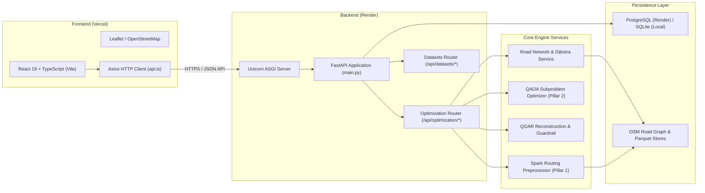

# 09 — FRONTEND, BACKEND, AND CLOUD DEPLOYMENT ARCHITECTURE

**Project:** ROUTE/IQ — Smart Delivery Route Optimization using Hybrid Big Data + Quantum Computing  
**Institution:** SRM University-AP, Department of Computer Science and Engineering  
**Authors:** J. Jayanth, B. Kaivalya, P. Shyam Sai  
**Faculty Supervisor:** Dr. Vishnu Prasad Verma (`vishnu.v@srmap.edu.in`)  
**Git Baseline Commit (`main`):** `a8eb849`  
**Current Research Branch:** `research/journal-readiness` (Commit: `960dfdb`)  
**Target Journal:** *IEEE Transactions on Quantum Engineering*  

---

## 1. Application Stack Overview

ROUTE/IQ is structured as a modern, decoupled web application. The frontend provides a responsive, geospatial dispatcher cockpit, while the backend serves high-performance REST APIs powered by asynchronous Python services, Apache Spark, and Qiskit.



---

## 2. Frontend Architecture (React 19 + Vite + TypeScript)

### 2.1 Technology Stack
- **Framework:** React 19.x with TypeScript.
- **Build Tool:** Vite 5.x for ultra-fast Hot Module Replacement (HMR) and optimized static bundling.
- **Styling:** Tailwind CSS with custom dark/light theme tokens and glowing status indicators.
- **Map Visualization:** Leaflet 1.9 and `react-leaflet` with OpenStreetMap CartoDB tiles.
- **Icons:** Lucide React for consistent, lightweight vector iconography.

### 2.2 Key Pages and Views
1. **Plan Workspace (`frontend/src/pages/PlanWorkspace.tsx`):**
   - The central dispatch canvas. Allows dispatchers to select delivery stops interactively on the NYC map or load presets (18-stop Manhattan showcase, Brooklyn clusters).
   - Configures origin depot coordinates, fleet vehicle count ($K$), vehicle payload capacity ($Q$), traffic congestion levels, weather conditions, and optimization algorithm (QGAR, OR-Tools, Clarke-Wright).
2. **Results View (`frontend/src/pages/ResultsView.tsx`):**
   - Renders interactive turn-by-turn road routes with distinct vehicle color palettes.
   - Highlights the glowing 'D' depot hub and aligned stop number markers (1..18).
   - Displays real-time metrics: total travel distance (km), travel duration (min), fleet capacity utilization (%), and quantum subproblem telemetry.
3. **Comparison View (`frontend/src/pages/ComparisonView.tsx`):**
   - Side-by-side multi-algorithm benchmarking interface. Displays comparative metric tables, bar charts, and route overlays comparing QGAR against classical baselines.
4. **Dataset Management (`frontend/src/pages/DatasetManagement.tsx`):**
   - Portal for uploading customer delivery CSV files, validating schema headers, inspecting tabular data, and triggering Parquet curation.
5. **Overview Dashboard (`frontend/src/pages/OverviewDashboard.tsx`):**
   - High-level telemetry summary displaying total historical optimization runs, total distance saved, average vehicle capacity utilization, and system operational health.

### 2.3 API Communication Client (`frontend/src/services/api.ts`)
Communication with the backend is abstracted through a centralized Axios client:
- Automatically detects execution environment (local Vite proxy `/api` vs production cloud endpoint `https://route-iq-backend.onrender.com/api`).
- Configures 120-second timeout thresholds to accommodate complex quantum simulation runs.
- Provides strongly typed async methods (`runOptimization`, `getDatasets`, `getRoadNetwork`, `checkHealth`).

---

## 3. Backend Architecture (FastAPI + Python 3.14 / 3.11)

### 3.1 Technology Stack
- **Web Framework:** FastAPI with asynchronous ASGI execution on Uvicorn.
- **Data Validation:** Pydantic V2 for strict request/response data contracts.
- **Logging:** Loguru with structured console outputs and file rotations.
- **Database ORM:** SQLAlchemy with `aiosqlite` (local) and `asyncpg` (production PostgreSQL).

### 3.2 Primary REST Endpoints & Schemas

| HTTP Method | Route Endpoint | Purpose / Functionality | Request / Response Schema |
| :--- | :--- | :--- | :--- |
| `GET` | `/health` / `/api/health` | Service heartbeat & runtime dependencies check | Returns `{status, version, python_version, qiskit_version, db}` |
| `POST` | `/api/optimization/run` | Main route optimization endpoint | `OptimizationRequest` $\to$ `OptimizationResponse` |
| `GET` | `/api/optimization/algorithms` | List available solvers & hardware backends | Returns catalog of classical and quantum solvers |
| `POST` | `/api/optimization/estimate` | Estimate problem size, qubits, and runtime | Returns `{num_qubits, estimated_runtime_s, num_subproblems}` |
| `GET` | `/api/datasets` | List available delivery datasets | Returns array of `Dataset` metadata models |
| `POST` | `/api/datasets/upload` | Upload new CSV delivery file | Multipart FormData $\to$ Registered Dataset Record |
| `GET` | `/api/road-network` | Metadata & statistics on loaded OSM network | Returns node count (54k), edge count, bounding box |
| `GET` | `/api/experiments` | Paginated history of optimization runs | Returns list of `Experiment` summary records |

---

## 4. Cloud Deployment Architecture

ROUTE/IQ is continuously deployed across cloud platforms:

```
[Vercel Global Edge CDN]                   [Render Cloud Infrastructure]
+-------------------------+               +--------------------------------------+
|  React 19 Frontend SPA  |               |  FastAPI Docker / Python Web Service |
|  - Custom Domain        |  HTTPS / REST |  - Uvicorn (Port 8000 / $PORT)       |
|  - Automatic SSL        | ------------> |  - In-Memory OSM Graph (54k nodes)   |
|  - SPA Rewrite Rules    |               |  - Classical Simulators (Qiskit Aer) |
|  (vercel.json)          |               |  - Render Managed PostgreSQL DB      |
+-------------------------+               +--------------------------------------+
```

### 4.1 Frontend on Vercel (`vercel.json`)
- Deployed as a Vite build output (`dist/`).
- Configured with single-page application (SPA) rewrite rules ensuring all client-side routes (`/plan`, `/results`, `/compare`) route to `index.html`:
  ```json
  {
    "rewrites": [
      { "source": "/(.*)", "destination": "/index.html" }
    ]
  }
  ```

### 4.2 Backend on Render (`render.yaml`)
- Configured as a Python Web Service running on Linux Ubuntu environments.
- Automatically provisions environment variables (`PYTHON_VERSION=3.11.9`, `CORS_ORIGIN_REGEX`, `FRONTEND_URL`).

### 4.3 Production Memory Optimizations for Cloud Free Tiers
To operate reliably within the strict memory constraints of cloud free tiers (e.g. Render 512 MB RAM limit) without triggering Out-Of-Memory (OOM) process termination:
1. **Glibc Arena Throttling:** `MALLOC_ARENA_MAX=2` limits glibc memory pools, preventing virtual memory fragmentation.
2. **Explicit Memory Trimming:** Backend calls `ctypes.CDLL("libc.so.6").malloc_trim(0)` immediately following OSM graph loading to release unused heap memory back to the OS.
3. **Zero-RAM XML Schema Inspection:** Road network XML files are parsed using iterative `xml.etree.cElementTree.iterparse` with explicit element clearing to prevent DOM bloat.
4. **Compact Coordinate Arrays:** KD-Tree coordinates are stored as contiguous 32-bit float arrays (`float32`), reducing spatial index memory by 50%.
5. **Decoupled Heavy Spark:** Production web requests utilize lightweight, in-memory preprocessor routines; heavy multi-gigabyte Spark ETL is executed in dedicated batch worker environments.
