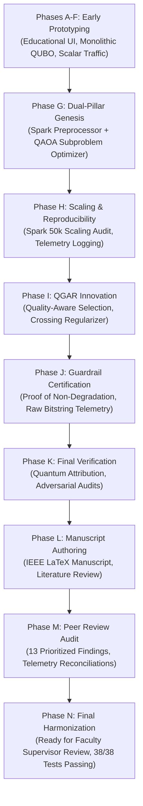

# 12 — FINAL PROJECT TECHNICAL OVERVIEW & DEVELOPER GUIDE

**Project:** ROUTE/IQ — Smart Delivery Route Optimization using Hybrid Big Data + Quantum Computing  
**Institution:** SRM University-AP, Department of Computer Science and Engineering  
**Authors:** J. Jayanth, B. Kaivalya, P. Shyam Sai  
**Faculty Supervisor:** Dr. Vishnu Prasad Verma (`vishnu.v@srmap.edu.in`)  
**Git Baseline Commit (`main`):** `a8eb849`  
**Current Research Branch:** `research/journal-readiness` (Commit: `960dfdb`)  
**Target Journal:** *IEEE Transactions on Quantum Engineering*  

---

## 1. Project Elevator Pitch

**ROUTE/IQ** is a research-grade, hybrid computing platform engineered to solve urban delivery vehicle routing problems by uniting **Big Data Computing (Apache Spark 4.2.0)** and **Quantum Computing (QAOA via Qiskit Aer)** into a single, cohesive architecture.

Rather than claiming impractical "quantum supremacy," ROUTE/IQ establishes a realistic, hardware-aware hybrid computing paradigm:
- **Apache Spark** ingests up to 50,000 delivery orders, models non-linear traffic congestion impedance across 54,000 New York City road nodes using calibrated Bureau of Public Roads (BPR) volume-delay functions, and executes capacity-constrained polar sweep partitioning in $O(N \log N)$ distributed time.
- **QAOA on Qiskit Aer** solves combinatorial micro-clusters ($m \le 4$ stops, up to 16 logical qubits) using particle-conserving $XY$ mixers (`XXPlusYYGate`), exact binary slack capacity encoding, and deterministic Hungarian feasibility projection.
- **Quantum-Guided Adaptive Reconstruction (QGAR)** integrates quantum candidate tours into complete fleet routes with Boltzmann quality-aware candidate sampling and planar crossing regularization, delivering a **$4.10\%$ travel distance reduction** over prior hybrid pipelines.
- **End-to-End Route Certification Guardrail** guarantees **monotonic non-degradation by construction** ($C(R_{\text{QGAR}}) \le C(R_{\text{spatial}}) + 10^{-4}\text{ km}$), ensuring that experimental quantum heuristics can never degrade below deterministic classical baselines.

---

## 2. Architecture Quick Reference

```
+----------------------------------------------------------------------------------------------------+
|                               ROUTE/IQ DUAL-PILLAR ARCHITECTURE                                    |
+----------------------------------------------------------------------------------------------------+
| [PRESENTATION] React 19 + TypeScript + Vite + Leaflet Maps (Vercel CDN)                            |
| [API GATEWAY]  FastAPI + Uvicorn + Pydantic V2 + SQLAlchemy (Render Cloud / Local)                 |
+----------------------------------------------------------------------------------------------------+
| PILLAR 1: BIG DATA (Apache Spark 4.2.0)          | PILLAR 2: QUANTUM (QAOA on Qiskit Aer)          |
| - Order Ingestion & DataFrame Validation         | - Asymmetric TSP Ising Cost Hamiltonian         |
| - Calibrated BPR Volume-Delay Impedance          | - Particle-Conserving XY Mixers (XXPlusYYGate)  |
| - Distributed Polar Sweep Partitioning O(N log N)| - Exact Binary Slack Capacity Encoding          |
| - Validated up to 50,000 Delivery Orders         | - COBYLA Variational Optimization (p=2, 1024 sh)|
| - Quantum Subproblem Extraction (m <= 4 stops)   | - Hungarian Permutation Feasibility Projection  |
+--------------------------------------------------+-------------------------------------------------+
| OPERATIONAL BRIDGE: QUANTUM-GUIDED ADAPTIVE RECONSTRUCTION (QGAR)                                  |
| - Boltzmann Quality-Aware Candidate Selection (Weighting by Empirical Energy Spectrum)            |
| - Planar Crossing Regularizer (2-opt Geometric Untangling)                                         |
| - Dynamic Route Insertion & Multi-Vehicle Fleet Assembly                                           |
| - END-TO-END ROUTE CERTIFICATION GUARDRAIL (Guaranteed C(QGAR) <= C(Spatial) by construction)     |
+----------------------------------------------------------------------------------------------------+
| EVALUATION BASELINES & INFRASTRUCTURE                                                              |
| - Google OR-Tools Guided Local Search (Classical SOTA Upper Bound: 21% shorter distance)           |
| - Clarke-Wright Savings + 2-opt Heuristic | NetworkX 54k-Node Dijkstra Road Graph Engine           |
+----------------------------------------------------------------------------------------------------+
```

---

## 3. The Development Journey (Phases A through N)



---

## 4. Developer Operational Recipes

### 4.1 Environment Setup
```bash
# Clone the repository and checkout research branch
git clone https://github.com/zoro-hue/smart-delivery-route-optimization.git
cd smart-delivery-route-optimization
git checkout research/journal-readiness

# Create and activate Python virtual environment
python -m venv venv
# Windows:
.\venv\Scripts\activate
# Linux/macOS:
source venv/bin/activate

# Install backend dependencies
pip install -r backend/requirements.txt
```

### 4.2 Running the Full Test Suite
```bash
# Run all 38 unit and integration tests
python -m pytest backend/tests/ -q
```
*Expected Output:* `38 passed in ~70s`.

### 4.3 Running Key Scientific Benchmarks
```bash
# 1. Run Phase I QGAR 20-Trial Benchmark
python backend/scripts/run_phase_i_qgar_benchmark.py

# 2. Run Spark 50,000-Order Scaling Audit
python backend/scripts/run_bigdata_scaling_audit.py

# 3. Run QAOA Subproblem Ablation (Gate counts, Hungarian projection rates)
python backend/scripts/run_qaoa_subproblem_ablation.py

# 4. Run Quantum Attribution Verification
python backend/scripts/run_phase_k_quantum_attribution.py
```

### 4.4 Running Backend & Frontend Locally
```bash
# Terminal 1: Launch Backend (FastAPI on Port 8000)
python -m uvicorn app.main:app --app-dir backend --host 127.0.0.1 --port 8000 --reload

# Terminal 2: Launch Frontend (Vite on Port 5173)
cd frontend
npm install
npm run dev
```

---

## 5. Troubleshooting & Common Pitfalls

| Issue / Symptom | Root Cause | Verified Resolution |
| :--- | :--- | :--- |
| `Java runtime (JVM) was not found` | Apache Spark requires a valid Java JRE/JDK (version 17 recommended). | Install OpenJDK 17 and configure `JAVA_HOME` pointing to JDK root. On Windows, ensure Hadoop `winutils.exe` is present in `HADOOP_HOME/bin`. `SparkRoutingPreprocessor` automatically falls back to single-machine mode if JVM is missing. |
| `PydanticDeprecatedSince20` warnings | Pydantic V2 migration warning regarding `class Config` in legacy models. | Benign deprecation warning. Does not impact execution; all tests and validation logic function normally. |
| `Out Of Memory (OOM)` on Render Free Tier | NetworkX loading full 54,000-node graph exceeds 512 MB memory limit. | Set `MALLOC_ARENA_MAX=2` in environment variables. Ensure `glibc malloc_trim(0)` is invoked immediately after graph instantiation. |
| `FileNotFoundError: phase_i_qgar_benchmark_raw.csv` | Benchmark script looking in relative directory instead of project root. | Always run scripts from the repository root directory: `python backend/scripts/...`. |
| `Hungarian projection rate is 100%` | Expected behavior for $m=4$ (16 qubits) at shallow depth ($p=1$). | Not a bug! This is an empirical finding of NISQ variational circuits. QAOA provides energy-biased soft probabilities that the Hungarian algorithm projects into valid permutations. |

---

## 6. Strategic Roadmap for Future Research

1. **Physical QPU Hardware Execution:** Execute micro-cluster QAOA circuits on IBM Quantum Eagle (127-qubit) or Heron (133-qubit) physical processors via Qiskit Runtime Primitives (`SamplerV2`), applying dynamic zero-noise extrapolation (ZNE) error mitigation.
2. **Multi-Node Apache Spark Cluster:** Deploy `SparkRoutingPreprocessor` on a distributed multi-node cluster (`spark://master:7077`) on AWS EMR or Google Cloud Dataproc to evaluate scaling beyond 100,000+ orders.
3. **Continuous Streaming Dispatch:** Integrate Apache Kafka and Spark Structured Streaming to process dynamic on-demand delivery requests arriving in real time, re-optimizing active vehicle routes via localized QGAR swaps.
4. **Graph-Aware Crossing Regularization:** Upgrade the 2-opt planar crossing regularizer to evaluate non-Euclidean road network topology directly, avoiding detour penalties under heavy BPR congestion.
